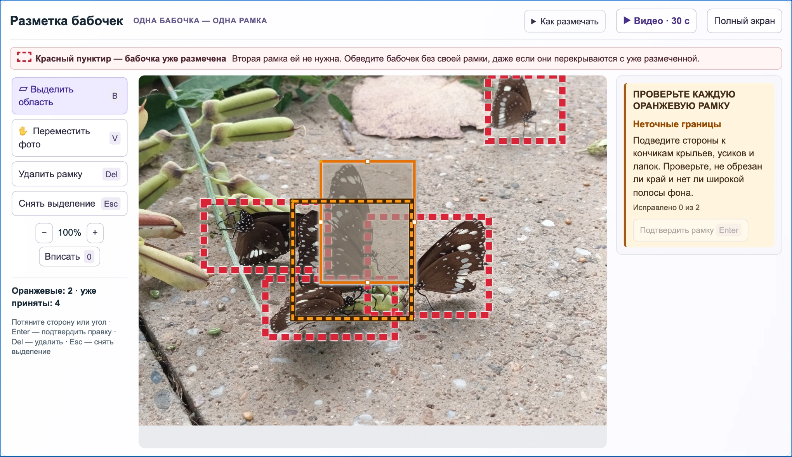
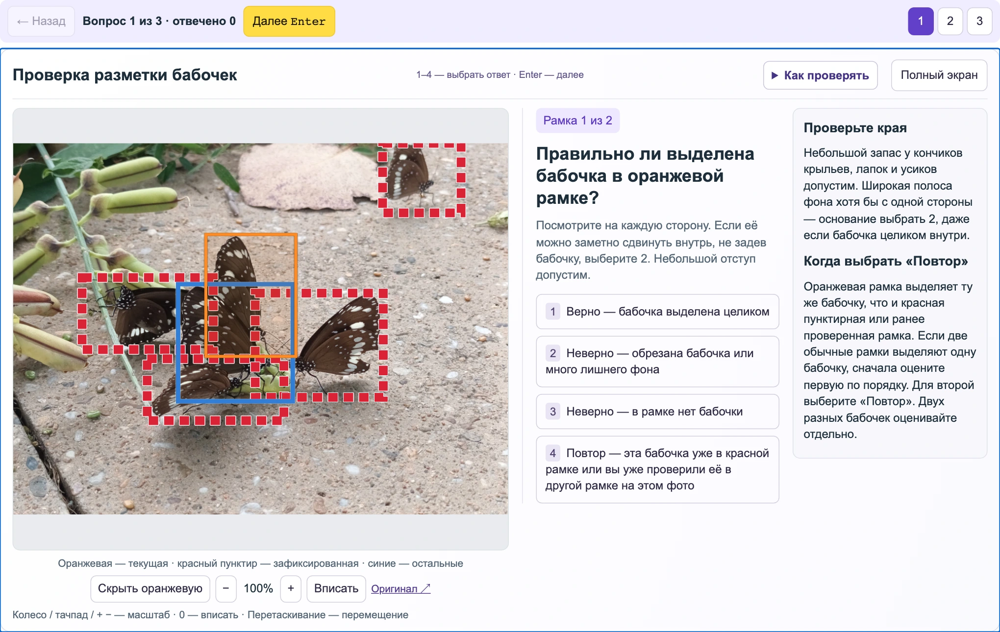
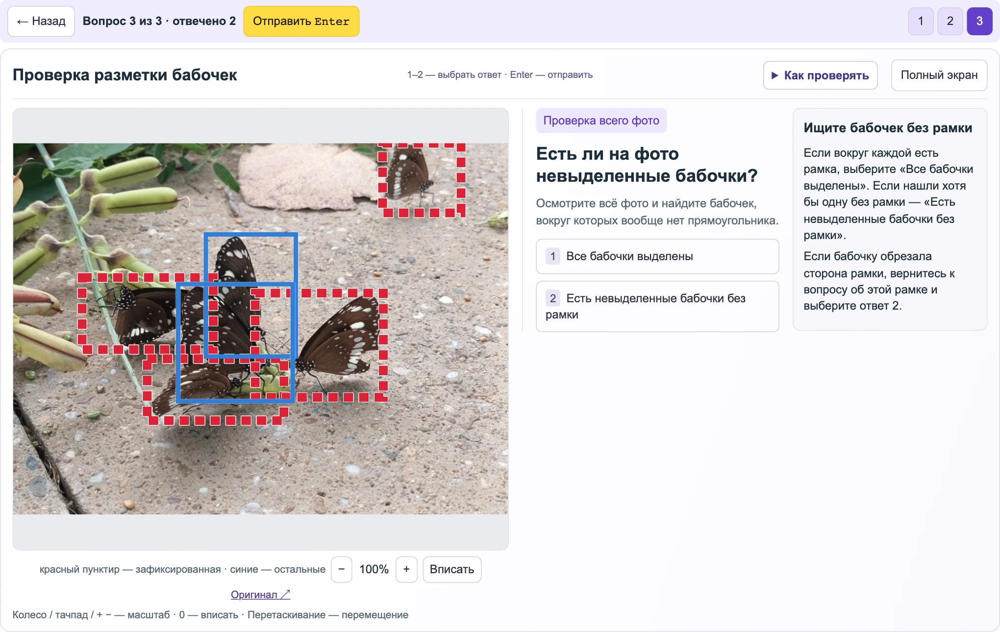
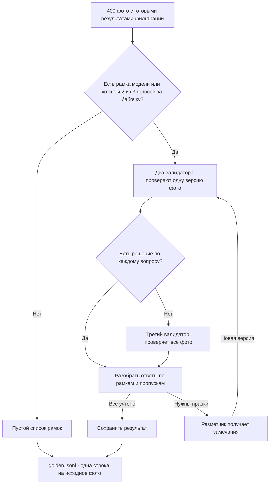
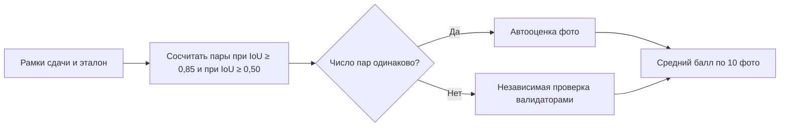

# Разметка бабочек на фотографиях

Проект превращает предсказания модели и готовые результаты фильтрации в набор проверенных рамок. Валидаторы сначала проверяют модель. Разметчик получает только фотографии, где требуется исправление. Итог запуска — **400 фото, 197 с бабочками, 218 рамок**. [Отчёт с примерами](REPORT.md)

## Куда смотреть

| Что нужно | Файлы и команды |
|---|---|
| Повторить результат локально | `python3 run.py replay` · [точка входа](run.py) · [итоговый JSONL](reference/golden.jsonl) |
| Проверить подготовку / запустить новый сбор | `python3 run.py plan` / `python3 run.py start` · [пошаговый запуск](how_to_run.md) |
| Посмотреть вход и настройки | [400 фото, рамки модели и голоса фильтрации](data/photos.json) · [тарифы, места и пороги](config.json) · [шаблоны пулов](data/pools.json) |
| Посмотреть задания разметчика | [Инструкция](interfaces/bbox/instructions.html) · [интерфейс](interfaces/bbox/) · [видеопамятка](media/annotation.mp4) · [обучение](data/bbox_training.json) · [экзамен и эталоны](data/bbox_exam.json) |
| Посмотреть задания валидатора | [Инструкция](interfaces/validation/instructions.html) · [интерфейс](interfaces/validation/) · [урок](data/validation_lesson.json) · [экзамен](data/validation_exam.json) · [контрольные фото](data/validation_controls.json) |
| Найти код рабочего цикла | [Создание проектов и пулов](app/deployment.py) · [обработчик](app/worker.py) · [отправка на проверку и исправление](app/routing.py) · [подсчёт голосов](app/models.py) · [сбор результата](app/review.py) |

## Результаты контроля качества

Итоги сбора 19–20 ноября 2026 года. В основном пуле валидации с эталоном совпали **152 из 168 ответов на ханипотах (90,5%)**. Все вопросы на странице решили верно в **59 из 75 сдач (78,7%)**. Эти 75 сдач охватывают 24 разных контрольных фото и 7 валидаторов.

| Этап | Сколько человек завершили этап | Качество ответов |
|---|---|---|
| Обучение разметчиков | Все 9 фото завершили 18 из 162 человек (11,1%), сдавших хотя бы одну страницу | Медианный IoU с учебной рамкой — **0,954** по 459 сдачам со стандартным прямоугольником |
| Обучение валидаторов | Все 99 человек, сдавших учебную страницу, ответили на 6 вопросов | **618 из 618** итоговых ответов верны в 103 сдачах. До отправки можно было пользоваться подсказками и исправлять ответы |
| Экзамен разметчиков | Допуск получили **6 из 7** | Средний балл **91,9 из 100**, медиана **96,7** |
| Экзамен валидаторов | Допуск получили **9 из 10** | **87 из 100** ответов верны, медианный балл **90 из 100** |

**Где ошибались на ханипотах.** Повтор распознали в 11 из 18 случаев (61,1%), неточные границы — в 12 из 18 (66,7%). Вместе это 13 из 16 ошибок. По полноте верны все 75 ответов, в том числе 9 из 9 на фото с пропущенной бабочкой.

В отдельном пуле проверки экзаменационных фото разметчиков валидаторы верно ответили на 6 из 6 контрольных вопросов в трёх сдачах. [Разбивка по типам вопросов и источники данных](REPORT.md#4-что-показали-скрытые-контроли)

## Пулы и интерфейсы заданий

Ссылки ведут в кабинет заказчика Яндекс Заданий. Для просмотра нужен доступ к проекту.

| Проект | Обучение | Экзамен | Рабочие пулы |
|---|---|---|---|
| [Разметка](https://tasks.yandex.ru/requester/project/11891) | [Обучение](https://tasks.yandex.ru/requester/project/11891/training/6869749) | [Экзамен разметчиков](https://tasks.yandex.ru/requester/project/11891/pool/6869750) | [Исправление разметки](https://tasks.yandex.ru/requester/project/11891/pool/6869751) |
| [Валидация](https://tasks.yandex.ru/requester/project/11892) | [Обучение](https://tasks.yandex.ru/requester/project/11892/training/6869894) | [Экзамен валидаторов](https://tasks.yandex.ru/requester/project/11892/pool/6869752) | [Проверка рабочих фото](https://tasks.yandex.ru/requester/project/11892/pool/6869754) · [Проверка экзаменационных фото разметчиков](https://tasks.yandex.ru/requester/project/11892/pool/6869753) |

На скриншотах — фото № 761031680 в локальном предпросмотре тех же шаблонов, которые загружены в пулы.

**1. Разметчик исправляет границы.** Справа видно замечание к выбранной оранжевой рамке. Красным пунктиром показаны уже принятые рамки.

**2. Валидатор проверяет исправление.** Оранжевым выделена текущая рамка, синим — следующая. Справа от фото валидатор выбирает оценку.

<b>3. Валидатор проверяет, остались ли бабочки без рамки</b>

После оценки отдельных рамок валидатор видит все рамки сразу и отвечает на последний вопрос по фото.

## Путь фотографии

1. **Объект** — одна взрослая дневная или ночная бабочка, включая моль. Рамка охватывает видимые крылья, тело, усики и лапки с небольшим отступом. Для двух перекрывающихся бабочек нужны две рамки.
2. **Страница валидации** — одно фото. Оранжевая рамка проверяется сейчас, синие показывают остальные, красный пунктир обозначает уже принятую. Валидаторы видят один порядок рамок. Последний вопрос — есть ли бабочка совсем без рамки.
3. **Голосование** — два независимых ответа на каждый вопрос. При расхождении третий человек проходит всю страницу с тем же контекстом. Решение по вопросу принимается двумя совпавшими голосами. Три разных ответа о рамке отправляют её на исправление. При нехватке действительных голосов вопрос остаётся открытым.
4. **Независимость** — авторы разметки фото исключены из его проверки и последующих исправлений. Валидатор, забраковавший одну из предыдущих версий, также исключён из её исправления. Правило действует и при проверке чужого экзамена.
5. **Исправление** — до двух платных попыток на фото. Разметчик по очереди открывает замечания у мигающих рамок, меняет границы или удаляет рамку. Затем добавляет пропущенных бабочек и подтверждает просмотр. Если добавлять нечего, это можно подтвердить отдельно. Новая версия проходит полную проверку.
6. **Приёмка спорного фото** — после отклонения двух разных версий заказчик может принять оставшиеся рамки последней версии с их текущими координатами. Решение записывается отдельно от голосов. Если очередное исправление уже взято, обработчик ждёт его результата. Для пустой разметки нужны два ответа «Все бабочки выделены».

| Ответ валидатора | Что происходит с фото |
|---|---|
| Верно | Рамка фиксируется и остаётся видна на следующих версиях |
| Неточные границы | Рамка возвращается разметчику с замечанием |
| В рамке нет бабочки | Рамка удаляется |
| Повтор | Валидатор обязательно указывает причину — бабочка уже в красной рамке или была в предыдущей рамке на этом фото. Голоса за обе причины суммируются. Копия удаляется |
| Есть бабочка без рамки | Фото возвращается для добавления рамок. Если после удаления повтора не осталось принятой рамки, обработчик также запрашивает новую |

## Допуск и оплата

Два проекта, два обучения и пять платных пулов. Для платных пулов нужны русский язык и компьютер. Экзамен каждой роли выдаётся до назначения её экзаменационного навыка. Оплата указана за сдачу страницы.

| Пул | Задание | Доступ / цена |
|---|---|---|
| `bbox_qualification` | 10 фото на одной экзаменационной странице | 7 мест. За завершённую проверенную сдачу 5 ₽ |
| `bbox_production` | Исправить одно фото | Экзамен от 80%. Автоприёмка, 1 ₽ |
| `validation_exam` | 10 контрольных вопросов | 10 мест. Отложенная приёмка до 7 дней, 3 ₽ при сдаче от 80% |
| `validation_annotation_exam` | Проверить неоднозначное фото из экзамена разметчика | Экзамен валидатора от 80%. Приоритет 10, 0,50 ₽ |
| `validation_production` | Проверить одну версию рабочего фото | Экзамен валидатора от 80%. Автоприёмка, 0,50 ₽ |

- **Обучение разметчика.** 9 страниц, для допуска нужно 100%. На восьми фото нужно совместить редактируемую рамку с ориентиром при IoU ≥ 0,80. На девятом — подтвердить пустое фото.
- **Обучение валидатора.** Одна фотография, пять оценок рамок и вопрос о пропусках. Есть подсказки и два вида повтора. Порог обучения — 80%.
- **Экзамен валидатора.** Каждый из десяти вопросов даёт один балл. Для повтора засчитывается любая из двух допустимых причин. Экзаменационный навык открывает доступ к рабочим пулам.
- **Экзамен разметчика.** Итог — среднее по десяти фото. Эталон используется на стороне заказчика. IoU — площадь пересечения двух рамок, делённая на площадь их объединения. Каждая рамка может соответствовать только одной эталонной.

При автооценке число уверенных пар делится на большее из двух количеств рамок. Одна точная рамка из двух даёт 50%. Два подтверждённых пустых набора дают 100%. При проверке людьми верная рамка даёт 1, спорная после третьего голоса — 0,5. Знаменатель учитывает сданные рамки, число эталонов и отмеченный пропуск. Оплата исправлений экзаменационных фото отсутствует. [Расчёт IoU](app/annotation_exam.py) · [Оценка по голосам](app/models.py)

## Контроль во время работы

| Правило | Когда срабатывает | Действие |
|---|---|---|
| Скрытая контрольная страница | После 8–12 обычных страниц **в очереди пула** | Одно фото из банка 24, обычный интерфейс и порядок вопросов, перекрытие 3. В пуле проверки экзаменов максимум одна такая страница |
| Точность валидатора | Последние 20 контрольных **вопросов** из двух рабочих пулов. При 60–<70% — пауза, ниже 60% — карантин голосов | Первая блокировка на 2 ч, следующие на 4, 8, 16 и 24 ч. Экзамен в это окно не входит |
| Однообразные ответы | Только «Верно / пропусков нет» на трёх разных сложных контрольных фото подряд среди сложных, либо во всём окне из 20 при ≥5 ошибках | Карантин рабочих голосов после последней безошибочной сложной контрольной страницы. Решения пересчитываются |
| Качество разметчика | От 5 разных проверенных рабочих фото, окно до 10. Каждая редактируемая рамка и полнота дают по одному равновесному критерию | При среднем ниже 60% доступ приостанавливается на 2 ч, при повторении — на 24 ч. На каждое фото берётся последняя оценённая сдача |

Согласие двух людей показывает воспроизводимость решения. Точность проверяется отдельно на контрольных фото с ключом. [Контроль валидаторов](app/validation_quality.py) · [Качество разметчиков](app/work_quality.py)
