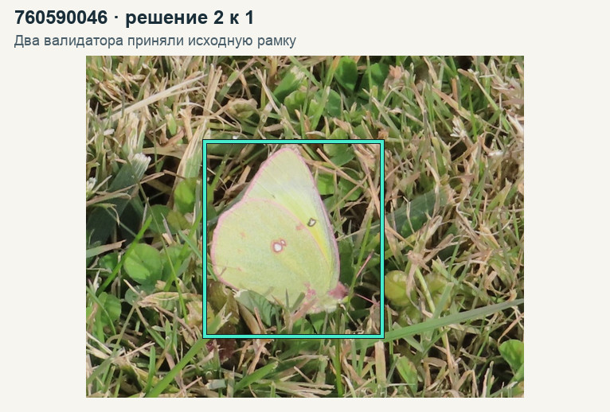
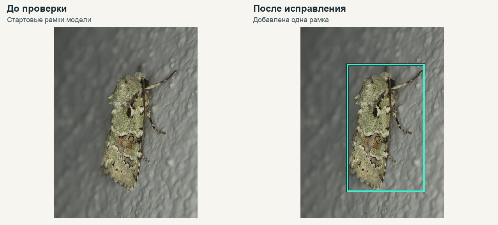
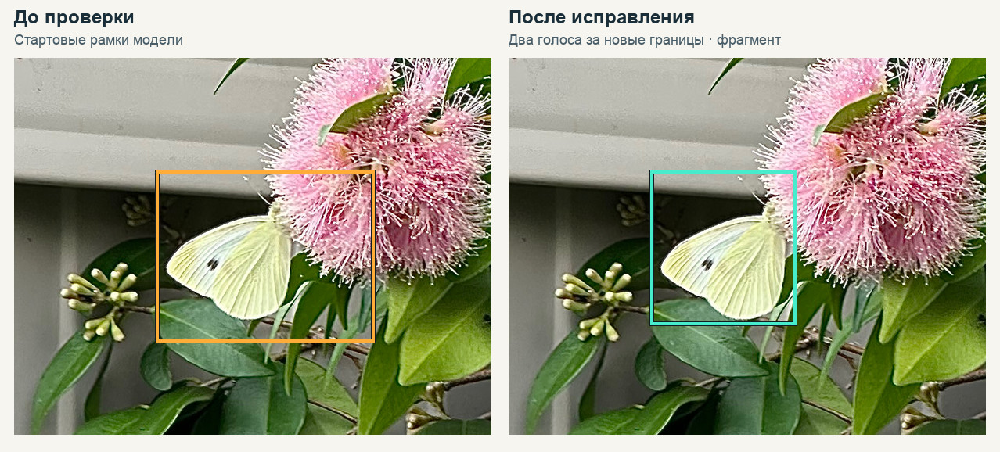
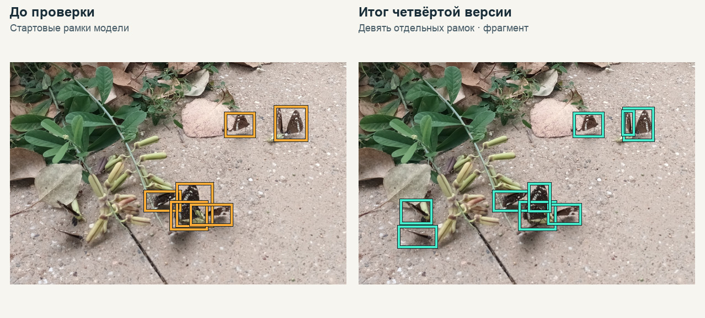
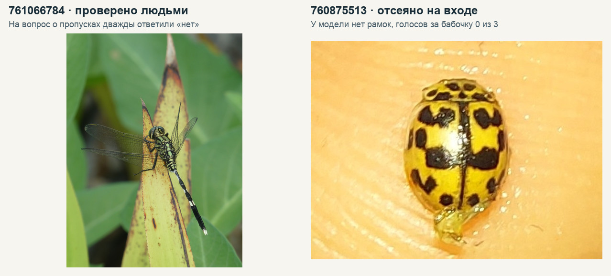
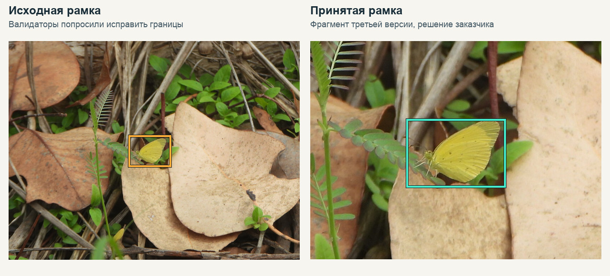

# Итоги разметки бабочек

**400 фотографий → 205 на проверку → 197 фото с бабочками → 218 рамок.** Сбор шёл 19–20 ноября 2026 года. У всех 205 отобранных фото есть итоговое решение. [Готовый датасет](reference/golden.jsonl) · [Правила проекта](README.md)

## 1. Что попало в датасет

| Входной сигнал | Всего фото | С рамками в итоге | Пустых в итоге |
|---|---:|---:|---:|
| Бабочку отметили и модель, и большинство при фильтрации | 185 | 185 | 0 |
| Только модель | 3 | 3 | 0 |
| Только большинство при фильтрации | 17 | 9 | 8 |
| Оба сигнала отрицательные | 195 | 0 | 195 |
| **Всего** | **400** | **197** | **203** |

- У модели было 206 рамок на 188 фото. Объединение двух источников добавило **9 фото с бабочками**, на которых у модели не было ни одной рамки.
- **195 фото** получили пустой список на входе. Их полноту рамочные валидаторы не проверяли. Ещё **8 фото** получили пустой список по итогам валидации.
- В финале одна бабочка на 191 фото, две на 3 фото, шесть на 2 фото и девять на одном. [Входные данные](data/photos.json) · [Финальные голоса](reference/final_votes.jsonl)

## 2. Где понадобилось исправление

| На какой версии завершилась проверка | Фото |
|---|---:|
| Предразметка модели | 147 |
| После первого исправления | 52 |
| После второго исправления | 5 |
| После третьего исправления — исключение в завершённом сборе | 1 |
| **Всего** | **205** |

- **147 из 205 фото (71,7%)** прошли без исправления. Для остальных 58 у 47 причиной возврата были только границы, у 10 — только пропуски, у одного фото — обе причины.
- На первой версии два валидатора совпали по всей странице на **159 из 205 фото (77,6%)**. На остальных 46 понадобился третий голос. По отдельным рамкам первые два ответа совпали в **155 из 206** случаев, по полноте — в **205 из 205**. Одинаковые ответы могли означать и согласие отправить фото на исправление.
- Основной пул принял **588 обычных сдач** по 270 версиям фото и **75 контрольных сдач**. Разметчики сдали **65 исправлений**. Медиана времени от выдачи до отправки — **10,5 с** для страницы основного пула валидаторов и **17,3 с** для исправления.

## 3. Обучение и экзамены

| Этап | Разметчики | Валидаторы |
|---|---:|---:|
| Сдали хотя бы одну учебную страницу | 162 человека | 99 человек |
| Завершили весь набор учебных страниц | 18 из 162 (11,1%) | 99 из 99 |
| Сдали экзаменационную страницу | 7 | 10 |
| Прошли экзамен, итоговый допуск | **6 из 7** | **9 из 10** |
| Выполнили хотя бы одну сдачу в основном рабочем пуле | 5 | 8 |

- **Обучение разметчиков.** Всего 485 принятых страниц. Все девять разных фото завершили 18 человек, 62 остановились после первого. На 459 сдачах с прямоугольником стандартного формата медианный IoU с учебным ориентиром — **0,954**. Ещё 8 сдач с другим форматом рамки исключены из расчёта IoU, 18 сдач относились к пустому фото.
- **Обучение валидаторов.** 103 завершённые страницы у 99 человек, по 6 ответов на страницу. Все 618 отправленных ответов совпали с учебным ключом. Интерфейс давал подсказки и позволял исправиться до отправки. Журнал показывает итоговый ответ, а число ошибок с первой попытки неизвестно.
- **Экзамен разметчиков.** Средний балл **91,9**, медиана **96,7**. Из 70 сданных фото итоговый балл для 30 определён по IoU, для 40 — по голосам. В завершённом сборе автоматическая проверка появилась по ходу работы. Медианное время сдачи десяти фото — 3 мин 21 с.
- **Экзамен валидаторов.** В сумме **87 верных ответов из 100**, медианный балл — **90**. По вопросам о пропусках — 30/30, по неточным границам — 15/20, по рамкам без бабочки — 15/20. Медианное время сдачи — 1 мин 33 с.

## 4. Что показали скрытые контроли

В основном пуле **7 валидаторов** сдали 25 контрольных страниц по три раза. Это **75 сдач на 24 разных фото**. Верно решены **152 из 168 вопросов (90,5%)**. Полностью верны **59 из 75 страниц (78,7%)**. В отдельном пуле проверки экзамена разметчиков контроль дал ещё 6/6 верных ответов в трёх сдачах.

| Ожидаемый ответ в основном пуле | Верно / всего | Доля |
|---|---:|---:|
| Бабочка выделена правильно | 36 / 39 | 92,3% |
| Границы неточные | 12 / 18 | 66,7% |
| В рамке нет бабочки | 18 / 18 | 100% |
| Повтор | 11 / 18 | 61,1% |
| Есть бабочка без рамки | 9 / 9 | 100% |
| Все бабочки выделены | 66 / 66 | 100% |

Из 16 ошибок **13 пришлись на повторы и неточные границы**. В журнале рабочего контроля валидаторов не зафиксировано карантинов. Процент по контрольным заданиям измеряет совпадение с ключом на этих примерах. Для всего набора из 400 фото отдельного независимого эталона нет. [Банк контрольных фото и ответов](data/validation_controls.json)

## 5. Шесть маршрутов на реальных фотографиях

На иллюстрациях оранжевым показана исходная рамка модели, бирюзовым — рамка, попавшая в выгрузку. Номер в заголовке соответствует `photo_id` в JSONL.

### 760590046 · Третий голос сохранил исходную рамку

Первый валидатор принял границы, второй счёл их неточными. Третий проверил всю страницу и принял границы. Все трое указали, что пропусков нет. Фото завершилось на первой версии.

### 761015426 · Люди нашли пропуск модели

У модели было ноль рамок. При фильтрации 2 из 3 человек заметили бабочку. Оба валидатора подтвердили пропуск, разметчик добавил рамку, следующие два голоса подтвердили границы и полноту.

### 760607483 · Исполнитель убрал лишний фон

Два валидатора отметили неточные границы. Разметчик сдвинул правую сторону рамки к бабочке и поднял нижнюю. IoU старой и новой рамок — **0,60**. Оба валидатора второй версии приняли исправление.

### 761031648 · Шесть рамок превратились в девять

В первой версии валидаторы подтвердили три рамки, у трёх отклонили границы и отметили пропуск. На последней проверке семь рамок были зафиксированы, две оценивались. Оба валидатора приняли обе, пропусков не нашли. Для этого фото в историческом запуске разрешили третье исправление. В новом сборе общий лимит — два.

### 761066784 и 760875513 · Два пути к пустому списку

На левом снимке фильтрация дала 2 голоса из 3 за бабочку. Оба рамочных валидатора ответили, что бабочек без рамки нет. На правом снимке модель не дала рамок, при фильтрации было 0 голосов за бабочку. В итоговом файле обе записи имеют `"boxes":[]`.

### 761036757 · Последняя версия принята с текущими координатами

Первая версия получила два замечания по границам. Во второй голоса разделились 2 к 1 за исправление. В третьей оба валидатора снова отметили неточные границы и отсутствие пропусков. В выгрузку вошла одна рамка третьей версии по решению заказчика. Исходные голоса сохранены. [Записи по финальным версиям](reference/final_votes.jsonl)

## 6. Выплаты за принятые страницы

| Пул | Оплачено сдач | Вознаграждения |
|---|---:|---:|
| Экзамен разметчиков | 7 | 35,00 ₽ |
| Экзамен валидаторов | 9 | 27,00 ₽ |
| Основная валидация, включая контроли | 663 | 297,90 ₽ |
| Валидация экзаменационных фото, включая контроль | 92 | 27,60 ₽ |
| Исправления | 65 | 62,50 ₽ |
| **Итого за страницы** | **836** | **450,00 ₽** |

Суммы взяты из поля `reward` принятых сдач. Тарифы менялись в ходе сбора. Комиссия платформы и предыдущая фильтрация в сумму не входят. Отдельно зафиксирован бонус **5 ₽** на спорном пустом фото 625495767, привязанный к ответу «пропусков нет». Для этого фото бонус ограничивает независимость результата.

**Источники.** Сдачи обучений и журнал пяти платных пулов по состоянию на 20 ноября 2026 года, 11:40 UTC. Для точности контроля использованы ключи фактически выданных страниц. Уникальные участники считаются отдельно в каждой роли. Публичная часть архива содержит обезличенные голоса последних версий и итоговые рамки. [Воспроизведение итоговой выгрузки](how_to_run.md)
