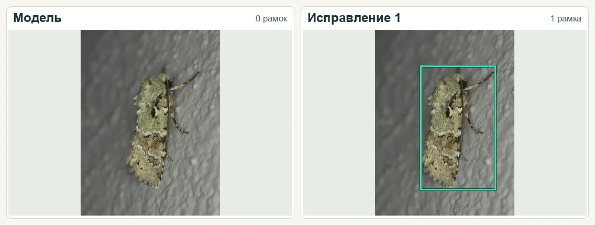
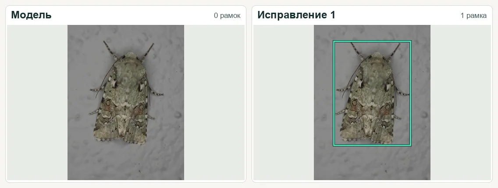
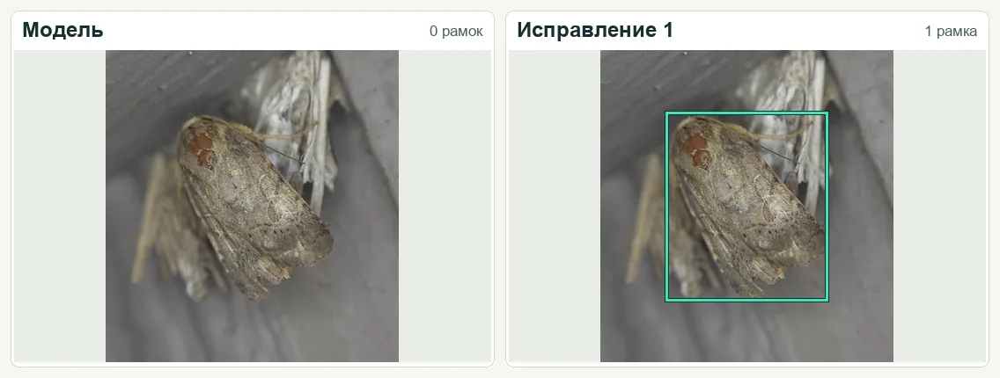
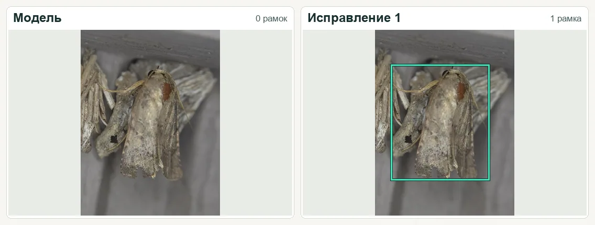
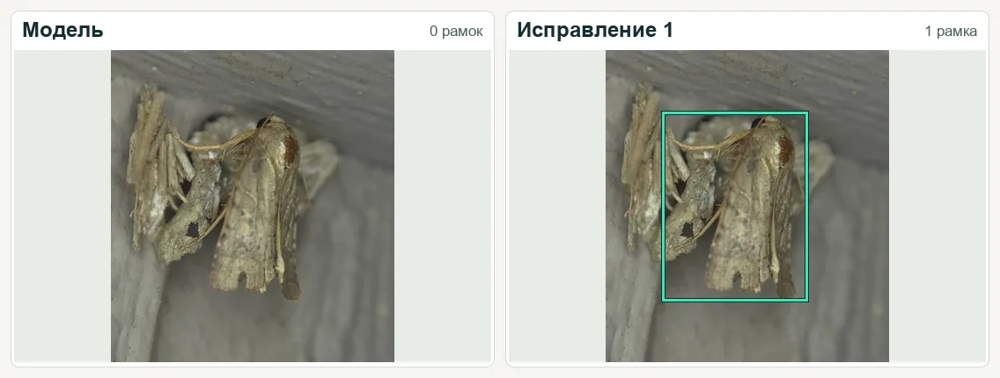
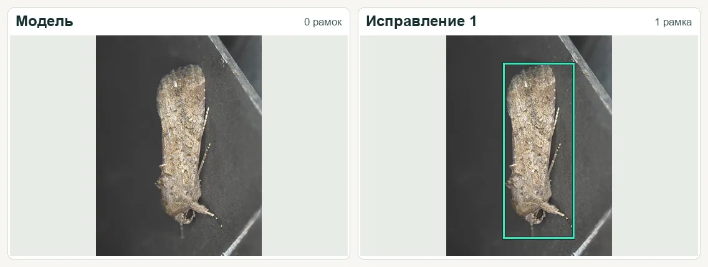
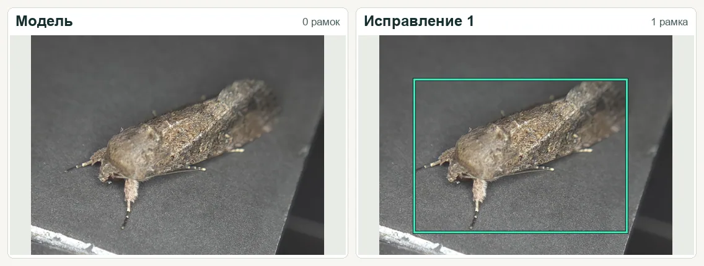
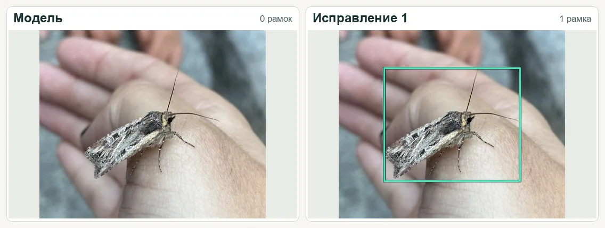
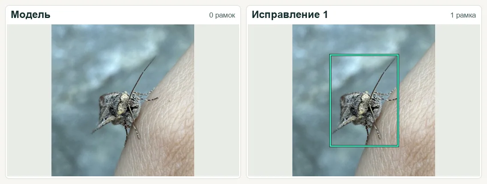

# Одно исправление · добавлена пропущенная бабочка

[Вся галерея](README.md)

Версии расположены по порядку слева направо, затем сверху вниз. Кадрирование одинаково для всех версий одного фото. Оранжевым отмечены рамки, отправленные на исправление, бирюзовым — принятые, включая принятые ранее.

[761015426](#761015426) · [761015459](#761015459) · [761015673](#761015673) · [761015725](#761015725) · [761015743](#761015743) · [761038837](#761038837) · [761038872](#761038872) · [761105922](#761105922) · [761105956](#761105956)

### 761015426

Голоса фильтрации — 2/3 за бабочку. В итоговой выгрузке — 1 рамка. [Оригинал](https://inaturalist-open-data.s3.amazonaws.com/photos/761015426/original.jpg)

| Версия | Изменение | Результат проверки |
|---|---|---|
| Модель | У модели нет рамок. | Валидаторы отметили пропуск. |
| Исправление 1 | Добавлено рамок — 1. | Принято — 1. Пропусков нет. |

### 761015459

Голоса фильтрации — 3/3 за бабочку. В итоговой выгрузке — 1 рамка. [Оригинал](https://inaturalist-open-data.s3.amazonaws.com/photos/761015459/original.jpg)

| Версия | Изменение | Результат проверки |
|---|---|---|
| Модель | У модели нет рамок. | Валидаторы отметили пропуск. |
| Исправление 1 | Добавлено рамок — 1. | Принято — 1. Пропусков нет. |

### 761015673

Голоса фильтрации — 3/3 за бабочку. В итоговой выгрузке — 1 рамка. [Оригинал](https://inaturalist-open-data.s3.amazonaws.com/photos/761015673/original.jpg)

| Версия | Изменение | Результат проверки |
|---|---|---|
| Модель | У модели нет рамок. | Валидаторы отметили пропуск. |
| Исправление 1 | Добавлено рамок — 1. | Принято — 1. Пропусков нет. |

### 761015725

Голоса фильтрации — 3/3 за бабочку. В итоговой выгрузке — 1 рамка. [Оригинал](https://inaturalist-open-data.s3.amazonaws.com/photos/761015725/original.jpg)

| Версия | Изменение | Результат проверки |
|---|---|---|
| Модель | У модели нет рамок. | Валидаторы отметили пропуск. |
| Исправление 1 | Добавлено рамок — 1. | Принято — 1. Пропусков нет. |

### 761015743

Голоса фильтрации — 2/3 за бабочку. В итоговой выгрузке — 1 рамка. [Оригинал](https://inaturalist-open-data.s3.amazonaws.com/photos/761015743/original.jpg)

| Версия | Изменение | Результат проверки |
|---|---|---|
| Модель | У модели нет рамок. | Валидаторы отметили пропуск. |
| Исправление 1 | Добавлено рамок — 1. | Принято — 1. Пропусков нет. |

### 761038837

Голоса фильтрации — 2/3 за бабочку. В итоговой выгрузке — 1 рамка. [Оригинал](https://inaturalist-open-data.s3.amazonaws.com/photos/761038837/original.jpg)

| Версия | Изменение | Результат проверки |
|---|---|---|
| Модель | У модели нет рамок. | Валидаторы отметили пропуск. |
| Исправление 1 | Добавлено рамок — 1. | Принято — 1. Пропусков нет. |

### 761038872

Голоса фильтрации — 3/3 за бабочку. В итоговой выгрузке — 1 рамка. [Оригинал](https://inaturalist-open-data.s3.amazonaws.com/photos/761038872/original.jpg)

| Версия | Изменение | Результат проверки |
|---|---|---|
| Модель | У модели нет рамок. | Валидаторы отметили пропуск. |
| Исправление 1 | Добавлено рамок — 1. | Принято — 1. Пропусков нет. |

### 761105922

Голоса фильтрации — 3/3 за бабочку. В итоговой выгрузке — 1 рамка. [Оригинал](https://inaturalist-open-data.s3.amazonaws.com/photos/761105922/original.jpg)

| Версия | Изменение | Результат проверки |
|---|---|---|
| Модель | У модели нет рамок. | Валидаторы отметили пропуск. |
| Исправление 1 | Добавлено рамок — 1. | Принято — 1. Пропусков нет. |

### 761105956

Голоса фильтрации — 2/3 за бабочку. В итоговой выгрузке — 1 рамка. [Оригинал](https://inaturalist-open-data.s3.amazonaws.com/photos/761105956/original.jpg)

| Версия | Изменение | Результат проверки |
|---|---|---|
| Модель | У модели нет рамок. | Валидаторы отметили пропуск. |
| Исправление 1 | Добавлено рамок — 1. | Принято — 1. Пропусков нет. |

[К группам и поиску по ID](README.md)
