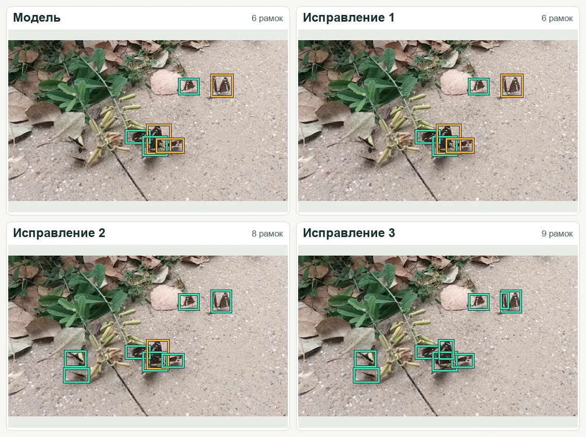

# Три исправления · границы и пропущенные бабочки

[Вся галерея](README.md)

Версии расположены по порядку слева направо, затем сверху вниз. Кадрирование одинаково для всех версий одного фото. Оранжевым отмечены рамки, отправленные на исправление, бирюзовым — принятые, включая принятые ранее.

[761031648](#761031648)

### 761031648

Голоса фильтрации — 3/3 за бабочку. В итоговой выгрузке — 9 рамок. [Оригинал](https://inaturalist-open-data.s3.amazonaws.com/photos/761031648/original.jpg)

| Версия | Изменение | Результат проверки |
|---|---|---|
| Модель | Исходная предразметка. | Принято — 3, поправить границы — 3. Валидаторы отметили пропуск. Для решения по границам понадобился третий голос. |
| Исправление 1 | Координаты остались прежними. | Рамок из прошлых версий — 3, поправить границы — 3. Отмечен пропуск. Сохранён один голос. Версию вернул на исправление заказчик. |
| Исправление 2 | Было 6, стало 8. Прежние координаты у 3 из 6 рамок. | Рамок из прошлых версий — 3, принято — 4, поправить границы — 1. Валидаторы отметили пропуск. По полноте голоса разделились 2 к 1. |
| Исправление 3 | Было 8, стало 9. Прежние координаты у 7 из 8 рамок. | Рамок из прошлых версий — 7, принято — 2. Пропусков нет. |

[К группам и поиску по ID](README.md)
