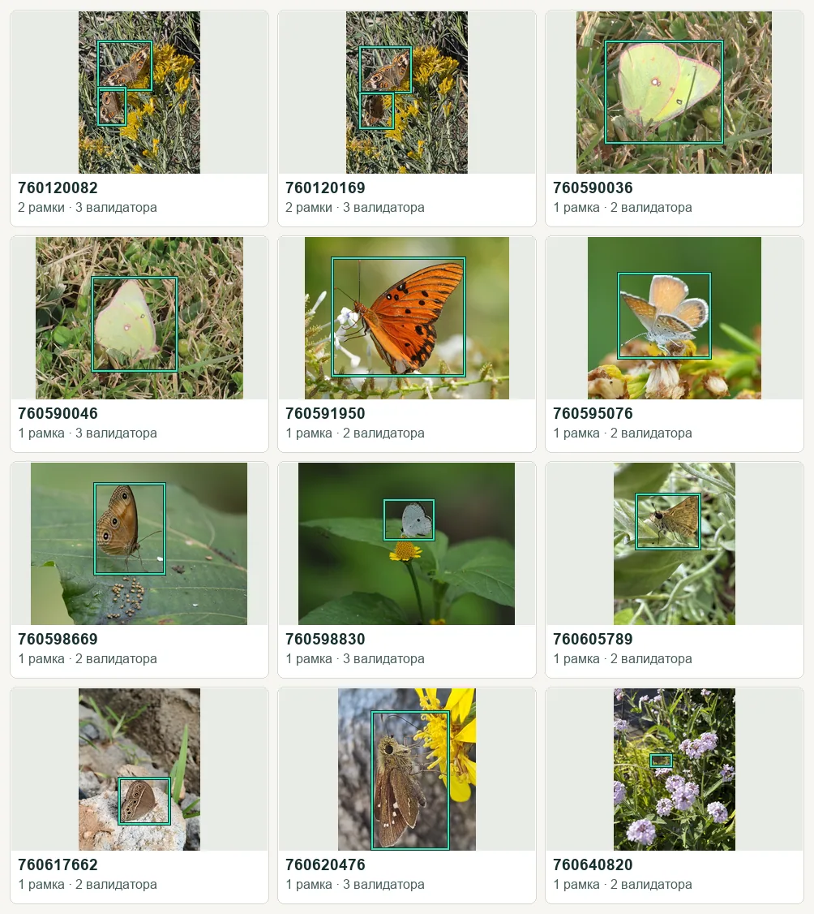
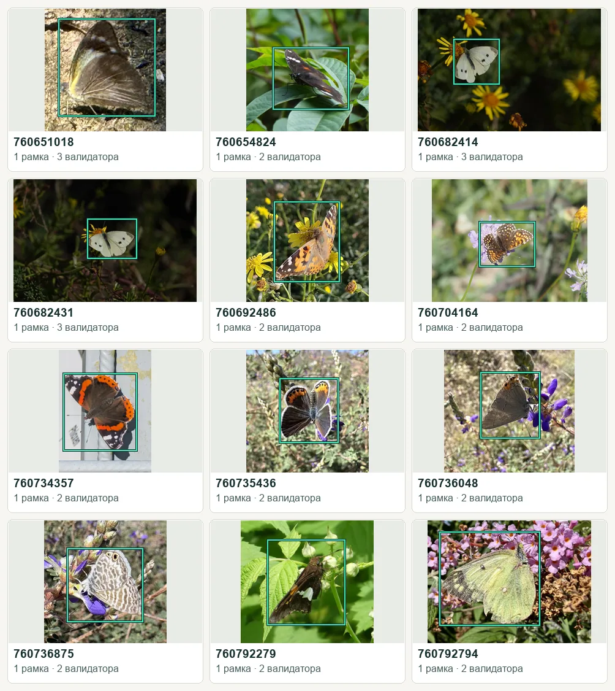

# Без исправлений · рамки модели подтверждены

[Вся галерея](README.md) · Страницы **1** · [2](confirmed-2.md) · [3](confirmed-3.md) · [4](confirmed-4.md) · [5](confirmed-5.md) · [6](confirmed-6.md)

У всех фото рамки модели вошли в итог с исходными координатами. На карточке указаны число рамок и число независимых сдач этой версии.

### Лист 1

| Фото | Голоса фильтра «есть» | Рамок модели → итог | Проверка рамок |
|---|---:|---:|---|
| [760120082](https://inaturalist-open-data.s3.amazonaws.com/photos/760120082/original.jpg) | 3/3 | 2 → 2 | После третьего голоса |
| [760120169](https://inaturalist-open-data.s3.amazonaws.com/photos/760120169/original.jpg) | 3/3 | 2 → 2 | После третьего голоса |
| [760590036](https://inaturalist-open-data.s3.amazonaws.com/photos/760590036/original.jpg) | 3/3 | 1 → 1 | Совпали два голоса |
| [760590046](https://inaturalist-open-data.s3.amazonaws.com/photos/760590046/original.jpg) | 3/3 | 1 → 1 | После третьего голоса |
| [760591950](https://inaturalist-open-data.s3.amazonaws.com/photos/760591950/original.jpg) | 3/3 | 1 → 1 | Совпали два голоса |
| [760595076](https://inaturalist-open-data.s3.amazonaws.com/photos/760595076/original.jpg) | 3/3 | 1 → 1 | Совпали два голоса |
| [760598669](https://inaturalist-open-data.s3.amazonaws.com/photos/760598669/original.jpg) | 3/3 | 1 → 1 | Совпали два голоса |
| [760598830](https://inaturalist-open-data.s3.amazonaws.com/photos/760598830/original.jpg) | 3/3 | 1 → 1 | После третьего голоса |
| [760605789](https://inaturalist-open-data.s3.amazonaws.com/photos/760605789/original.jpg) | 3/3 | 1 → 1 | Совпали два голоса |
| [760617662](https://inaturalist-open-data.s3.amazonaws.com/photos/760617662/original.jpg) | 3/3 | 1 → 1 | Совпали два голоса |
| [760620476](https://inaturalist-open-data.s3.amazonaws.com/photos/760620476/original.jpg) | 3/3 | 1 → 1 | После третьего голоса |
| [760640820](https://inaturalist-open-data.s3.amazonaws.com/photos/760640820/original.jpg) | 2/3 | 1 → 1 | Совпали два голоса |

### Лист 2

| Фото | Голоса фильтра «есть» | Рамок модели → итог | Проверка рамок |
|---|---:|---:|---|
| [760651018](https://inaturalist-open-data.s3.amazonaws.com/photos/760651018/original.jpg) | 3/3 | 1 → 1 | После третьего голоса |
| [760654824](https://inaturalist-open-data.s3.amazonaws.com/photos/760654824/original.jpg) | 3/3 | 1 → 1 | Совпали два голоса |
| [760682414](https://inaturalist-open-data.s3.amazonaws.com/photos/760682414/original.jpg) | 3/3 | 1 → 1 | После третьего голоса |
| [760682431](https://inaturalist-open-data.s3.amazonaws.com/photos/760682431/original.jpg) | 3/3 | 1 → 1 | После третьего голоса |
| [760692486](https://inaturalist-open-data.s3.amazonaws.com/photos/760692486/original.jpg) | 3/3 | 1 → 1 | Совпали два голоса |
| [760704164](https://inaturalist-open-data.s3.amazonaws.com/photos/760704164/original.jpg) | 3/3 | 1 → 1 | Совпали два голоса |
| [760734357](https://inaturalist-open-data.s3.amazonaws.com/photos/760734357/original.jpg) | 3/3 | 1 → 1 | Совпали два голоса |
| [760735436](https://inaturalist-open-data.s3.amazonaws.com/photos/760735436/original.jpg) | 3/3 | 1 → 1 | Совпали два голоса |
| [760736048](https://inaturalist-open-data.s3.amazonaws.com/photos/760736048/original.jpg) | 3/3 | 1 → 1 | Совпали два голоса |
| [760736875](https://inaturalist-open-data.s3.amazonaws.com/photos/760736875/original.jpg) | 3/3 | 1 → 1 | Совпали два голоса |
| [760792279](https://inaturalist-open-data.s3.amazonaws.com/photos/760792279/original.jpg) | 2/3 | 1 → 1 | Совпали два голоса |
| [760792794](https://inaturalist-open-data.s3.amazonaws.com/photos/760792794/original.jpg) | 3/3 | 1 → 1 | Совпали два голоса |

[К группам и поиску по ID](README.md) · [Следующая страница](confirmed-2.md)
