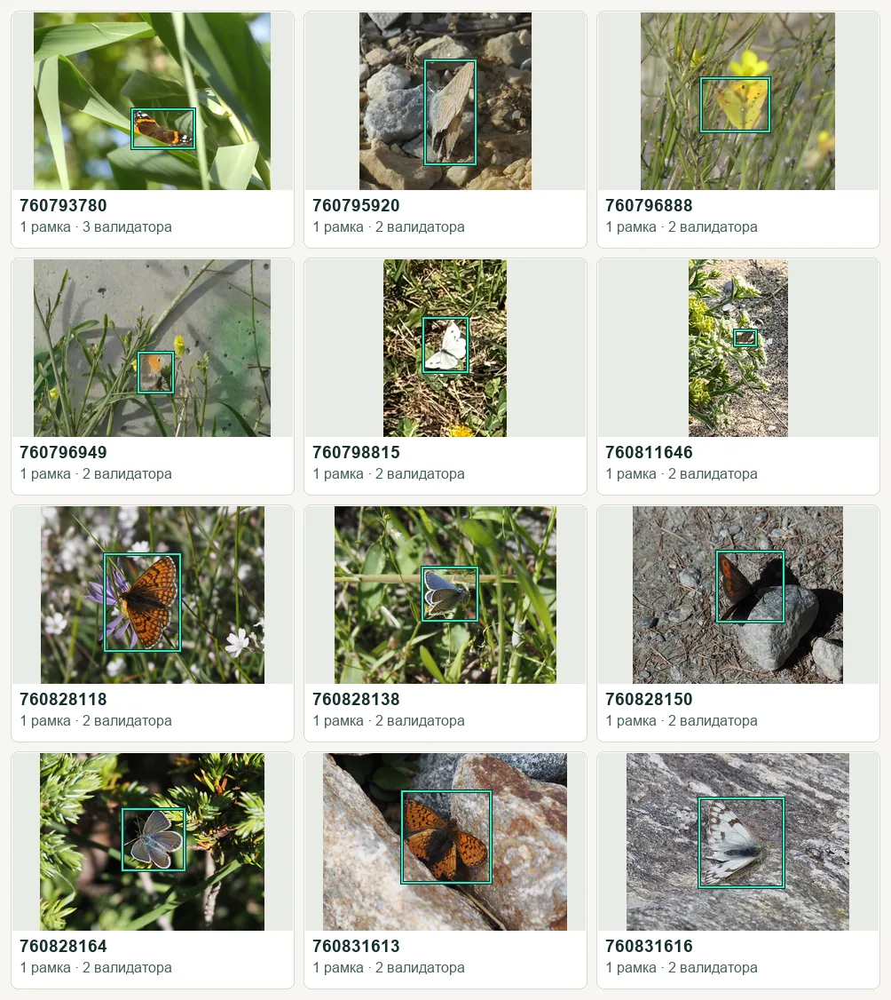
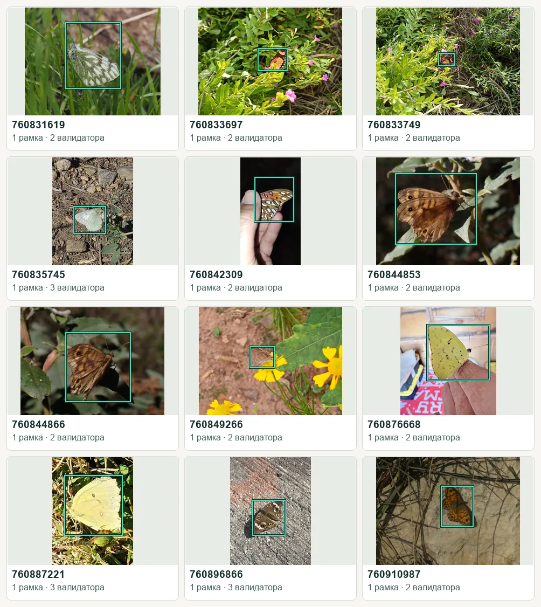

# Без исправлений · рамки модели подтверждены

[Вся галерея](README.md) · Страницы [1](confirmed-1.md) · **2** · [3](confirmed-3.md) · [4](confirmed-4.md) · [5](confirmed-5.md) · [6](confirmed-6.md)

У всех фото рамки модели вошли в итог с исходными координатами. На карточке указаны число рамок и число независимых сдач этой версии.

### Лист 3

| Фото | Голоса фильтра «есть» | Рамок модели → итог | Проверка рамок |
|---|---:|---:|---|
| [760793780](https://inaturalist-open-data.s3.amazonaws.com/photos/760793780/original.jpg) | 3/3 | 1 → 1 | После третьего голоса |
| [760795920](https://inaturalist-open-data.s3.amazonaws.com/photos/760795920/original.jpg) | 3/3 | 1 → 1 | Совпали два голоса |
| [760796888](https://inaturalist-open-data.s3.amazonaws.com/photos/760796888/original.jpg) | 3/3 | 1 → 1 | Совпали два голоса |
| [760796949](https://inaturalist-open-data.s3.amazonaws.com/photos/760796949/original.jpg) | 3/3 | 1 → 1 | Совпали два голоса |
| [760798815](https://inaturalist-open-data.s3.amazonaws.com/photos/760798815/original.jpg) | 3/3 | 1 → 1 | Совпали два голоса |
| [760811646](https://inaturalist-open-data.s3.amazonaws.com/photos/760811646/original.jpg) | 3/3 | 1 → 1 | Совпали два голоса |
| [760828118](https://inaturalist-open-data.s3.amazonaws.com/photos/760828118/original.jpg) | 3/3 | 1 → 1 | Совпали два голоса |
| [760828138](https://inaturalist-open-data.s3.amazonaws.com/photos/760828138/original.jpg) | 3/3 | 1 → 1 | Совпали два голоса |
| [760828150](https://inaturalist-open-data.s3.amazonaws.com/photos/760828150/original.jpg) | 3/3 | 1 → 1 | Совпали два голоса |
| [760828164](https://inaturalist-open-data.s3.amazonaws.com/photos/760828164/original.jpg) | 3/3 | 1 → 1 | Совпали два голоса |
| [760831613](https://inaturalist-open-data.s3.amazonaws.com/photos/760831613/original.jpg) | 3/3 | 1 → 1 | Совпали два голоса |
| [760831616](https://inaturalist-open-data.s3.amazonaws.com/photos/760831616/original.jpg) | 3/3 | 1 → 1 | Совпали два голоса |

### Лист 4

| Фото | Голоса фильтра «есть» | Рамок модели → итог | Проверка рамок |
|---|---:|---:|---|
| [760831619](https://inaturalist-open-data.s3.amazonaws.com/photos/760831619/original.jpg) | 3/3 | 1 → 1 | Совпали два голоса |
| [760833697](https://inaturalist-open-data.s3.amazonaws.com/photos/760833697/original.jpg) | 3/3 | 1 → 1 | Совпали два голоса |
| [760833749](https://inaturalist-open-data.s3.amazonaws.com/photos/760833749/original.jpg) | 3/3 | 1 → 1 | Совпали два голоса |
| [760835745](https://inaturalist-open-data.s3.amazonaws.com/photos/760835745/original.jpg) | 2/3 | 1 → 1 | После третьего голоса |
| [760842309](https://inaturalist-open-data.s3.amazonaws.com/photos/760842309/original.jpg) | 3/3 | 1 → 1 | Совпали два голоса |
| [760844853](https://inaturalist-open-data.s3.amazonaws.com/photos/760844853/original.jpg) | 3/3 | 1 → 1 | Совпали два голоса |
| [760844866](https://inaturalist-open-data.s3.amazonaws.com/photos/760844866/original.jpg) | 3/3 | 1 → 1 | Совпали два голоса |
| [760849266](https://inaturalist-open-data.s3.amazonaws.com/photos/760849266/original.jpg) | 3/3 | 1 → 1 | Совпали два голоса |
| [760876668](https://inaturalist-open-data.s3.amazonaws.com/photos/760876668/original.jpg) | 3/3 | 1 → 1 | Совпали два голоса |
| [760887221](https://inaturalist-open-data.s3.amazonaws.com/photos/760887221/original.jpg) | 3/3 | 1 → 1 | После третьего голоса |
| [760896866](https://inaturalist-open-data.s3.amazonaws.com/photos/760896866/original.jpg) | 3/3 | 1 → 1 | После третьего голоса |
| [760910987](https://inaturalist-open-data.s3.amazonaws.com/photos/760910987/original.jpg) | 3/3 | 1 → 1 | Совпали два голоса |

[К группам и поиску по ID](README.md) · [Следующая страница](confirmed-3.md)
