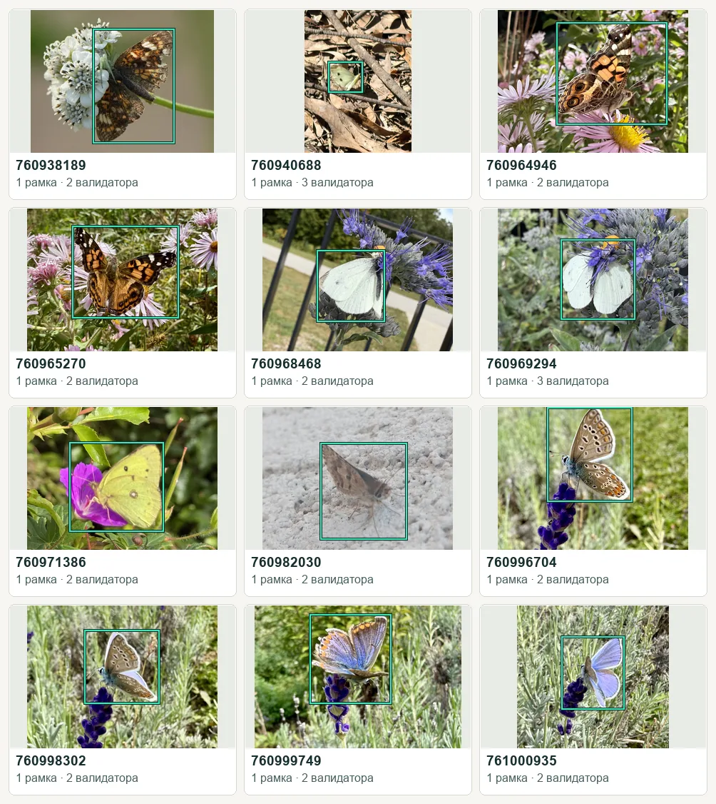
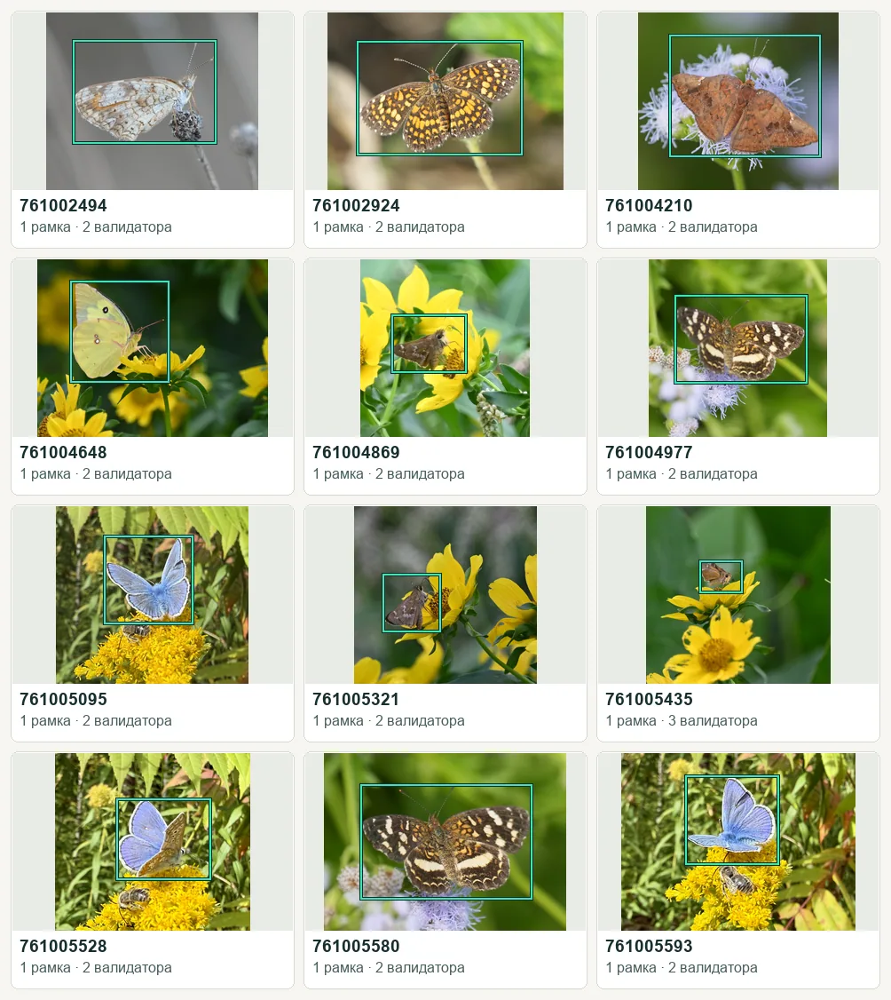

# Без исправлений · рамки модели подтверждены

[Вся галерея](README.md) · Страницы [1](confirmed-1.md) · [2](confirmed-2.md) · **3** · [4](confirmed-4.md) · [5](confirmed-5.md) · [6](confirmed-6.md)

У всех фото рамки модели вошли в итог с исходными координатами. На карточке указаны число рамок и число независимых сдач этой версии.

### Лист 5

| Фото | Голоса фильтра «есть» | Рамок модели → итог | Проверка рамок |
|---|---:|---:|---|
| [760938189](https://inaturalist-open-data.s3.amazonaws.com/photos/760938189/original.jpg) | 3/3 | 1 → 1 | Совпали два голоса |
| [760940688](https://inaturalist-open-data.s3.amazonaws.com/photos/760940688/original.jpg) | 3/3 | 1 → 1 | После третьего голоса |
| [760964946](https://inaturalist-open-data.s3.amazonaws.com/photos/760964946/original.jpg) | 3/3 | 1 → 1 | Совпали два голоса |
| [760965270](https://inaturalist-open-data.s3.amazonaws.com/photos/760965270/original.jpg) | 3/3 | 1 → 1 | Совпали два голоса |
| [760968468](https://inaturalist-open-data.s3.amazonaws.com/photos/760968468/original.jpg) | 3/3 | 1 → 1 | Совпали два голоса |
| [760969294](https://inaturalist-open-data.s3.amazonaws.com/photos/760969294/original.jpg) | 3/3 | 1 → 1 | После третьего голоса |
| [760971386](https://inaturalist-open-data.s3.amazonaws.com/photos/760971386/original.jpg) | 3/3 | 1 → 1 | Совпали два голоса |
| [760982030](https://inaturalist-open-data.s3.amazonaws.com/photos/760982030/original.jpg) | 3/3 | 1 → 1 | Совпали два голоса |
| [760996704](https://inaturalist-open-data.s3.amazonaws.com/photos/760996704/original.jpg) | 3/3 | 1 → 1 | Совпали два голоса |
| [760998302](https://inaturalist-open-data.s3.amazonaws.com/photos/760998302/original.jpg) | 3/3 | 1 → 1 | Совпали два голоса |
| [760999749](https://inaturalist-open-data.s3.amazonaws.com/photos/760999749/original.jpg) | 3/3 | 1 → 1 | Совпали два голоса |
| [761000935](https://inaturalist-open-data.s3.amazonaws.com/photos/761000935/original.jpg) | 3/3 | 1 → 1 | Совпали два голоса |

### Лист 6

| Фото | Голоса фильтра «есть» | Рамок модели → итог | Проверка рамок |
|---|---:|---:|---|
| [761002494](https://inaturalist-open-data.s3.amazonaws.com/photos/761002494/original.jpg) | 3/3 | 1 → 1 | Совпали два голоса |
| [761002924](https://inaturalist-open-data.s3.amazonaws.com/photos/761002924/original.jpg) | 3/3 | 1 → 1 | Совпали два голоса |
| [761004210](https://inaturalist-open-data.s3.amazonaws.com/photos/761004210/original.jpg) | 3/3 | 1 → 1 | Совпали два голоса |
| [761004648](https://inaturalist-open-data.s3.amazonaws.com/photos/761004648/original.jpg) | 3/3 | 1 → 1 | Совпали два голоса |
| [761004869](https://inaturalist-open-data.s3.amazonaws.com/photos/761004869/original.jpg) | 2/3 | 1 → 1 | Совпали два голоса |
| [761004977](https://inaturalist-open-data.s3.amazonaws.com/photos/761004977/original.jpg) | 3/3 | 1 → 1 | Совпали два голоса |
| [761005095](https://inaturalist-open-data.s3.amazonaws.com/photos/761005095/original.jpg) | 3/3 | 1 → 1 | Совпали два голоса |
| [761005321](https://inaturalist-open-data.s3.amazonaws.com/photos/761005321/original.jpg) | 2/3 | 1 → 1 | Совпали два голоса |
| [761005435](https://inaturalist-open-data.s3.amazonaws.com/photos/761005435/original.jpg) | 3/3 | 1 → 1 | После третьего голоса |
| [761005528](https://inaturalist-open-data.s3.amazonaws.com/photos/761005528/original.jpg) | 3/3 | 1 → 1 | Совпали два голоса |
| [761005580](https://inaturalist-open-data.s3.amazonaws.com/photos/761005580/original.jpg) | 3/3 | 1 → 1 | Совпали два голоса |
| [761005593](https://inaturalist-open-data.s3.amazonaws.com/photos/761005593/original.jpg) | 3/3 | 1 → 1 | Совпали два голоса |

[К группам и поиску по ID](README.md) · [Следующая страница](confirmed-4.md)
