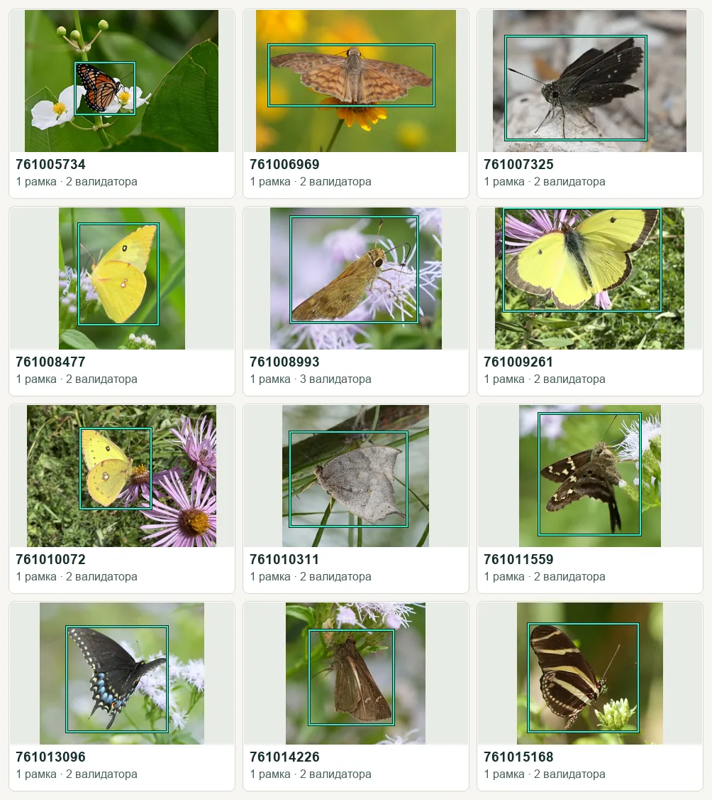
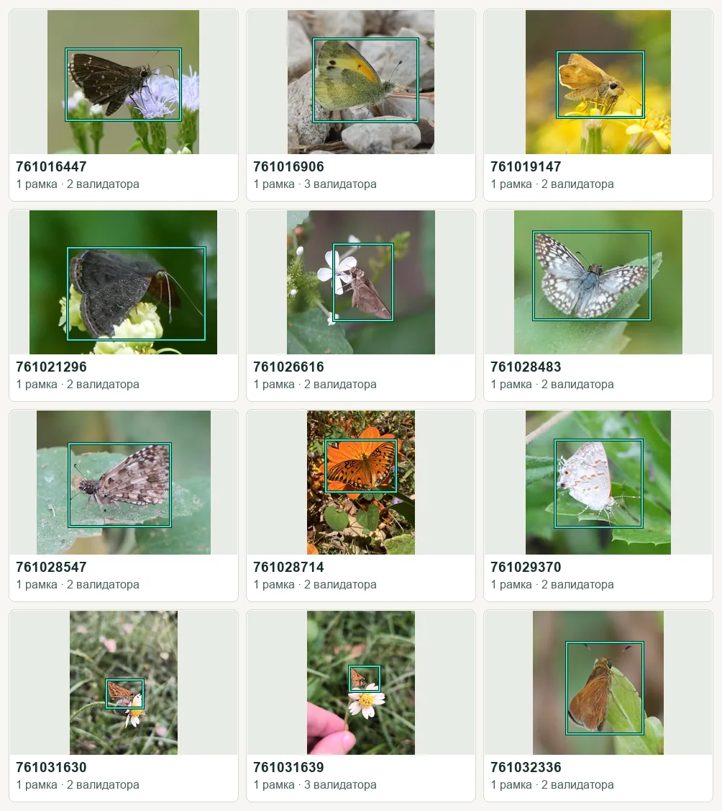

# Без исправлений · рамки модели подтверждены

[Вся галерея](README.md) · Страницы [1](confirmed-1.md) · [2](confirmed-2.md) · [3](confirmed-3.md) · **4** · [5](confirmed-5.md) · [6](confirmed-6.md)

У всех фото рамки модели вошли в итог с исходными координатами. На карточке указаны число рамок и число независимых сдач этой версии.

### Лист 7

| Фото | Голоса фильтра «есть» | Рамок модели → итог | Проверка рамок |
|---|---:|---:|---|
| [761005734](https://inaturalist-open-data.s3.amazonaws.com/photos/761005734/original.jpg) | 3/3 | 1 → 1 | Совпали два голоса |
| [761006969](https://inaturalist-open-data.s3.amazonaws.com/photos/761006969/original.jpg) | 3/3 | 1 → 1 | Совпали два голоса |
| [761007325](https://inaturalist-open-data.s3.amazonaws.com/photos/761007325/original.jpg) | 3/3 | 1 → 1 | Совпали два голоса |
| [761008477](https://inaturalist-open-data.s3.amazonaws.com/photos/761008477/original.jpg) | 3/3 | 1 → 1 | Совпали два голоса |
| [761008993](https://inaturalist-open-data.s3.amazonaws.com/photos/761008993/original.jpg) | 3/3 | 1 → 1 | После третьего голоса |
| [761009261](https://inaturalist-open-data.s3.amazonaws.com/photos/761009261/original.jpg) | 3/3 | 1 → 1 | Совпали два голоса |
| [761010072](https://inaturalist-open-data.s3.amazonaws.com/photos/761010072/original.jpg) | 3/3 | 1 → 1 | Совпали два голоса |
| [761010311](https://inaturalist-open-data.s3.amazonaws.com/photos/761010311/original.jpg) | 3/3 | 1 → 1 | Совпали два голоса |
| [761011559](https://inaturalist-open-data.s3.amazonaws.com/photos/761011559/original.jpg) | 3/3 | 1 → 1 | Совпали два голоса |
| [761013096](https://inaturalist-open-data.s3.amazonaws.com/photos/761013096/original.jpg) | 3/3 | 1 → 1 | Совпали два голоса |
| [761014226](https://inaturalist-open-data.s3.amazonaws.com/photos/761014226/original.jpg) | 3/3 | 1 → 1 | Совпали два голоса |
| [761015168](https://inaturalist-open-data.s3.amazonaws.com/photos/761015168/original.jpg) | 3/3 | 1 → 1 | Совпали два голоса |

### Лист 8

| Фото | Голоса фильтра «есть» | Рамок модели → итог | Проверка рамок |
|---|---:|---:|---|
| [761016447](https://inaturalist-open-data.s3.amazonaws.com/photos/761016447/original.jpg) | 3/3 | 1 → 1 | Совпали два голоса |
| [761016906](https://inaturalist-open-data.s3.amazonaws.com/photos/761016906/original.jpg) | 3/3 | 1 → 1 | После третьего голоса |
| [761019147](https://inaturalist-open-data.s3.amazonaws.com/photos/761019147/original.jpg) | 3/3 | 1 → 1 | Совпали два голоса |
| [761021296](https://inaturalist-open-data.s3.amazonaws.com/photos/761021296/original.jpg) | 3/3 | 1 → 1 | Совпали два голоса |
| [761026616](https://inaturalist-open-data.s3.amazonaws.com/photos/761026616/original.jpg) | 3/3 | 1 → 1 | Совпали два голоса |
| [761028483](https://inaturalist-open-data.s3.amazonaws.com/photos/761028483/original.jpg) | 3/3 | 1 → 1 | Совпали два голоса |
| [761028547](https://inaturalist-open-data.s3.amazonaws.com/photos/761028547/original.jpg) | 3/3 | 1 → 1 | Совпали два голоса |
| [761028714](https://inaturalist-open-data.s3.amazonaws.com/photos/761028714/original.jpg) | 3/3 | 1 → 1 | Совпали два голоса |
| [761029370](https://inaturalist-open-data.s3.amazonaws.com/photos/761029370/original.jpg) | 3/3 | 1 → 1 | Совпали два голоса |
| [761031630](https://inaturalist-open-data.s3.amazonaws.com/photos/761031630/original.jpg) | 3/3 | 1 → 1 | Совпали два голоса |
| [761031639](https://inaturalist-open-data.s3.amazonaws.com/photos/761031639/original.jpg) | 3/3 | 1 → 1 | После третьего голоса |
| [761032336](https://inaturalist-open-data.s3.amazonaws.com/photos/761032336/original.jpg) | 3/3 | 1 → 1 | Совпали два голоса |

[К группам и поиску по ID](README.md) · [Следующая страница](confirmed-5.md)
