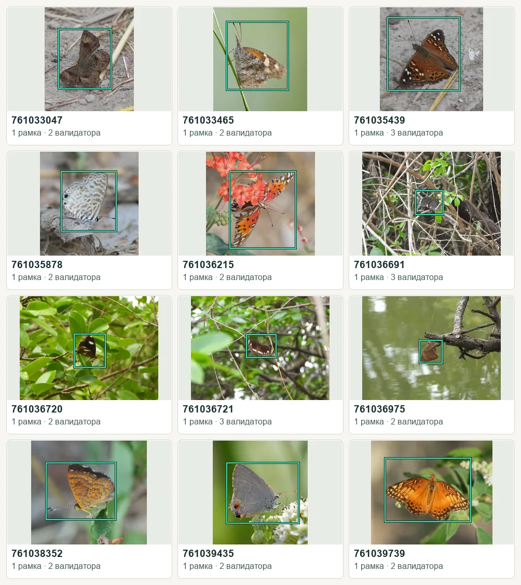
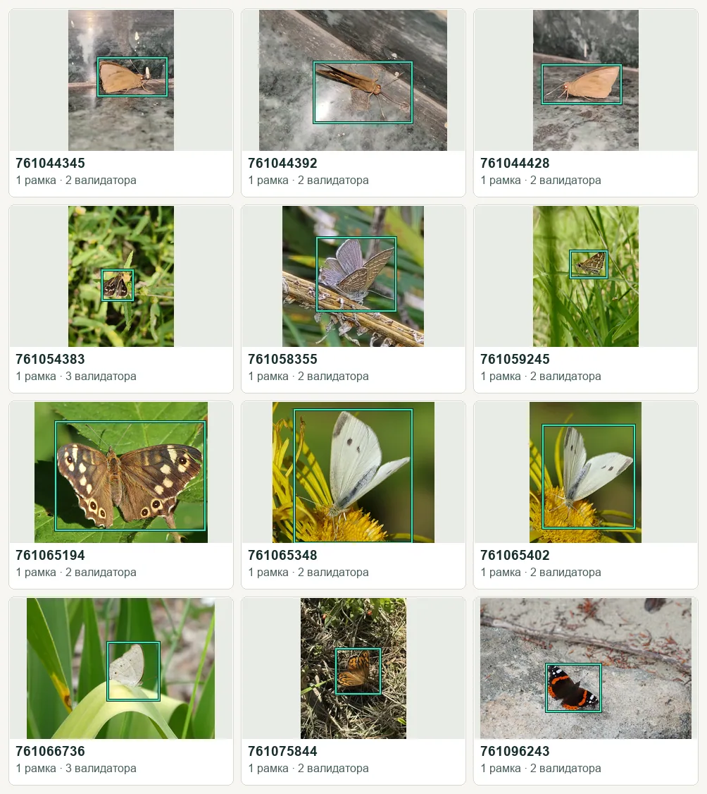

# Без исправлений · рамки модели подтверждены

[Вся галерея](README.md) · Страницы [1](confirmed-1.md) · [2](confirmed-2.md) · [3](confirmed-3.md) · [4](confirmed-4.md) · **5** · [6](confirmed-6.md)

У всех фото рамки модели вошли в итог с исходными координатами. На карточке указаны число рамок и число независимых сдач этой версии.

### Лист 9

| Фото | Голоса фильтра «есть» | Рамок модели → итог | Проверка рамок |
|---|---:|---:|---|
| [761033047](https://inaturalist-open-data.s3.amazonaws.com/photos/761033047/original.jpg) | 3/3 | 1 → 1 | Совпали два голоса |
| [761033465](https://inaturalist-open-data.s3.amazonaws.com/photos/761033465/original.jpg) | 3/3 | 1 → 1 | Совпали два голоса |
| [761035439](https://inaturalist-open-data.s3.amazonaws.com/photos/761035439/original.jpg) | 3/3 | 1 → 1 | После третьего голоса |
| [761035878](https://inaturalist-open-data.s3.amazonaws.com/photos/761035878/original.jpg) | 3/3 | 1 → 1 | Совпали два голоса |
| [761036215](https://inaturalist-open-data.s3.amazonaws.com/photos/761036215/original.jpg) | 3/3 | 1 → 1 | Совпали два голоса |
| [761036691](https://inaturalist-open-data.s3.amazonaws.com/photos/761036691/original.jpg) | 3/3 | 1 → 1 | После третьего голоса |
| [761036720](https://inaturalist-open-data.s3.amazonaws.com/photos/761036720/original.jpg) | 3/3 | 1 → 1 | Совпали два голоса |
| [761036721](https://inaturalist-open-data.s3.amazonaws.com/photos/761036721/original.jpg) | 2/3 | 1 → 1 | После третьего голоса |
| [761036975](https://inaturalist-open-data.s3.amazonaws.com/photos/761036975/original.jpg) | 3/3 | 1 → 1 | Совпали два голоса |
| [761038352](https://inaturalist-open-data.s3.amazonaws.com/photos/761038352/original.jpg) | 3/3 | 1 → 1 | Совпали два голоса |
| [761039435](https://inaturalist-open-data.s3.amazonaws.com/photos/761039435/original.jpg) | 3/3 | 1 → 1 | Совпали два голоса |
| [761039739](https://inaturalist-open-data.s3.amazonaws.com/photos/761039739/original.jpg) | 3/3 | 1 → 1 | Совпали два голоса |

### Лист 10

| Фото | Голоса фильтра «есть» | Рамок модели → итог | Проверка рамок |
|---|---:|---:|---|
| [761044345](https://inaturalist-open-data.s3.amazonaws.com/photos/761044345/original.jpg) | 3/3 | 1 → 1 | Совпали два голоса |
| [761044392](https://inaturalist-open-data.s3.amazonaws.com/photos/761044392/original.jpg) | 3/3 | 1 → 1 | Совпали два голоса |
| [761044428](https://inaturalist-open-data.s3.amazonaws.com/photos/761044428/original.jpg) | 3/3 | 1 → 1 | Совпали два голоса |
| [761054383](https://inaturalist-open-data.s3.amazonaws.com/photos/761054383/original.jpg) | 3/3 | 1 → 1 | После третьего голоса |
| [761058355](https://inaturalist-open-data.s3.amazonaws.com/photos/761058355/original.jpg) | 3/3 | 1 → 1 | Совпали два голоса |
| [761059245](https://inaturalist-open-data.s3.amazonaws.com/photos/761059245/original.jpg) | 3/3 | 1 → 1 | Совпали два голоса |
| [761065194](https://inaturalist-open-data.s3.amazonaws.com/photos/761065194/original.jpg) | 3/3 | 1 → 1 | Совпали два голоса |
| [761065348](https://inaturalist-open-data.s3.amazonaws.com/photos/761065348/original.jpg) | 3/3 | 1 → 1 | Совпали два голоса |
| [761065402](https://inaturalist-open-data.s3.amazonaws.com/photos/761065402/original.jpg) | 3/3 | 1 → 1 | Совпали два голоса |
| [761066736](https://inaturalist-open-data.s3.amazonaws.com/photos/761066736/original.jpg) | 2/3 | 1 → 1 | После третьего голоса |
| [761075844](https://inaturalist-open-data.s3.amazonaws.com/photos/761075844/original.jpg) | 3/3 | 1 → 1 | Совпали два голоса |
| [761096243](https://inaturalist-open-data.s3.amazonaws.com/photos/761096243/original.jpg) | 3/3 | 1 → 1 | Совпали два голоса |

[К группам и поиску по ID](README.md) · [Следующая страница](confirmed-6.md)
