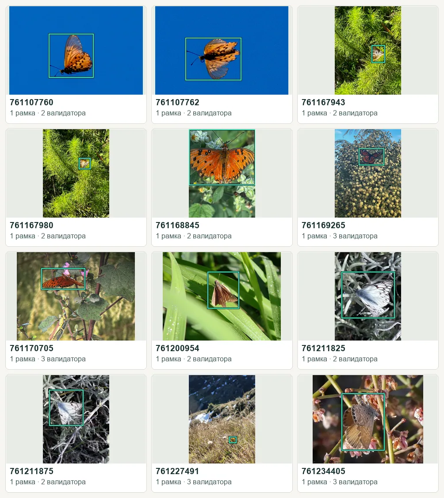
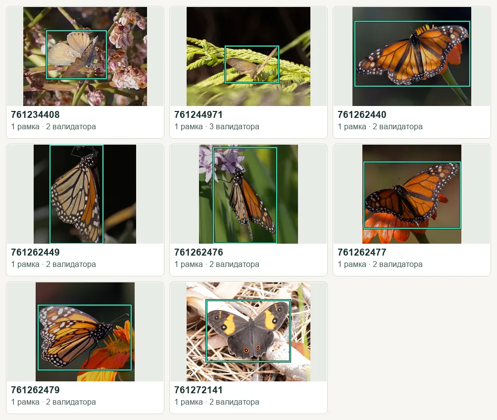

# Без исправлений · рамки модели подтверждены

[Вся галерея](README.md) · Страницы [1](confirmed-1.md) · [2](confirmed-2.md) · [3](confirmed-3.md) · [4](confirmed-4.md) · [5](confirmed-5.md) · **6**

У всех фото рамки модели вошли в итог с исходными координатами. На карточке указаны число рамок и число независимых сдач этой версии.

### Лист 11

| Фото | Голоса фильтра «есть» | Рамок модели → итог | Проверка рамок |
|---|---:|---:|---|
| [761107760](https://inaturalist-open-data.s3.amazonaws.com/photos/761107760/original.jpg) | 3/3 | 1 → 1 | Совпали два голоса |
| [761107762](https://inaturalist-open-data.s3.amazonaws.com/photos/761107762/original.jpg) | 2/3 | 1 → 1 | Совпали два голоса |
| [761167943](https://inaturalist-open-data.s3.amazonaws.com/photos/761167943/original.jpg) | 3/3 | 1 → 1 | Совпали два голоса |
| [761167980](https://inaturalist-open-data.s3.amazonaws.com/photos/761167980/original.jpg) | 3/3 | 1 → 1 | Совпали два голоса |
| [761168845](https://inaturalist-open-data.s3.amazonaws.com/photos/761168845/original.jpg) | 3/3 | 1 → 1 | Совпали два голоса |
| [761169265](https://inaturalist-open-data.s3.amazonaws.com/photos/761169265/original.jpg) | 3/3 | 1 → 1 | После третьего голоса |
| [761170705](https://inaturalist-open-data.s3.amazonaws.com/photos/761170705/original.jpg) | 2/3 | 1 → 1 | После третьего голоса |
| [761200954](https://inaturalist-open-data.s3.amazonaws.com/photos/761200954/original.jpg) | 1/3 | 1 → 1 | Совпали два голоса |
| [761211825](https://inaturalist-open-data.s3.amazonaws.com/photos/761211825/original.jpg) | 3/3 | 1 → 1 | Совпали два голоса |
| [761211875](https://inaturalist-open-data.s3.amazonaws.com/photos/761211875/original.jpg) | 3/3 | 1 → 1 | Совпали два голоса |
| [761227491](https://inaturalist-open-data.s3.amazonaws.com/photos/761227491/original.jpg) | 0/3 | 1 → 1 | После третьего голоса |
| [761234405](https://inaturalist-open-data.s3.amazonaws.com/photos/761234405/original.jpg) | 3/3 | 1 → 1 | После третьего голоса |

### Лист 12

| Фото | Голоса фильтра «есть» | Рамок модели → итог | Проверка рамок |
|---|---:|---:|---|
| [761234408](https://inaturalist-open-data.s3.amazonaws.com/photos/761234408/original.jpg) | 3/3 | 1 → 1 | Совпали два голоса |
| [761244971](https://inaturalist-open-data.s3.amazonaws.com/photos/761244971/original.jpg) | 3/3 | 1 → 1 | После третьего голоса |
| [761262440](https://inaturalist-open-data.s3.amazonaws.com/photos/761262440/original.jpg) | 3/3 | 1 → 1 | Совпали два голоса |
| [761262449](https://inaturalist-open-data.s3.amazonaws.com/photos/761262449/original.jpg) | 3/3 | 1 → 1 | Совпали два голоса |
| [761262476](https://inaturalist-open-data.s3.amazonaws.com/photos/761262476/original.jpg) | 3/3 | 1 → 1 | Совпали два голоса |
| [761262477](https://inaturalist-open-data.s3.amazonaws.com/photos/761262477/original.jpg) | 2/3 | 1 → 1 | Совпали два голоса |
| [761262479](https://inaturalist-open-data.s3.amazonaws.com/photos/761262479/original.jpg) | 2/3 | 1 → 1 | Совпали два голоса |
| [761272141](https://inaturalist-open-data.s3.amazonaws.com/photos/761272141/original.jpg) | 3/3 | 1 → 1 | Совпали два голоса |

[К группам и поиску по ID](README.md)
