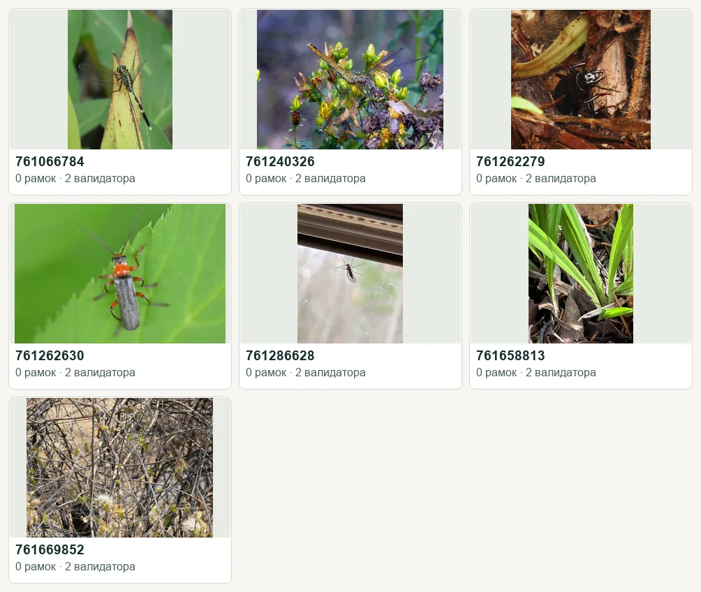

# Без исправлений · пустое фото подтверждено

[Вся галерея](README.md)

Модель не предложила рамок. Фото попало к валидаторам по голосам фильтрации. После проверки результат остался пустым.

### Лист 1

| Фото | Голоса фильтра «есть» | Рамок модели → итог | Проверка рамок |
|---|---:|---:|---|
| [761066784](https://inaturalist-open-data.s3.amazonaws.com/photos/761066784/original.jpg) | 2/3 | 0 → 0 | Совпали два голоса |
| [761240326](https://inaturalist-open-data.s3.amazonaws.com/photos/761240326/original.jpg) | 2/3 | 0 → 0 | Совпали два голоса |
| [761262279](https://inaturalist-open-data.s3.amazonaws.com/photos/761262279/original.jpg) | 2/3 | 0 → 0 | Совпали два голоса |
| [761262630](https://inaturalist-open-data.s3.amazonaws.com/photos/761262630/original.jpg) | 2/3 | 0 → 0 | Совпали два голоса |
| [761286628](https://inaturalist-open-data.s3.amazonaws.com/photos/761286628/original.jpg) | 2/3 | 0 → 0 | Совпали два голоса |
| [761658813](https://inaturalist-open-data.s3.amazonaws.com/photos/761658813/original.jpg) | 2/3 | 0 → 0 | Совпали два голоса |
| [761669852](https://inaturalist-open-data.s3.amazonaws.com/photos/761669852/original.jpg) | 2/3 | 0 → 0 | Совпали два голоса |

[К группам и поиску по ID](README.md)
