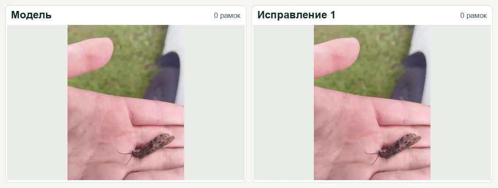

# Одно исправление · проверен сигнал о пропуске, итог пустой

[Вся галерея](README.md)

Версии расположены по порядку слева направо, затем сверху вниз. Кадрирование одинаково для всех версий одного фото. Оранжевым отмечены рамки, отправленные на исправление, бирюзовым — принятые, включая принятые ранее.

[625495767](#625495767)

### 625495767

Голоса фильтрации — 3/3 за бабочку. В итоговой выгрузке — 0 рамок. [Оригинал](https://inaturalist-open-data.s3.amazonaws.com/photos/625495767/original.jpg)

| Версия | Изменение | Результат проверки |
|---|---|---|
| Модель | У модели нет рамок. | Валидаторы отметили пропуск. |
| Исправление 1 | Рамки не добавлены. | Пропусков нет. По полноте голоса разделились 2 к 1. |

При сборе последнего голоса исполнителей приглашали адресно. Условия сбора ограничивают независимость решения по этому фото.

[К группам и поиску по ID](README.md)
