# Одно исправление · изменены границы

[Вся галерея](README.md) · Страницы **1** · [2](geometry-2.md) · [3](geometry-3.md) · [4](geometry-4.md)

Версии расположены по порядку слева направо, затем сверху вниз. Кадрирование одинаково для всех версий одного фото. Оранжевым отмечены рамки, отправленные на исправление, бирюзовым — принятые, включая принятые ранее.

[760607483](#760607483) · [760631172](#760631172) · [760651030](#760651030) · [760665528](#760665528) · [760675347](#760675347) · [760675781](#760675781) · [760795504](#760795504) · [760828115](#760828115) · [760828171](#760828171) · [760845284](#760845284) · [760845363](#760845363) · [760849218](#760849218)

### 760607483

Голоса фильтрации — 3/3 за бабочку. В итоговой выгрузке — 1 рамка. [Оригинал](https://inaturalist-open-data.s3.amazonaws.com/photos/760607483/original.jpg)

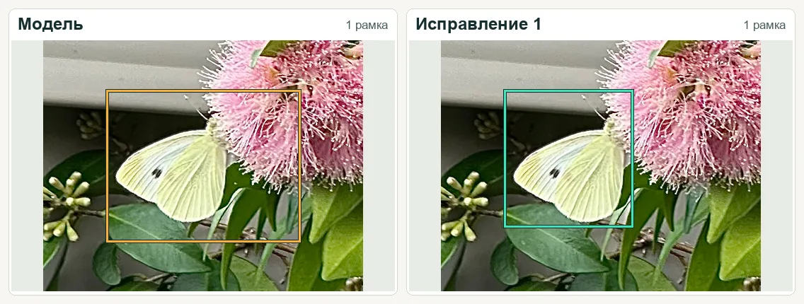

| Версия | Изменение | Результат проверки |
|---|---|---|
| Модель | Исходная предразметка. | Поправить границы — 1. Пропусков нет. |
| Исправление 1 | Сдвиг сторон (пиксели) — правый ←131, нижний ↑30. | Принято — 1. Пропусков нет. |

### 760631172

Голоса фильтрации — 3/3 за бабочку. В итоговой выгрузке — 1 рамка. [Оригинал](https://inaturalist-open-data.s3.amazonaws.com/photos/760631172/original.jpg)

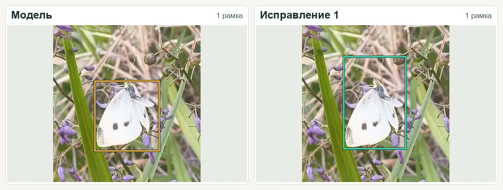

| Версия | Изменение | Результат проверки |
|---|---|---|
| Модель | Исходная предразметка. | Поправить границы — 1. Пропусков нет. |
| Исправление 1 | Сдвиг сторон (пиксели) — верхний ↑169, правый ←16, нижний ↑14. | Принято — 1. Пропусков нет. |

### 760651030

Голоса фильтрации — 3/3 за бабочку. В итоговой выгрузке — 1 рамка. [Оригинал](https://inaturalist-open-data.s3.amazonaws.com/photos/760651030/original.jpg)

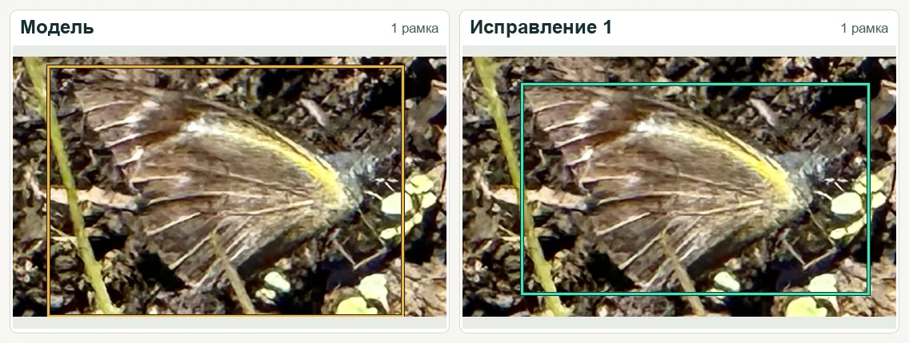

| Версия | Изменение | Результат проверки |
|---|---|---|
| Модель | Исходная предразметка. | Поправить границы — 1. Пропусков нет. |
| Исправление 1 | Сдвиг сторон (пиксели) — левый край →63, верхний ↓46, правый →42, нижний ↑61. | Принято — 1. Пропусков нет. |

### 760665528

Голоса фильтрации — 3/3 за бабочку. В итоговой выгрузке — 1 рамка. [Оригинал](https://inaturalist-open-data.s3.amazonaws.com/photos/760665528/original.jpg)

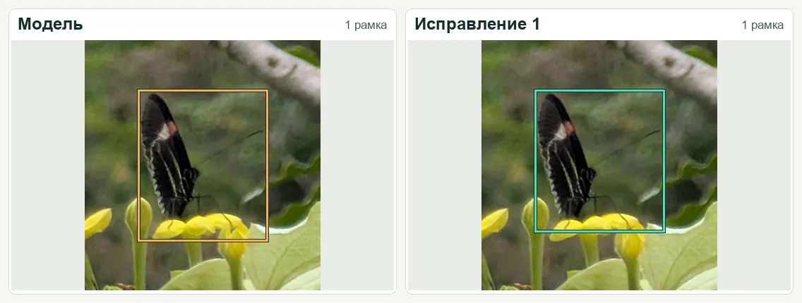

| Версия | Изменение | Результат проверки |
|---|---|---|
| Модель | Исходная предразметка. | Поправить границы — 1. Пропусков нет. |
| Исправление 1 | Сдвиг сторон (пиксели) — нижний ↑36. | Принято — 1. Пропусков нет. |

### 760675347

Голоса фильтрации — 3/3 за бабочку. В итоговой выгрузке — 1 рамка. [Оригинал](https://inaturalist-open-data.s3.amazonaws.com/photos/760675347/original.jpg)

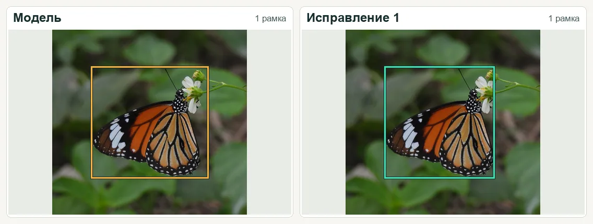

| Версия | Изменение | Результат проверки |
|---|---|---|
| Модель | Исходная предразметка. | Поправить границы — 1. Пропусков нет. |
| Исправление 1 | Сдвиг сторон (пиксели) — правый ←41. | Принято — 1. Пропусков нет. |

### 760675781

Голоса фильтрации — 3/3 за бабочку. В итоговой выгрузке — 1 рамка. [Оригинал](https://inaturalist-open-data.s3.amazonaws.com/photos/760675781/original.jpg)

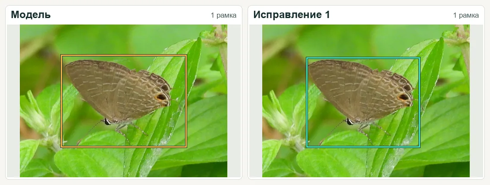

| Версия | Изменение | Результат проверки |
|---|---|---|
| Модель | Исходная предразметка. | Поправить границы — 1. Пропусков нет. |
| Исправление 1 | Сдвиг сторон (пиксели) — левый край →17, верхний ↓13, правый ←46. | Принято — 1. Пропусков нет. |

### 760795504

Голоса фильтрации — 3/3 за бабочку. В итоговой выгрузке — 1 рамка. [Оригинал](https://inaturalist-open-data.s3.amazonaws.com/photos/760795504/original.jpg)

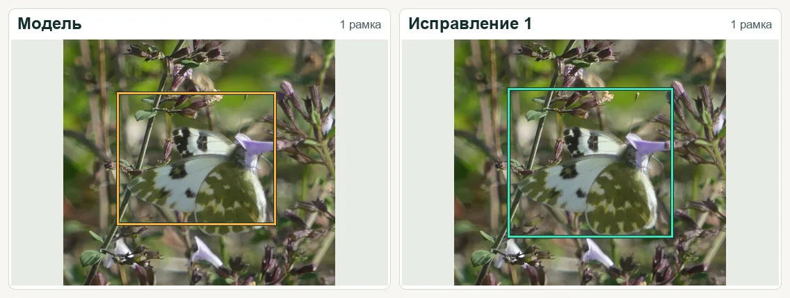

| Версия | Изменение | Результат проверки |
|---|---|---|
| Модель | Исходная предразметка. | Поправить границы — 1. Пропусков нет. |
| Исправление 1 | Сдвиг сторон (пиксели) — верхний ↑15, правый →22, нижний ↓43. | Принято — 1. Пропусков нет. Для решения по границам понадобился третий голос. |

### 760828115

Голоса фильтрации — 3/3 за бабочку. В итоговой выгрузке — 6 рамок. [Оригинал](https://inaturalist-open-data.s3.amazonaws.com/photos/760828115/original.jpg)

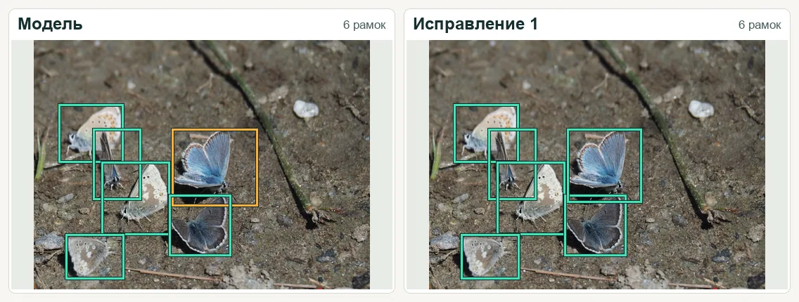

| Версия | Изменение | Результат проверки |
|---|---|---|
| Модель | Исходная предразметка. | Принято — 5, поправить границы — 1. Пропусков нет. Для решения по границам понадобился третий голос. |
| Исправление 1 | Было 6, стало 6. Прежние координаты у 5 из 6 рамок. | Рамок из прошлых версий — 5, принято — 1. Пропусков нет. |

### 760828171

Голоса фильтрации — 3/3 за бабочку. В итоговой выгрузке — 1 рамка. [Оригинал](https://inaturalist-open-data.s3.amazonaws.com/photos/760828171/original.jpg)

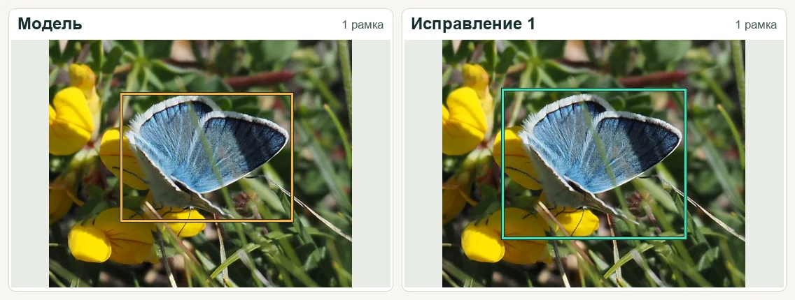

| Версия | Изменение | Результат проверки |
|---|---|---|
| Модель | Исходная предразметка. | Поправить границы — 1. Пропусков нет. Для решения по границам понадобился третий голос. |
| Исправление 1 | Сдвиг сторон (пиксели) — левый край ←44, верхний ↑16, нижний ↓69. | Принято — 1. Пропусков нет. |

### 760845284

Голоса фильтрации — 3/3 за бабочку. В итоговой выгрузке — 1 рамка. [Оригинал](https://inaturalist-open-data.s3.amazonaws.com/photos/760845284/original.jpg)

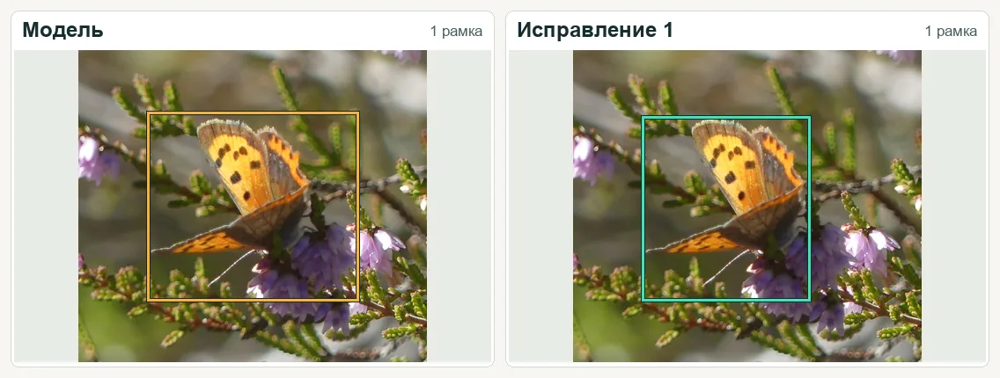

| Версия | Изменение | Результат проверки |
|---|---|---|
| Модель | Исходная предразметка. | Поправить границы — 1. Пропусков нет. |
| Исправление 1 | Сдвиг сторон (пиксели) — верхний ↓10, правый ←99. | Принято — 1. Пропусков нет. |

### 760845363

Голоса фильтрации — 3/3 за бабочку. В итоговой выгрузке — 1 рамка. [Оригинал](https://inaturalist-open-data.s3.amazonaws.com/photos/760845363/original.jpg)

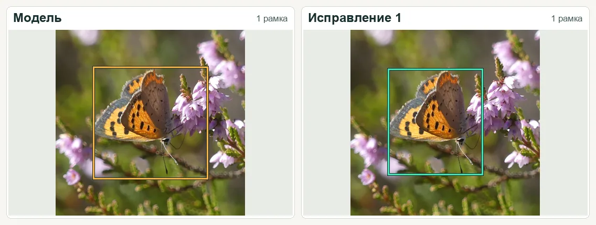

| Версия | Изменение | Результат проверки |
|---|---|---|
| Модель | Исходная предразметка. | Поправить границы — 1. Пропусков нет. |
| Исправление 1 | Сдвиг сторон (пиксели) — верхний ↓12, правый ←131, нижний ↑28. | Принято — 1. Пропусков нет. |

### 760849218

Голоса фильтрации — 3/3 за бабочку. В итоговой выгрузке — 1 рамка. [Оригинал](https://inaturalist-open-data.s3.amazonaws.com/photos/760849218/original.jpg)

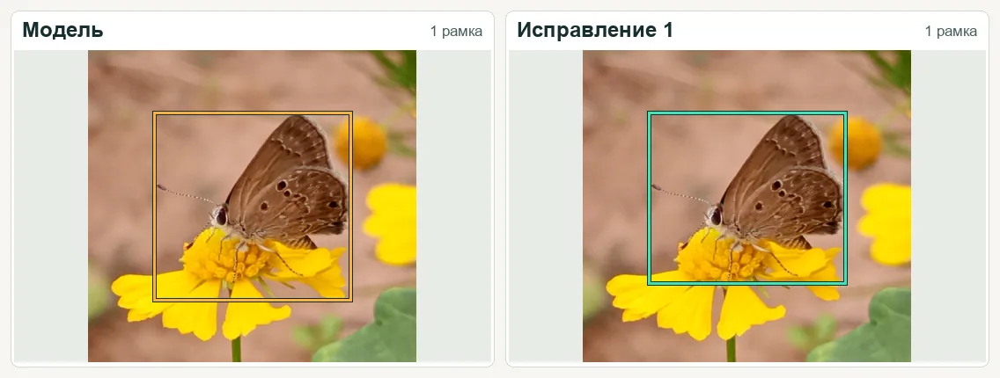

| Версия | Изменение | Результат проверки |
|---|---|---|
| Модель | Исходная предразметка. | Поправить границы — 1. Пропусков нет. |
| Исправление 1 | Сдвиг сторон (пиксели) — нижний ↑68. | Принято — 1. Пропусков нет. |

[К группам и поиску по ID](README.md) · [Следующая страница](geometry-2.md)
