# Одно исправление · изменены границы

[Вся галерея](README.md) · Страницы [1](geometry-1.md) · **2** · [3](geometry-3.md) · [4](geometry-4.md)

Версии расположены по порядку слева направо, затем сверху вниз. Кадрирование одинаково для всех версий одного фото. Оранжевым отмечены рамки, отправленные на исправление, бирюзовым — принятые, включая принятые ранее.

[760853346](#760853346) · [760937232](#760937232) · [760965375](#760965375) · [760971804](#760971804) · [760980351](#760980351) · [760998299](#760998299) · [761003491](#761003491) · [761004126](#761004126) · [761005674](#761005674) · [761031680](#761031680) · [761036956](#761036956) · [761037191](#761037191)

### 760853346

Голоса фильтрации — 3/3 за бабочку. В итоговой выгрузке — 1 рамка. [Оригинал](https://inaturalist-open-data.s3.amazonaws.com/photos/760853346/original.jpg)

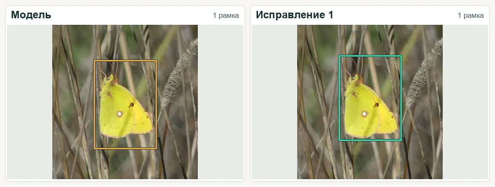

| Версия | Изменение | Результат проверки |
|---|---|---|
| Модель | Исходная предразметка. | Поправить границы — 1. Пропусков нет. |
| Исправление 1 | Сдвиг сторон (пиксели) — верхний ↑21, нижний ↑36. | Принято — 1. Пропусков нет. |

### 760937232

Голоса фильтрации — 2/3 за бабочку. В итоговой выгрузке — 1 рамка. [Оригинал](https://inaturalist-open-data.s3.amazonaws.com/photos/760937232/original.jpg)

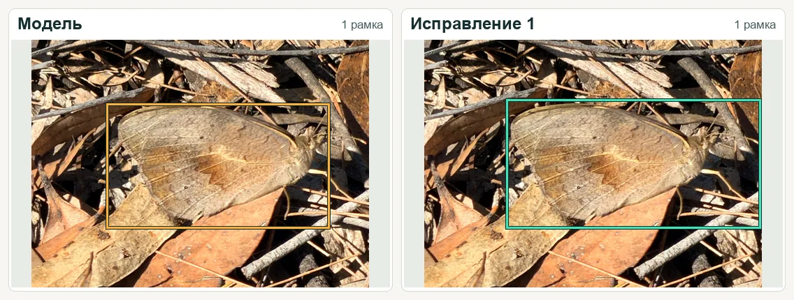

| Версия | Изменение | Результат проверки |
|---|---|---|
| Модель | Исходная предразметка. | Поправить границы — 1. Пропусков нет. Для решения по границам понадобился третий голос. |
| Исправление 1 | Сдвиг сторон (пиксели) — левый край →30, верхний ↑18, правый →172. | Принято — 1. Пропусков нет. |

### 760965375

Голоса фильтрации — 3/3 за бабочку. В итоговой выгрузке — 1 рамка. [Оригинал](https://inaturalist-open-data.s3.amazonaws.com/photos/760965375/original.jpg)

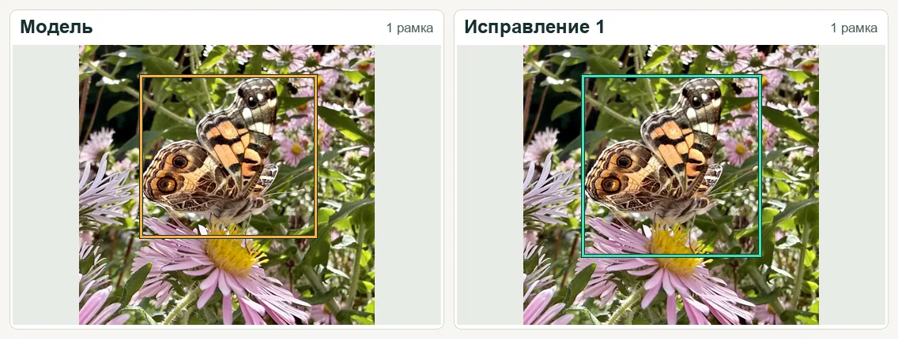

| Версия | Изменение | Результат проверки |
|---|---|---|
| Модель | Исходная предразметка. | Поправить границы — 1. Пропусков нет. Для решения по границам понадобился третий голос. |
| Исправление 1 | Сдвиг сторон (пиксели) — левый край ←14, нижний ↓106. | Принято — 1. Пропусков нет. |

### 760971804

Голоса фильтрации — 3/3 за бабочку. В итоговой выгрузке — 1 рамка. [Оригинал](https://inaturalist-open-data.s3.amazonaws.com/photos/760971804/original.jpg)

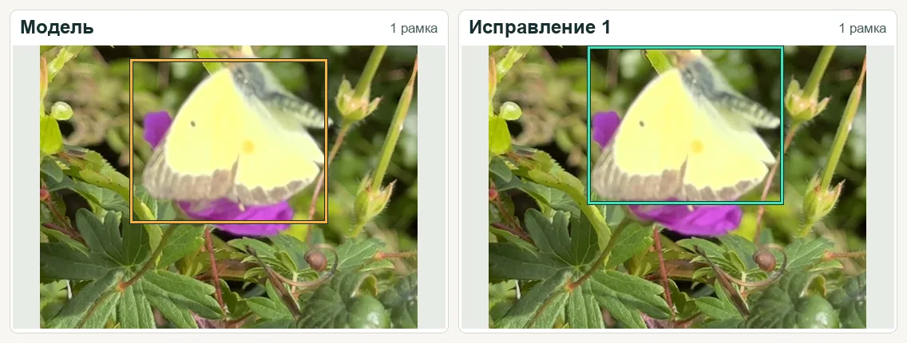

| Версия | Изменение | Результат проверки |
|---|---|---|
| Модель | Исходная предразметка. | Поправить границы — 1. Пропусков нет. |
| Исправление 1 | Сдвиг сторон (пиксели) — левый край →48, верхний ↑68, правый →39, нижний ↑103. | Принято — 1. Пропусков нет. |

### 760980351

Голоса фильтрации — 2/3 за бабочку. В итоговой выгрузке — 1 рамка. [Оригинал](https://inaturalist-open-data.s3.amazonaws.com/photos/760980351/original.jpg)

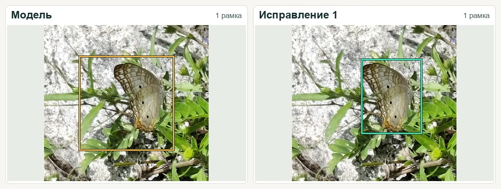

| Версия | Изменение | Результат проверки |
|---|---|---|
| Модель | Исходная предразметка. | Поправить границы — 1. Пропусков нет. |
| Исправление 1 | Сдвиг сторон (пиксели) — левый край →121, верхний ↓11, нижний ↑58. | Принято — 1. Пропусков нет. |

### 760998299

Голоса фильтрации — 3/3 за бабочку. В итоговой выгрузке — 1 рамка. [Оригинал](https://inaturalist-open-data.s3.amazonaws.com/photos/760998299/original.jpg)

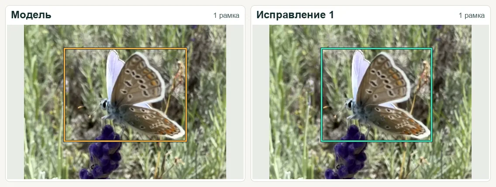

| Версия | Изменение | Результат проверки |
|---|---|---|
| Модель | Исходная предразметка. | Поправить границы — 1. Пропусков нет. Для решения по границам понадобился третий голос. |
| Исправление 1 | Сдвиг сторон (пиксели) — левый край →92. | Принято — 1. Пропусков нет. |

### 761003491

Голоса фильтрации — 3/3 за бабочку. В итоговой выгрузке — 1 рамка. [Оригинал](https://inaturalist-open-data.s3.amazonaws.com/photos/761003491/original.jpg)

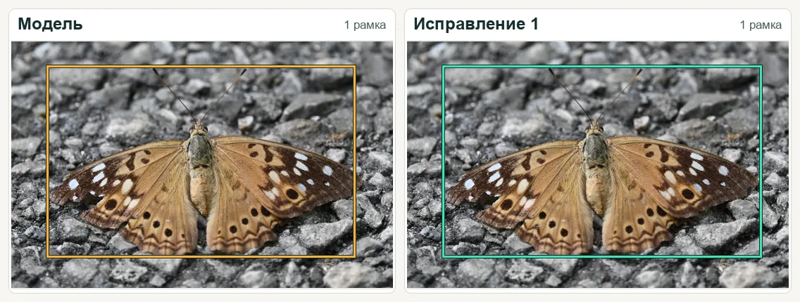

| Версия | Изменение | Результат проверки |
|---|---|---|
| Модель | Исходная предразметка. | Поправить границы — 1. Пропусков нет. Для решения по границам понадобился третий голос. |
| Исправление 1 | Сдвиг сторон (пиксели) — правый →56. | Принято — 1. Пропусков нет. |

### 761004126

Голоса фильтрации — 3/3 за бабочку. В итоговой выгрузке — 1 рамка. [Оригинал](https://inaturalist-open-data.s3.amazonaws.com/photos/761004126/original.jpg)

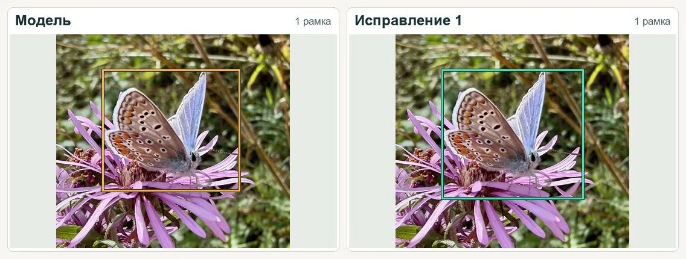

| Версия | Изменение | Результат проверки |
|---|---|---|
| Модель | Исходная предразметка. | Поправить границы — 1. Пропусков нет. Для решения по границам понадобился третий голос. |
| Исправление 1 | Сдвиг сторон (пиксели) — правый →27, нижний ↓54. | Принято — 1. Пропусков нет. |

### 761005674

Голоса фильтрации — 3/3 за бабочку. В итоговой выгрузке — 1 рамка. [Оригинал](https://inaturalist-open-data.s3.amazonaws.com/photos/761005674/original.jpg)

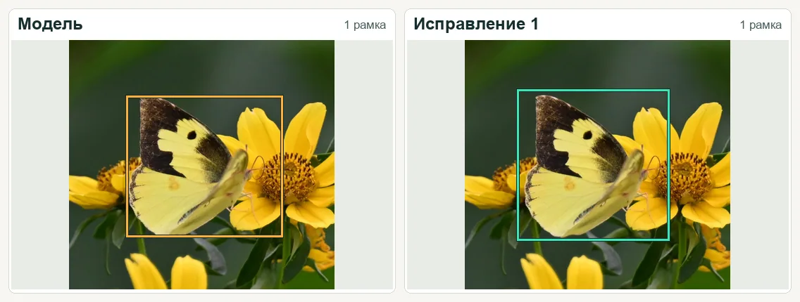

| Версия | Изменение | Результат проверки |
|---|---|---|
| Модель | Исходная предразметка. | Поправить границы — 1. Пропусков нет. Для решения по границам понадобился третий голос. |
| Исправление 1 | Сдвиг сторон (пиксели) — левый край ←18, верхний ↑26, правый ←36, нижний ↓14. | Принято — 1. Пропусков нет. |

### 761031680

Голоса фильтрации — 3/3 за бабочку. В итоговой выгрузке — 6 рамок. [Оригинал](https://inaturalist-open-data.s3.amazonaws.com/photos/761031680/original.jpg)

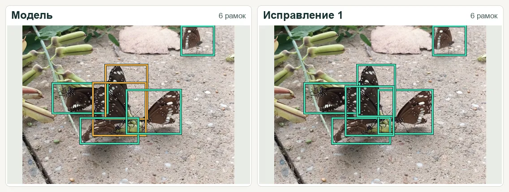

| Версия | Изменение | Результат проверки |
|---|---|---|
| Модель | Исходная предразметка. | Принято — 4, поправить границы — 2. Пропусков нет. Для решения по границам понадобился третий голос. |
| Исправление 1 | Было 6, стало 6. Прежние координаты у 4 из 6 рамок. | Рамок из прошлых версий — 4, принято — 2. Пропусков нет. |

### 761036956

Голоса фильтрации — 3/3 за бабочку. В итоговой выгрузке — 1 рамка. [Оригинал](https://inaturalist-open-data.s3.amazonaws.com/photos/761036956/original.jpg)

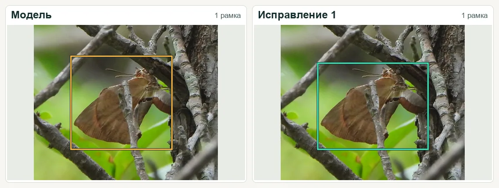

| Версия | Изменение | Результат проверки |
|---|---|---|
| Модель | Исходная предразметка. | Поправить границы — 1. Пропусков нет. |
| Исправление 1 | Сдвиг сторон (пиксели) — верхний ↓27, правый →35. | Принято — 1. Пропусков нет. |

### 761037191

Голоса фильтрации — 3/3 за бабочку. В итоговой выгрузке — 1 рамка. [Оригинал](https://inaturalist-open-data.s3.amazonaws.com/photos/761037191/original.jpg)

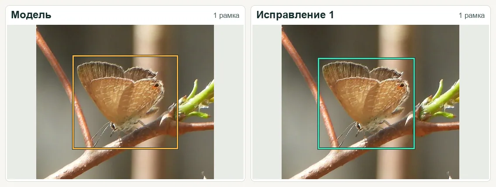

| Версия | Изменение | Результат проверки |
|---|---|---|
| Модель | Исходная предразметка. | Поправить границы — 1. Пропусков нет. |
| Исправление 1 | Сдвиг сторон (пиксели) — верхний ↓8, правый ←29. | Принято — 1. Пропусков нет. |

[К группам и поиску по ID](README.md) · [Следующая страница](geometry-3.md)
