# Одно исправление · изменены границы

[Вся галерея](README.md) · Страницы [1](geometry-1.md) · [2](geometry-2.md) · **3** · [4](geometry-4.md)

Версии расположены по порядку слева направо, затем сверху вниз. Кадрирование одинаково для всех версий одного фото. Оранжевым отмечены рамки, отправленные на исправление, бирюзовым — принятые, включая принятые ранее.

[761075853](#761075853) · [761134956](#761134956) · [761135011](#761135011) · [761135033](#761135033) · [761135063](#761135063) · [761145791](#761145791) · [761148032](#761148032) · [761151593](#761151593) · [761158481](#761158481) · [761158531](#761158531) · [761167692](#761167692) · [761167732](#761167732)

### 761075853

Голоса фильтрации — 3/3 за бабочку. В итоговой выгрузке — 1 рамка. [Оригинал](https://inaturalist-open-data.s3.amazonaws.com/photos/761075853/original.jpg)

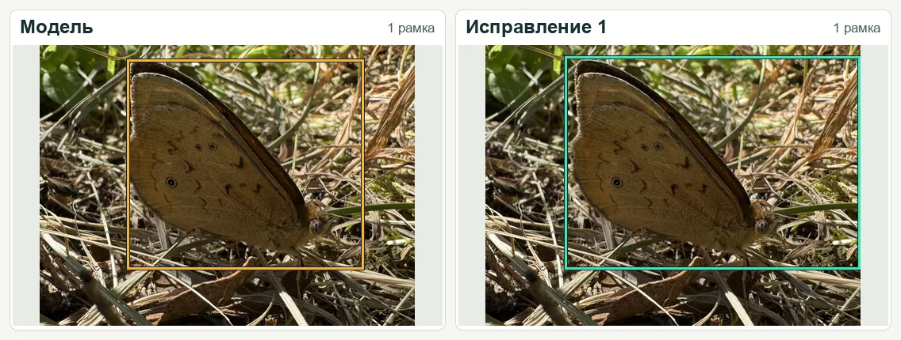

| Версия | Изменение | Результат проверки |
|---|---|---|
| Модель | Исходная предразметка. | Поправить границы — 1. Пропусков нет. Для решения по границам понадобился третий голос. |
| Исправление 1 | Сдвиг сторон (пиксели) — левый край ←46, верхний ↑18, правый →278. | Принято — 1. Пропусков нет. |

### 761134956

Голоса фильтрации — 3/3 за бабочку. В итоговой выгрузке — 1 рамка. [Оригинал](https://inaturalist-open-data.s3.amazonaws.com/photos/761134956/original.jpg)

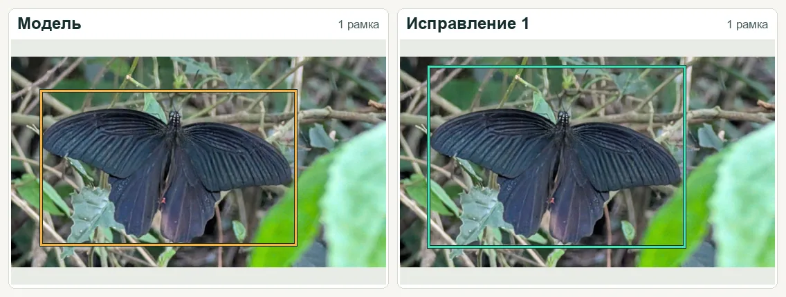

| Версия | Изменение | Результат проверки |
|---|---|---|
| Модель | Исходная предразметка. | Поправить границы — 1. Пропусков нет. Для решения по границам понадобился третий голос. |
| Исправление 1 | Сдвиг сторон (пиксели) — левый край ←8, верхний ↑133, нижний ↓12. | Принято — 1. Пропусков нет. |

### 761135011

Голоса фильтрации — 3/3 за бабочку. В итоговой выгрузке — 1 рамка. [Оригинал](https://inaturalist-open-data.s3.amazonaws.com/photos/761135011/original.jpg)

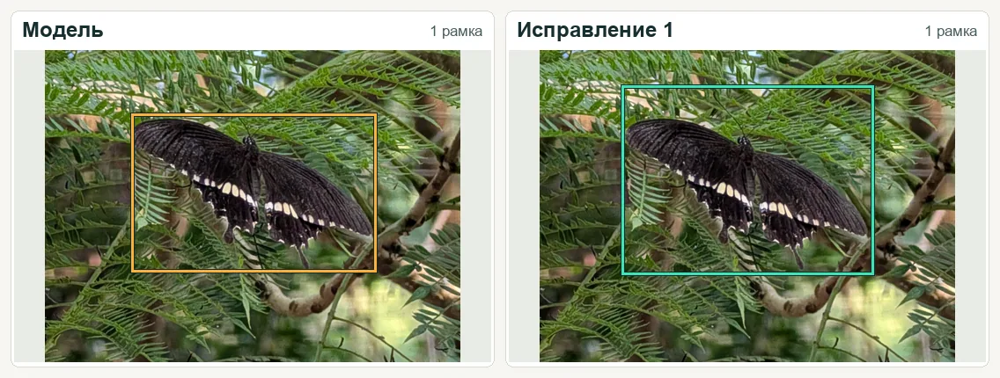

| Версия | Изменение | Результат проверки |
|---|---|---|
| Модель | Исходная предразметка. | Поправить границы — 1. Пропусков нет. Для решения по границам понадобился третий голос. |
| Исправление 1 | Сдвиг сторон (пиксели) — левый край ←15, верхний ↑103, правый →10, нижний ↓8. | Принято — 1. Пропусков нет. |

### 761135033

Голоса фильтрации — 1/3 за бабочку. В итоговой выгрузке — 2 рамки. [Оригинал](https://inaturalist-open-data.s3.amazonaws.com/photos/761135033/original.jpg)

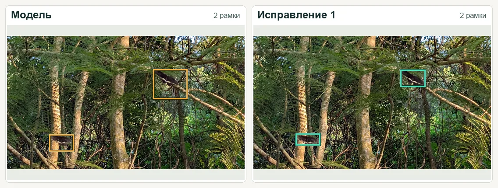

| Версия | Изменение | Результат проверки |
|---|---|---|
| Модель | Исходная предразметка. | Поправить границы — 2. Пропусков нет. |
| Исправление 1 | Было 2, стало 2. Прежние координаты у 0 из 2 рамок. | Принято — 2. Пропусков нет. |

### 761135063

Голоса фильтрации — 3/3 за бабочку. В итоговой выгрузке — 1 рамка. [Оригинал](https://inaturalist-open-data.s3.amazonaws.com/photos/761135063/original.jpg)

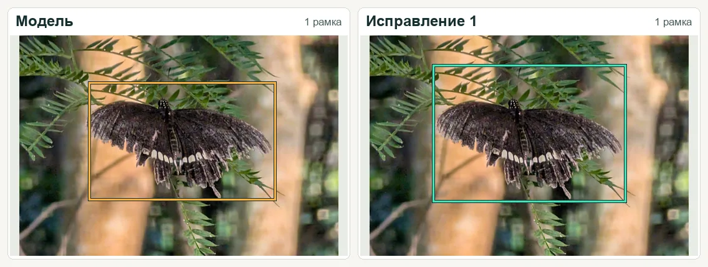

| Версия | Изменение | Результат проверки |
|---|---|---|
| Модель | Исходная предразметка. | Поправить границы — 1. Пропусков нет. Для решения по границам понадобился третий голос. |
| Исправление 1 | Сдвиг сторон (пиксели) — левый край ←34, верхний ↑90, нижний ↓10. | Принято — 1. Пропусков нет. |

### 761145791

Голоса фильтрации — 2/3 за бабочку. В итоговой выгрузке — 1 рамка. [Оригинал](https://inaturalist-open-data.s3.amazonaws.com/photos/761145791/original.jpg)

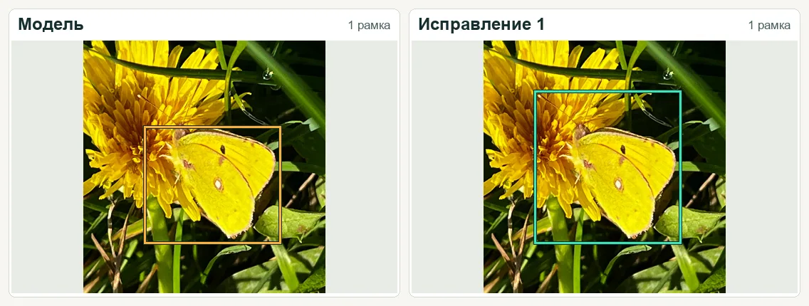

| Версия | Изменение | Результат проверки |
|---|---|---|
| Модель | Исходная предразметка. | Поправить границы — 1. Пропусков нет. Для решения по границам понадобился третий голос. |
| Исправление 1 | Сдвиг сторон (пиксели) — левый край ←55, верхний ↑189. | Принято — 1. Пропусков нет. |

### 761148032

Голоса фильтрации — 3/3 за бабочку. В итоговой выгрузке — 1 рамка. [Оригинал](https://inaturalist-open-data.s3.amazonaws.com/photos/761148032/original.jpg)

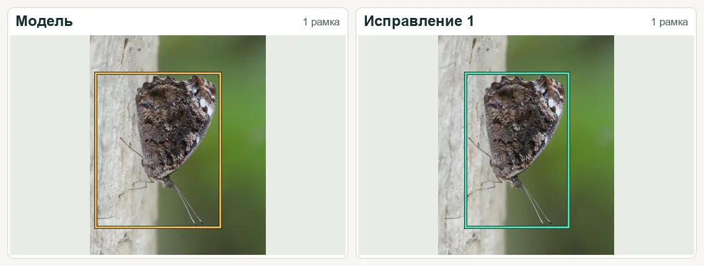

| Версия | Изменение | Результат проверки |
|---|---|---|
| Модель | Исходная предразметка. | Поправить границы — 1. Пропусков нет. Для решения по границам понадобился третий голос. |
| Исправление 1 | Сдвиг сторон (пиксели) — левый край →197. | Принято — 1. Пропусков нет. |

### 761151593

Голоса фильтрации — 3/3 за бабочку. В итоговой выгрузке — 1 рамка. [Оригинал](https://inaturalist-open-data.s3.amazonaws.com/photos/761151593/original.jpg)

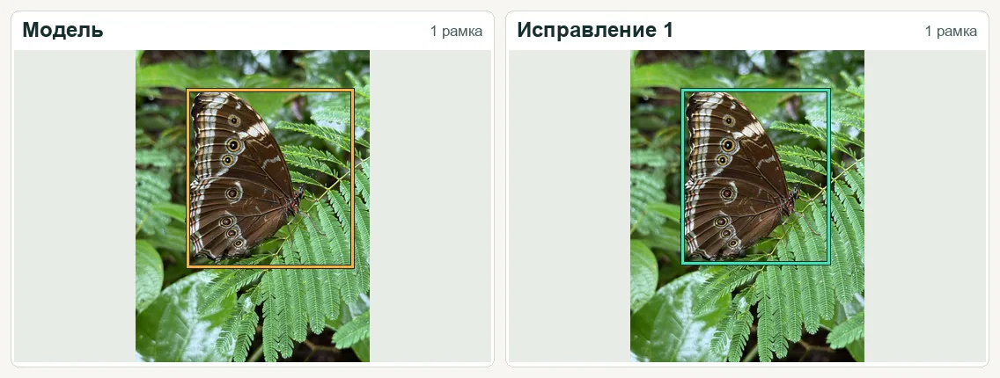

| Версия | Изменение | Результат проверки |
|---|---|---|
| Модель | Исходная предразметка. | Поправить границы — 1. Пропусков нет. |
| Исправление 1 | Сдвиг сторон (пиксели) — правый ←124, нижний ↑28. | Принято — 1. Пропусков нет. |

### 761158481

Голоса фильтрации — 3/3 за бабочку. В итоговой выгрузке — 1 рамка. [Оригинал](https://inaturalist-open-data.s3.amazonaws.com/photos/761158481/original.jpg)

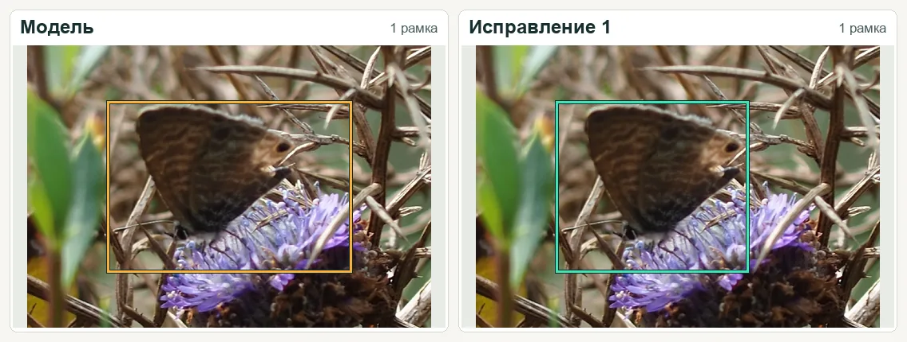

| Версия | Изменение | Результат проверки |
|---|---|---|
| Модель | Исходная предразметка. | Поправить границы — 1. Пропусков нет. |
| Исправление 1 | Сдвиг сторон (пиксели) — правый ←113. | Принято — 1. Пропусков нет. |

### 761158531

Голоса фильтрации — 3/3 за бабочку. В итоговой выгрузке — 1 рамка. [Оригинал](https://inaturalist-open-data.s3.amazonaws.com/photos/761158531/original.jpg)

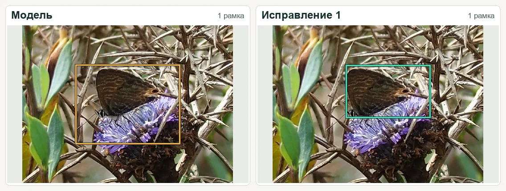

| Версия | Изменение | Результат проверки |
|---|---|---|
| Модель | Исходная предразметка. | Поправить границы — 1. Пропусков нет. |
| Исправление 1 | Сдвиг сторон (пиксели) — левый край →55, верхний ↓1, нижний ↑71. | Принято — 1. Пропусков нет. |

### 761167692

Голоса фильтрации — 3/3 за бабочку. В итоговой выгрузке — 1 рамка. [Оригинал](https://inaturalist-open-data.s3.amazonaws.com/photos/761167692/original.jpg)

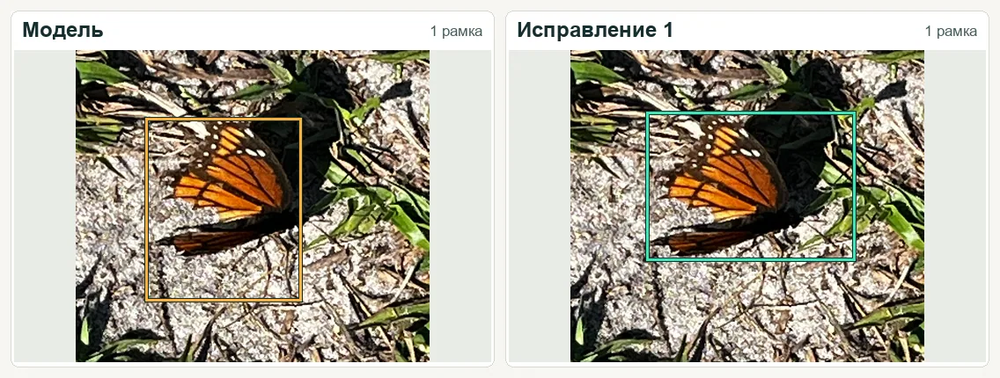

| Версия | Изменение | Результат проверки |
|---|---|---|
| Модель | Исходная предразметка. | Поправить границы — 1. Пропусков нет. |
| Исправление 1 | Сдвиг сторон (пиксели) — левый край →15, верхний ↑15, правый →144, нижний ↑100. | Принято — 1. Пропусков нет. |

### 761167732

Голоса фильтрации — 2/3 за бабочку. В итоговой выгрузке — 1 рамка. [Оригинал](https://inaturalist-open-data.s3.amazonaws.com/photos/761167732/original.jpg)

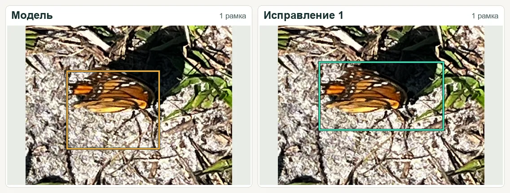

| Версия | Изменение | Результат проверки |
|---|---|---|
| Модель | Исходная предразметка. | Поправить границы — 1. Пропусков нет. |
| Исправление 1 | Сдвиг сторон (пиксели) — верхний ↑33, правый →115, нижний ↑68. | Принято — 1. Пропусков нет. |

[К группам и поиску по ID](README.md) · [Следующая страница](geometry-4.md)
