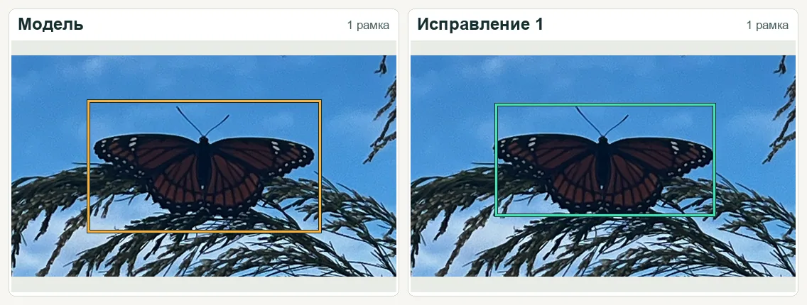
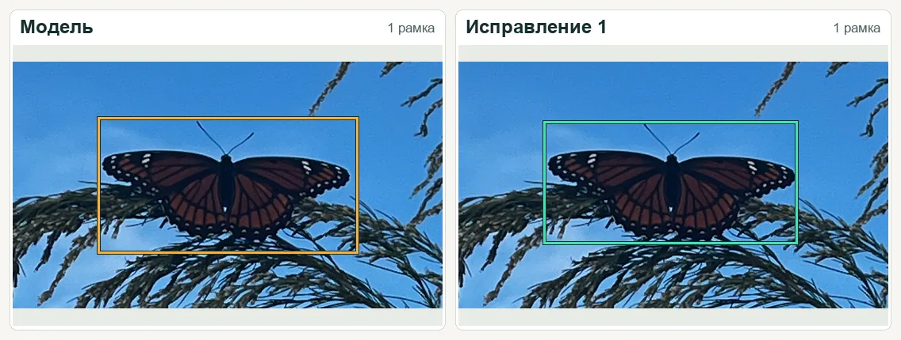
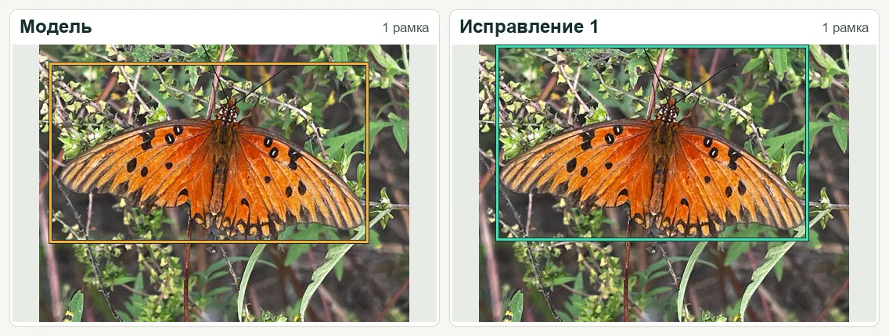
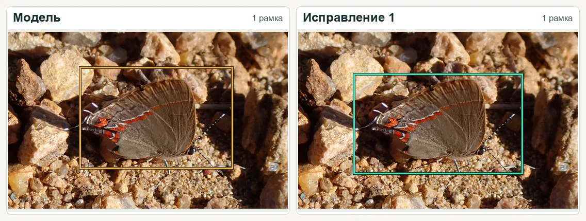
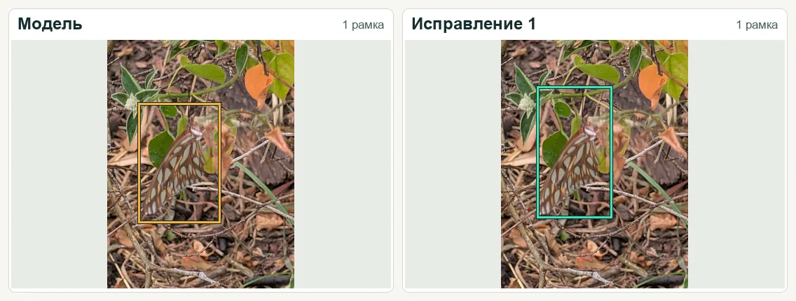
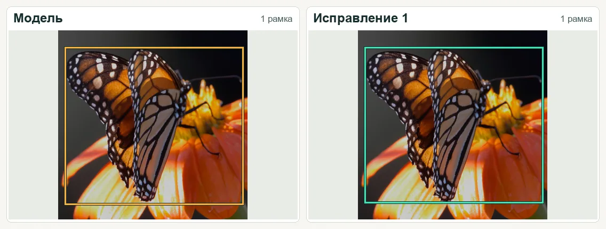

# Одно исправление · изменены границы

[Вся галерея](README.md) · Страницы [1](geometry-1.md) · [2](geometry-2.md) · [3](geometry-3.md) · **4**

Версии расположены по порядку слева направо, затем сверху вниз. Кадрирование одинаково для всех версий одного фото. Оранжевым отмечены рамки, отправленные на исправление, бирюзовым — принятые, включая принятые ранее.

[761169186](#761169186) · [761169189](#761169189) · [761181108](#761181108) · [761200985](#761200985) · [761219682](#761219682) · [761262473](#761262473)

### 761169186

Голоса фильтрации — 2/3 за бабочку. В итоговой выгрузке — 1 рамка. [Оригинал](https://inaturalist-open-data.s3.amazonaws.com/photos/761169186/original.jpg)

| Версия | Изменение | Результат проверки |
|---|---|---|
| Модель | Исходная предразметка. | Поправить границы — 1. Пропусков нет. |
| Исправление 1 | Сдвиг сторон (пиксели) — левый край →28, верхний ↓12, правый ←17, нижний ↑54. | Принято — 1. Пропусков нет. |

### 761169189

Голоса фильтрации — 3/3 за бабочку. В итоговой выгрузке — 1 рамка. [Оригинал](https://inaturalist-open-data.s3.amazonaws.com/photos/761169189/original.jpg)

| Версия | Изменение | Результат проверки |
|---|---|---|
| Модель | Исходная предразметка. | Поправить границы — 1. Пропусков нет. |
| Исправление 1 | Сдвиг сторон (пиксели) — верхний ↓10, правый ←20, нижний ↑28. | Принято — 1. Пропусков нет. |

### 761181108

Голоса фильтрации — 3/3 за бабочку. В итоговой выгрузке — 1 рамка. [Оригинал](https://inaturalist-open-data.s3.amazonaws.com/photos/761181108/original.jpg)

| Версия | Изменение | Результат проверки |
|---|---|---|
| Модель | Исходная предразметка. | Поправить границы — 1. Пропусков нет. |
| Исправление 1 | Сдвиг сторон (пиксели) — левый край →39, верхний ↑95, нижний ↑15. | Принято — 1. Пропусков нет. |

### 761200985

Голоса фильтрации — 3/3 за бабочку. В итоговой выгрузке — 1 рамка. [Оригинал](https://inaturalist-open-data.s3.amazonaws.com/photos/761200985/original.jpg)

| Версия | Изменение | Результат проверки |
|---|---|---|
| Модель | Исходная предразметка. | Поправить границы — 1. Пропусков нет. |
| Исправление 1 | Сдвиг сторон (пиксели) — левый край ←64, верхний ↓27, нижний ↓20. | Принято — 1. Пропусков нет. |

### 761219682

Голоса фильтрации — 3/3 за бабочку. В итоговой выгрузке — 1 рамка. [Оригинал](https://inaturalist-open-data.s3.amazonaws.com/photos/761219682/original.jpg)

| Версия | Изменение | Результат проверки |
|---|---|---|
| Модель | Исходная предразметка. | Поправить границы — 1. Пропусков нет. |
| Исправление 1 | Сдвиг сторон (пиксели) — левый край →37, верхний ↑140, правый ←19, нижний ↑40. | Принято — 1. Пропусков нет. |

### 761262473

Голоса фильтрации — 3/3 за бабочку. В итоговой выгрузке — 1 рамка. [Оригинал](https://inaturalist-open-data.s3.amazonaws.com/photos/761262473/original.jpg)

| Версия | Изменение | Результат проверки |
|---|---|---|
| Модель | Исходная предразметка. | Поправить границы — 1. Пропусков нет. |
| Исправление 1 | Сдвиг сторон (пиксели) — нижний ↑17. | Принято — 1. Пропусков нет. |

[К группам и поиску по ID](README.md)
