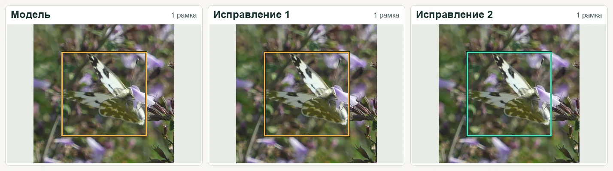
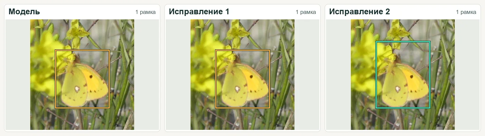
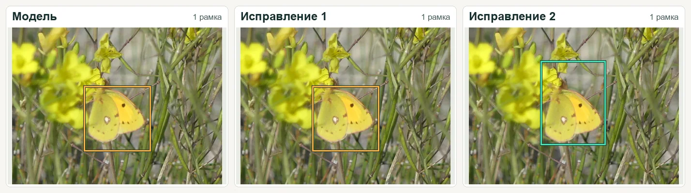
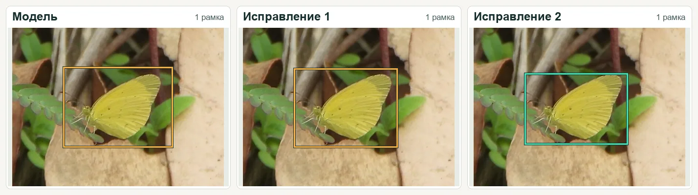
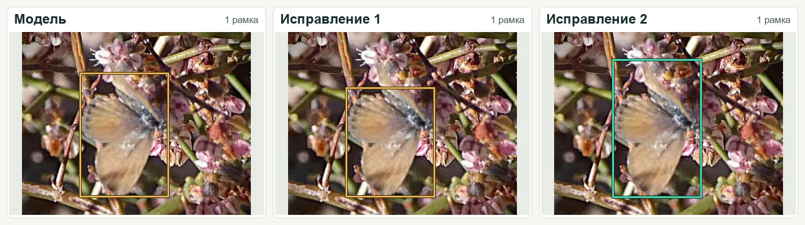

# Два исправления · повторная проверка границ

[Вся галерея](README.md)

Версии расположены по порядку слева направо, затем сверху вниз. Кадрирование одинаково для всех версий одного фото. Оранжевым отмечены рамки, отправленные на исправление, бирюзовым — принятые, включая принятые ранее.

[760795560](#760795560) · [760796846](#760796846) · [760796882](#760796882) · [761036757](#761036757) · [761234404](#761234404)

### 760795560

Голоса фильтрации — 3/3 за бабочку. В итоговой выгрузке — 1 рамка. [Оригинал](https://inaturalist-open-data.s3.amazonaws.com/photos/760795560/original.jpg)

| Версия | Изменение | Результат проверки |
|---|---|---|
| Модель | Исходная предразметка. | Поправить границы — 1. Пропусков нет. Для решения по границам понадобился третий голос. |
| Исправление 1 | Координаты остались прежними. | Поправить границы — 1. Пропусков нет. Сохранён один голос. Версию вернул на исправление заказчик. |
| Исправление 2 | Сдвиг сторон (пиксели) — правый ←4. | Принято — 1. Пропусков нет. Для решения по границам понадобился третий голос. |

### 760796846

Голоса фильтрации — 3/3 за бабочку. В итоговой выгрузке — 1 рамка. [Оригинал](https://inaturalist-open-data.s3.amazonaws.com/photos/760796846/original.jpg)

| Версия | Изменение | Результат проверки |
|---|---|---|
| Модель | Исходная предразметка. | Поправить границы — 1. Пропусков нет. Для решения по границам понадобился третий голос. |
| Исправление 1 | Координаты остались прежними. | Поправить границы — 1. Пропусков нет. Сохранён один голос. Версию вернул на исправление заказчик. |
| Исправление 2 | Сдвиг сторон (пиксели) — верхний ↑53. | Принято — 1. Пропусков нет. |

### 760796882

Голоса фильтрации — 2/3 за бабочку. В итоговой выгрузке — 1 рамка. [Оригинал](https://inaturalist-open-data.s3.amazonaws.com/photos/760796882/original.jpg)

| Версия | Изменение | Результат проверки |
|---|---|---|
| Модель | Исходная предразметка. | Поправить границы — 1. Пропусков нет. |
| Исправление 1 | Координаты остались прежними. | Поправить границы — 1. Пропусков нет. Сохранён один голос. Версию вернул на исправление заказчик. |
| Исправление 2 | Сдвиг сторон (пиксели) — верхний ↑68, правый ←4, нижний ↑17. | Принято — 1. Пропусков нет. |

### 761036757

Голоса фильтрации — 2/3 за бабочку. В итоговой выгрузке — 1 рамка. [Оригинал](https://inaturalist-open-data.s3.amazonaws.com/photos/761036757/original.jpg)

| Версия | Изменение | Результат проверки |
|---|---|---|
| Модель | Исходная предразметка. | Поправить границы — 1. Пропусков нет. |
| Исправление 1 | Сдвиг сторон (пиксели) — верхний ↓5, правый ←17. | Поправить границы — 1. Пропусков нет. Для решения по границам понадобился третий голос. |
| Исправление 2 | Сдвиг сторон (пиксели) — верхний ↓13, правый ←1, нижний ↑8. | Оба валидатора отклонили границы и подтвердили полноту. Заказчик принял эту рамку как есть. |

### 761234404

Голоса фильтрации — 3/3 за бабочку. В итоговой выгрузке — 1 рамка. [Оригинал](https://inaturalist-open-data.s3.amazonaws.com/photos/761234404/original.jpg)

| Версия | Изменение | Результат проверки |
|---|---|---|
| Модель | Исходная предразметка. | Поправить границы — 1. Пропусков нет. |
| Исправление 1 | Сдвиг сторон (пиксели) — верхний ↓48. | Поправить границы — 1. Пропусков нет. Для решения по границам понадобился третий голос. |
| Исправление 2 | Сдвиг сторон (пиксели) — левый край →3, верхний ↑92, правый →1, нижний ↓1. | Принято — 1. Пропусков нет. |

[К группам и поиску по ID](README.md)
