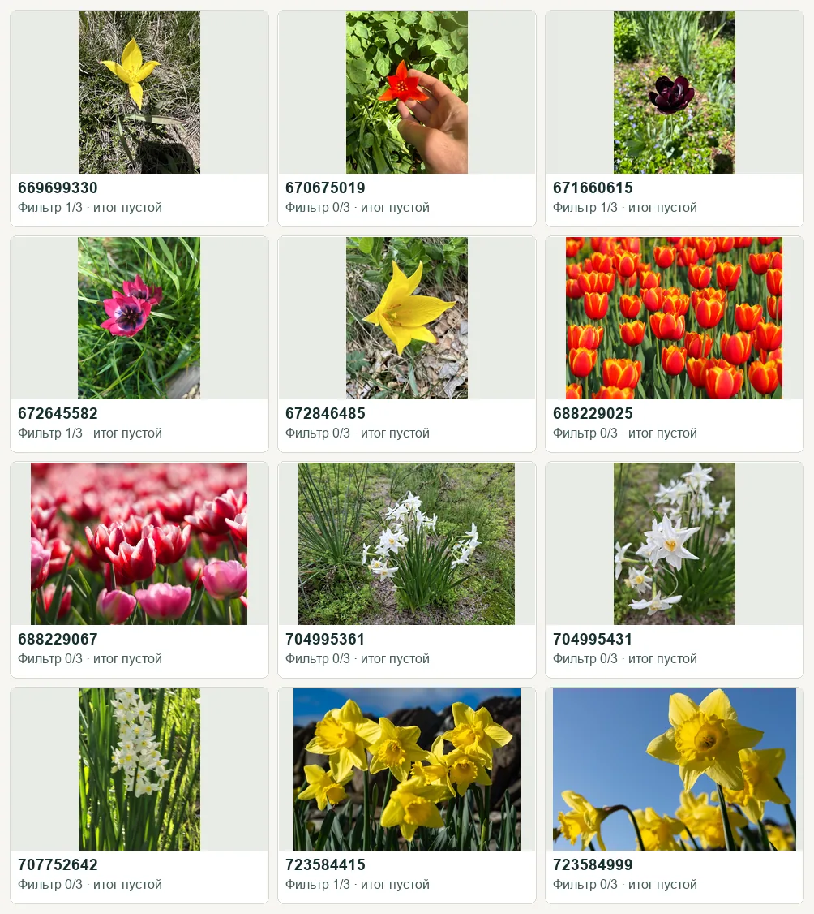
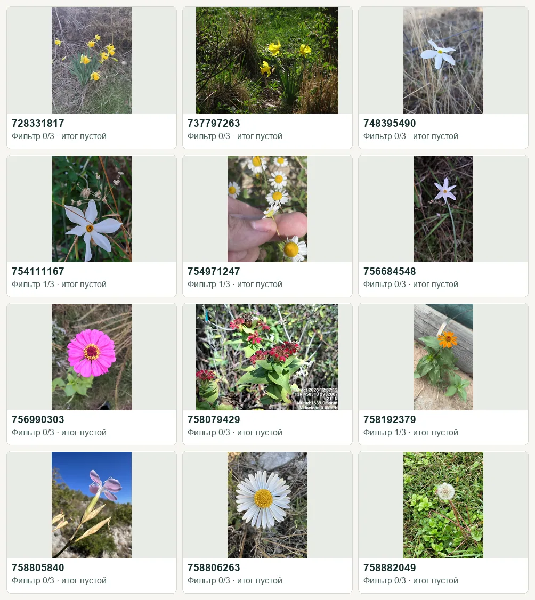

# Отсев на входе · проверка рамок не проводилась

[Вся галерея](README.md) · Страницы **1** · [2](screened-2.md) · [3](screened-3.md) · [4](screened-4.md) · [5](screened-5.md) · [6](screened-6.md) · [7](screened-7.md) · [8](screened-8.md) · [9](screened-9.md)

На каждом фото у модели 0 рамок и меньше двух голосов за бабочку. По правилу отбора фото сразу получило пустой список рамок.

### Лист 1

| Фото | Голоса фильтра «есть» | Рамок модели → итог | Проверка рамок |
|---|---:|---:|---|
| [669699330](https://inaturalist-open-data.s3.amazonaws.com/photos/669699330/original.jpg) | 1/3 | 0 → 0 | Отсев на входе |
| [670675019](https://inaturalist-open-data.s3.amazonaws.com/photos/670675019/original.jpg) | 0/3 | 0 → 0 | Отсев на входе |
| [671660615](https://inaturalist-open-data.s3.amazonaws.com/photos/671660615/original.jpg) | 1/3 | 0 → 0 | Отсев на входе |
| [672645582](https://inaturalist-open-data.s3.amazonaws.com/photos/672645582/original.jpg) | 1/3 | 0 → 0 | Отсев на входе |
| [672846485](https://inaturalist-open-data.s3.amazonaws.com/photos/672846485/original.jpg) | 0/3 | 0 → 0 | Отсев на входе |
| [688229025](https://inaturalist-open-data.s3.amazonaws.com/photos/688229025/original.jpg) | 0/3 | 0 → 0 | Отсев на входе |
| [688229067](https://inaturalist-open-data.s3.amazonaws.com/photos/688229067/original.jpg) | 0/3 | 0 → 0 | Отсев на входе |
| [704995361](https://inaturalist-open-data.s3.amazonaws.com/photos/704995361/original.jpg) | 0/3 | 0 → 0 | Отсев на входе |
| [704995431](https://inaturalist-open-data.s3.amazonaws.com/photos/704995431/original.jpg) | 0/3 | 0 → 0 | Отсев на входе |
| [707752642](https://inaturalist-open-data.s3.amazonaws.com/photos/707752642/original.jpg) | 0/3 | 0 → 0 | Отсев на входе |
| [723584415](https://inaturalist-open-data.s3.amazonaws.com/photos/723584415/original.jpg) | 1/3 | 0 → 0 | Отсев на входе |
| [723584999](https://inaturalist-open-data.s3.amazonaws.com/photos/723584999/original.jpg) | 0/3 | 0 → 0 | Отсев на входе |

### Лист 2

| Фото | Голоса фильтра «есть» | Рамок модели → итог | Проверка рамок |
|---|---:|---:|---|
| [728331817](https://inaturalist-open-data.s3.amazonaws.com/photos/728331817/original.jpg) | 0/3 | 0 → 0 | Отсев на входе |
| [737797263](https://inaturalist-open-data.s3.amazonaws.com/photos/737797263/original.jpg) | 0/3 | 0 → 0 | Отсев на входе |
| [748395490](https://inaturalist-open-data.s3.amazonaws.com/photos/748395490/original.jpg) | 0/3 | 0 → 0 | Отсев на входе |
| [754111167](https://inaturalist-open-data.s3.amazonaws.com/photos/754111167/original.jpg) | 1/3 | 0 → 0 | Отсев на входе |
| [754971247](https://inaturalist-open-data.s3.amazonaws.com/photos/754971247/original.jpg) | 1/3 | 0 → 0 | Отсев на входе |
| [756684548](https://inaturalist-open-data.s3.amazonaws.com/photos/756684548/original.jpg) | 0/3 | 0 → 0 | Отсев на входе |
| [756990303](https://inaturalist-open-data.s3.amazonaws.com/photos/756990303/original.jpg) | 0/3 | 0 → 0 | Отсев на входе |
| [758079429](https://inaturalist-open-data.s3.amazonaws.com/photos/758079429/original.jpg) | 0/3 | 0 → 0 | Отсев на входе |
| [758192379](https://inaturalist-open-data.s3.amazonaws.com/photos/758192379/original.jpg) | 1/3 | 0 → 0 | Отсев на входе |
| [758805840](https://inaturalist-open-data.s3.amazonaws.com/photos/758805840/original.jpg) | 0/3 | 0 → 0 | Отсев на входе |
| [758806263](https://inaturalist-open-data.s3.amazonaws.com/photos/758806263/original.jpg) | 0/3 | 0 → 0 | Отсев на входе |
| [758882049](https://inaturalist-open-data.s3.amazonaws.com/photos/758882049/original.jpg) | 0/3 | 0 → 0 | Отсев на входе |

[К группам и поиску по ID](README.md) · [Следующая страница](screened-2.md)
