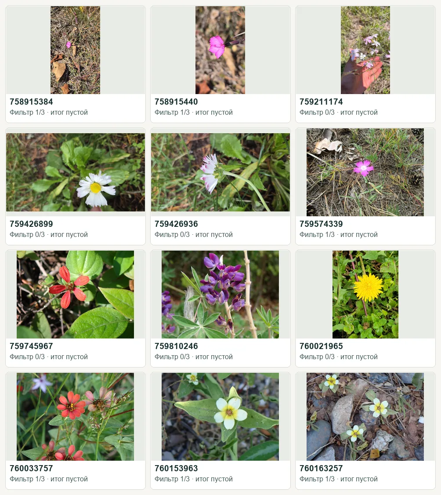
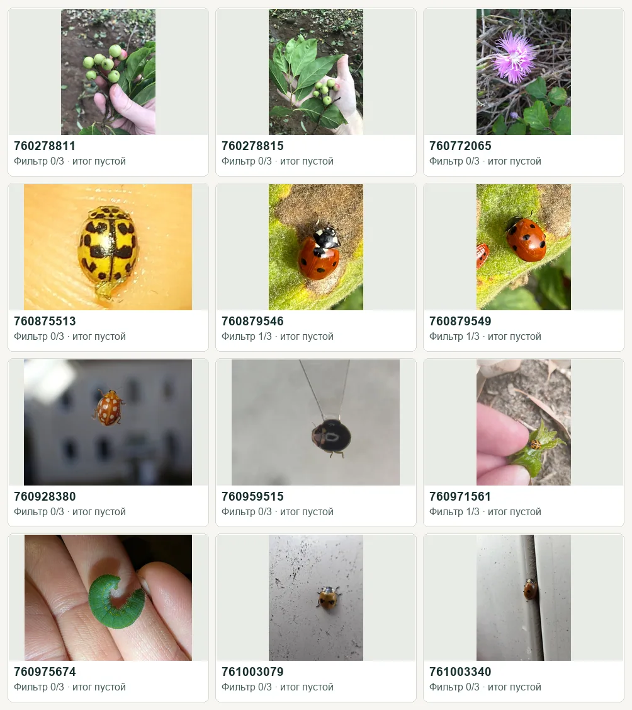

# Отсев на входе · проверка рамок не проводилась

[Вся галерея](README.md) · Страницы [1](screened-1.md) · **2** · [3](screened-3.md) · [4](screened-4.md) · [5](screened-5.md) · [6](screened-6.md) · [7](screened-7.md) · [8](screened-8.md) · [9](screened-9.md)

На каждом фото у модели 0 рамок и меньше двух голосов за бабочку. По правилу отбора фото сразу получило пустой список рамок.

### Лист 3

| Фото | Голоса фильтра «есть» | Рамок модели → итог | Проверка рамок |
|---|---:|---:|---|
| [758915384](https://inaturalist-open-data.s3.amazonaws.com/photos/758915384/original.jpg) | 1/3 | 0 → 0 | Отсев на входе |
| [758915440](https://inaturalist-open-data.s3.amazonaws.com/photos/758915440/original.jpg) | 1/3 | 0 → 0 | Отсев на входе |
| [759211174](https://inaturalist-open-data.s3.amazonaws.com/photos/759211174/original.jpg) | 0/3 | 0 → 0 | Отсев на входе |
| [759426899](https://inaturalist-open-data.s3.amazonaws.com/photos/759426899/original.jpg) | 0/3 | 0 → 0 | Отсев на входе |
| [759426936](https://inaturalist-open-data.s3.amazonaws.com/photos/759426936/original.jpg) | 0/3 | 0 → 0 | Отсев на входе |
| [759574339](https://inaturalist-open-data.s3.amazonaws.com/photos/759574339/original.jpg) | 1/3 | 0 → 0 | Отсев на входе |
| [759745967](https://inaturalist-open-data.s3.amazonaws.com/photos/759745967/original.jpg) | 0/3 | 0 → 0 | Отсев на входе |
| [759810246](https://inaturalist-open-data.s3.amazonaws.com/photos/759810246/original.jpg) | 0/3 | 0 → 0 | Отсев на входе |
| [760021965](https://inaturalist-open-data.s3.amazonaws.com/photos/760021965/original.jpg) | 0/3 | 0 → 0 | Отсев на входе |
| [760033757](https://inaturalist-open-data.s3.amazonaws.com/photos/760033757/original.jpg) | 1/3 | 0 → 0 | Отсев на входе |
| [760153963](https://inaturalist-open-data.s3.amazonaws.com/photos/760153963/original.jpg) | 1/3 | 0 → 0 | Отсев на входе |
| [760163257](https://inaturalist-open-data.s3.amazonaws.com/photos/760163257/original.jpg) | 1/3 | 0 → 0 | Отсев на входе |

### Лист 4

| Фото | Голоса фильтра «есть» | Рамок модели → итог | Проверка рамок |
|---|---:|---:|---|
| [760278811](https://inaturalist-open-data.s3.amazonaws.com/photos/760278811/original.jpg) | 0/3 | 0 → 0 | Отсев на входе |
| [760278815](https://inaturalist-open-data.s3.amazonaws.com/photos/760278815/original.jpg) | 0/3 | 0 → 0 | Отсев на входе |
| [760772065](https://inaturalist-open-data.s3.amazonaws.com/photos/760772065/original.jpg) | 0/3 | 0 → 0 | Отсев на входе |
| [760875513](https://inaturalist-open-data.s3.amazonaws.com/photos/760875513/original.jpg) | 0/3 | 0 → 0 | Отсев на входе |
| [760879546](https://inaturalist-open-data.s3.amazonaws.com/photos/760879546/original.jpg) | 1/3 | 0 → 0 | Отсев на входе |
| [760879549](https://inaturalist-open-data.s3.amazonaws.com/photos/760879549/original.jpg) | 1/3 | 0 → 0 | Отсев на входе |
| [760928380](https://inaturalist-open-data.s3.amazonaws.com/photos/760928380/original.jpg) | 0/3 | 0 → 0 | Отсев на входе |
| [760959515](https://inaturalist-open-data.s3.amazonaws.com/photos/760959515/original.jpg) | 0/3 | 0 → 0 | Отсев на входе |
| [760971561](https://inaturalist-open-data.s3.amazonaws.com/photos/760971561/original.jpg) | 1/3 | 0 → 0 | Отсев на входе |
| [760975674](https://inaturalist-open-data.s3.amazonaws.com/photos/760975674/original.jpg) | 0/3 | 0 → 0 | Отсев на входе |
| [761003079](https://inaturalist-open-data.s3.amazonaws.com/photos/761003079/original.jpg) | 0/3 | 0 → 0 | Отсев на входе |
| [761003340](https://inaturalist-open-data.s3.amazonaws.com/photos/761003340/original.jpg) | 0/3 | 0 → 0 | Отсев на входе |

[К группам и поиску по ID](README.md) · [Следующая страница](screened-3.md)
