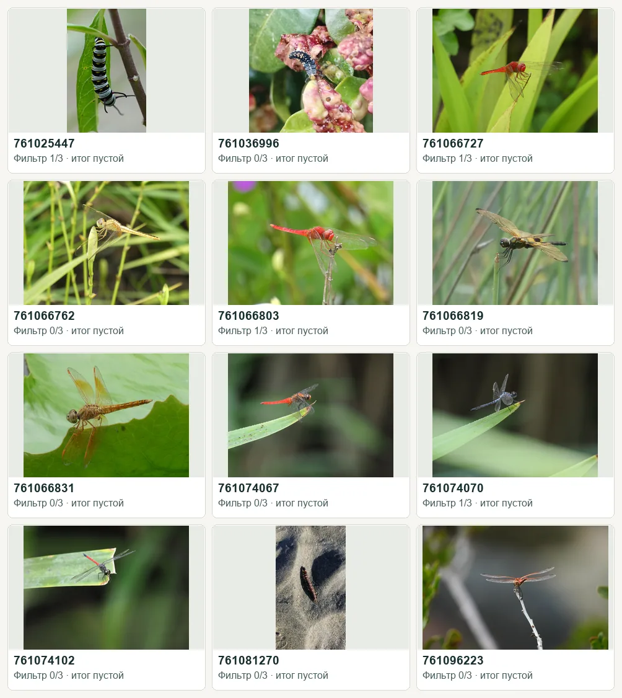
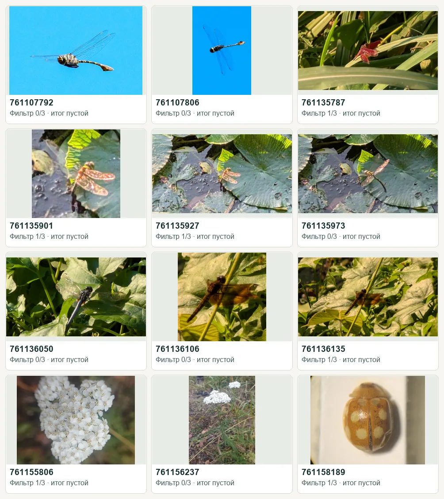

# Отсев на входе · проверка рамок не проводилась

[Вся галерея](README.md) · Страницы [1](screened-1.md) · [2](screened-2.md) · **3** · [4](screened-4.md) · [5](screened-5.md) · [6](screened-6.md) · [7](screened-7.md) · [8](screened-8.md) · [9](screened-9.md)

На каждом фото у модели 0 рамок и меньше двух голосов за бабочку. По правилу отбора фото сразу получило пустой список рамок.

### Лист 5

| Фото | Голоса фильтра «есть» | Рамок модели → итог | Проверка рамок |
|---|---:|---:|---|
| [761025447](https://inaturalist-open-data.s3.amazonaws.com/photos/761025447/original.jpg) | 1/3 | 0 → 0 | Отсев на входе |
| [761036996](https://inaturalist-open-data.s3.amazonaws.com/photos/761036996/original.jpg) | 0/3 | 0 → 0 | Отсев на входе |
| [761066727](https://inaturalist-open-data.s3.amazonaws.com/photos/761066727/original.jpg) | 1/3 | 0 → 0 | Отсев на входе |
| [761066762](https://inaturalist-open-data.s3.amazonaws.com/photos/761066762/original.jpg) | 0/3 | 0 → 0 | Отсев на входе |
| [761066803](https://inaturalist-open-data.s3.amazonaws.com/photos/761066803/original.jpg) | 1/3 | 0 → 0 | Отсев на входе |
| [761066819](https://inaturalist-open-data.s3.amazonaws.com/photos/761066819/original.jpg) | 0/3 | 0 → 0 | Отсев на входе |
| [761066831](https://inaturalist-open-data.s3.amazonaws.com/photos/761066831/original.jpg) | 0/3 | 0 → 0 | Отсев на входе |
| [761074067](https://inaturalist-open-data.s3.amazonaws.com/photos/761074067/original.jpg) | 0/3 | 0 → 0 | Отсев на входе |
| [761074070](https://inaturalist-open-data.s3.amazonaws.com/photos/761074070/original.jpg) | 1/3 | 0 → 0 | Отсев на входе |
| [761074102](https://inaturalist-open-data.s3.amazonaws.com/photos/761074102/original.jpg) | 0/3 | 0 → 0 | Отсев на входе |
| [761081270](https://inaturalist-open-data.s3.amazonaws.com/photos/761081270/original.jpg) | 0/3 | 0 → 0 | Отсев на входе |
| [761096223](https://inaturalist-open-data.s3.amazonaws.com/photos/761096223/original.jpg) | 0/3 | 0 → 0 | Отсев на входе |

### Лист 6

| Фото | Голоса фильтра «есть» | Рамок модели → итог | Проверка рамок |
|---|---:|---:|---|
| [761107792](https://inaturalist-open-data.s3.amazonaws.com/photos/761107792/original.jpg) | 0/3 | 0 → 0 | Отсев на входе |
| [761107806](https://inaturalist-open-data.s3.amazonaws.com/photos/761107806/original.jpg) | 0/3 | 0 → 0 | Отсев на входе |
| [761135787](https://inaturalist-open-data.s3.amazonaws.com/photos/761135787/original.jpg) | 1/3 | 0 → 0 | Отсев на входе |
| [761135901](https://inaturalist-open-data.s3.amazonaws.com/photos/761135901/original.jpg) | 1/3 | 0 → 0 | Отсев на входе |
| [761135927](https://inaturalist-open-data.s3.amazonaws.com/photos/761135927/original.jpg) | 1/3 | 0 → 0 | Отсев на входе |
| [761135973](https://inaturalist-open-data.s3.amazonaws.com/photos/761135973/original.jpg) | 0/3 | 0 → 0 | Отсев на входе |
| [761136050](https://inaturalist-open-data.s3.amazonaws.com/photos/761136050/original.jpg) | 0/3 | 0 → 0 | Отсев на входе |
| [761136106](https://inaturalist-open-data.s3.amazonaws.com/photos/761136106/original.jpg) | 0/3 | 0 → 0 | Отсев на входе |
| [761136135](https://inaturalist-open-data.s3.amazonaws.com/photos/761136135/original.jpg) | 1/3 | 0 → 0 | Отсев на входе |
| [761155806](https://inaturalist-open-data.s3.amazonaws.com/photos/761155806/original.jpg) | 1/3 | 0 → 0 | Отсев на входе |
| [761156237](https://inaturalist-open-data.s3.amazonaws.com/photos/761156237/original.jpg) | 0/3 | 0 → 0 | Отсев на входе |
| [761158189](https://inaturalist-open-data.s3.amazonaws.com/photos/761158189/original.jpg) | 1/3 | 0 → 0 | Отсев на входе |

[К группам и поиску по ID](README.md) · [Следующая страница](screened-4.md)
