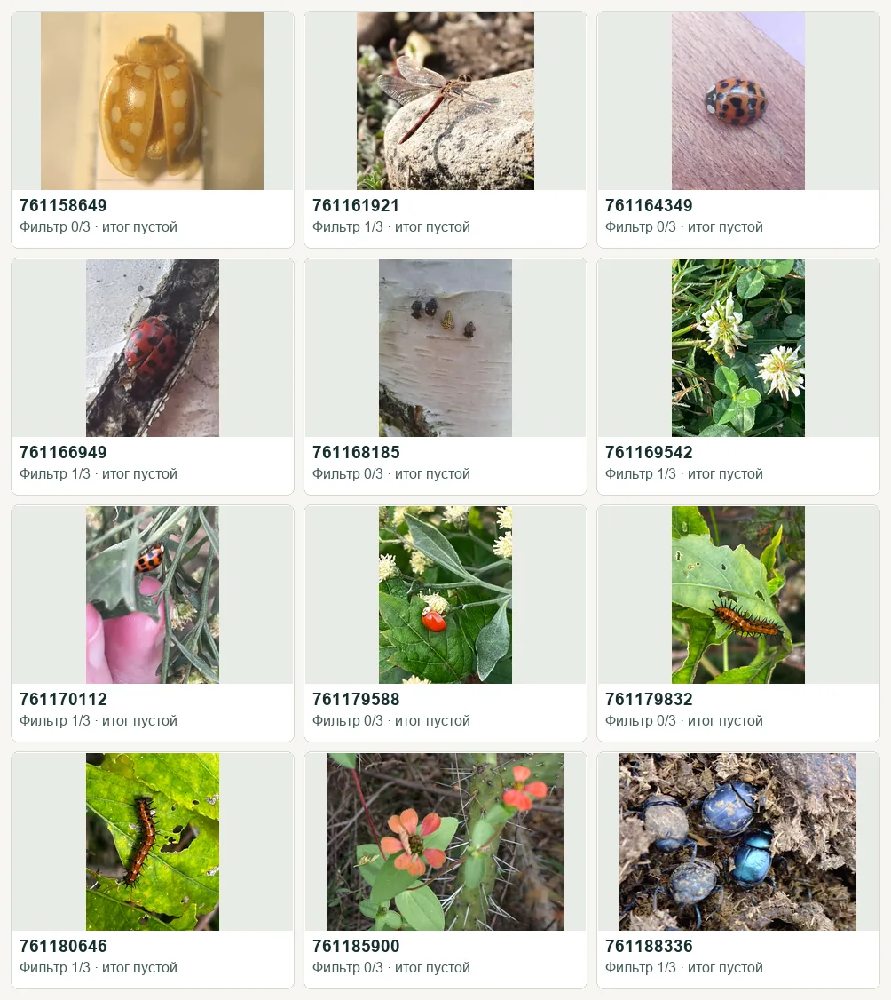
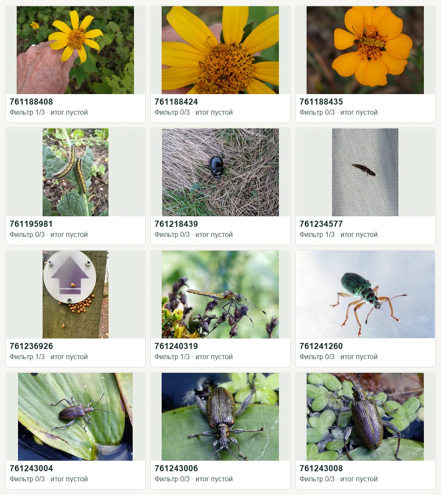

# Отсев на входе · проверка рамок не проводилась

[Вся галерея](README.md) · Страницы [1](screened-1.md) · [2](screened-2.md) · [3](screened-3.md) · **4** · [5](screened-5.md) · [6](screened-6.md) · [7](screened-7.md) · [8](screened-8.md) · [9](screened-9.md)

На каждом фото у модели 0 рамок и меньше двух голосов за бабочку. По правилу отбора фото сразу получило пустой список рамок.

### Лист 7

| Фото | Голоса фильтра «есть» | Рамок модели → итог | Проверка рамок |
|---|---:|---:|---|
| [761158649](https://inaturalist-open-data.s3.amazonaws.com/photos/761158649/original.jpg) | 0/3 | 0 → 0 | Отсев на входе |
| [761161921](https://inaturalist-open-data.s3.amazonaws.com/photos/761161921/original.jpg) | 1/3 | 0 → 0 | Отсев на входе |
| [761164349](https://inaturalist-open-data.s3.amazonaws.com/photos/761164349/original.jpg) | 0/3 | 0 → 0 | Отсев на входе |
| [761166949](https://inaturalist-open-data.s3.amazonaws.com/photos/761166949/original.jpg) | 1/3 | 0 → 0 | Отсев на входе |
| [761168185](https://inaturalist-open-data.s3.amazonaws.com/photos/761168185/original.jpg) | 0/3 | 0 → 0 | Отсев на входе |
| [761169542](https://inaturalist-open-data.s3.amazonaws.com/photos/761169542/original.jpg) | 1/3 | 0 → 0 | Отсев на входе |
| [761170112](https://inaturalist-open-data.s3.amazonaws.com/photos/761170112/original.jpg) | 1/3 | 0 → 0 | Отсев на входе |
| [761179588](https://inaturalist-open-data.s3.amazonaws.com/photos/761179588/original.jpg) | 0/3 | 0 → 0 | Отсев на входе |
| [761179832](https://inaturalist-open-data.s3.amazonaws.com/photos/761179832/original.jpg) | 0/3 | 0 → 0 | Отсев на входе |
| [761180646](https://inaturalist-open-data.s3.amazonaws.com/photos/761180646/original.jpg) | 1/3 | 0 → 0 | Отсев на входе |
| [761185900](https://inaturalist-open-data.s3.amazonaws.com/photos/761185900/original.jpg) | 0/3 | 0 → 0 | Отсев на входе |
| [761188336](https://inaturalist-open-data.s3.amazonaws.com/photos/761188336/original.jpg) | 1/3 | 0 → 0 | Отсев на входе |

### Лист 8

| Фото | Голоса фильтра «есть» | Рамок модели → итог | Проверка рамок |
|---|---:|---:|---|
| [761188408](https://inaturalist-open-data.s3.amazonaws.com/photos/761188408/original.jpg) | 1/3 | 0 → 0 | Отсев на входе |
| [761188424](https://inaturalist-open-data.s3.amazonaws.com/photos/761188424/original.jpg) | 0/3 | 0 → 0 | Отсев на входе |
| [761188435](https://inaturalist-open-data.s3.amazonaws.com/photos/761188435/original.jpg) | 0/3 | 0 → 0 | Отсев на входе |
| [761195981](https://inaturalist-open-data.s3.amazonaws.com/photos/761195981/original.jpg) | 0/3 | 0 → 0 | Отсев на входе |
| [761218439](https://inaturalist-open-data.s3.amazonaws.com/photos/761218439/original.jpg) | 0/3 | 0 → 0 | Отсев на входе |
| [761234577](https://inaturalist-open-data.s3.amazonaws.com/photos/761234577/original.jpg) | 1/3 | 0 → 0 | Отсев на входе |
| [761236926](https://inaturalist-open-data.s3.amazonaws.com/photos/761236926/original.jpg) | 1/3 | 0 → 0 | Отсев на входе |
| [761240319](https://inaturalist-open-data.s3.amazonaws.com/photos/761240319/original.jpg) | 1/3 | 0 → 0 | Отсев на входе |
| [761241260](https://inaturalist-open-data.s3.amazonaws.com/photos/761241260/original.jpg) | 0/3 | 0 → 0 | Отсев на входе |
| [761243004](https://inaturalist-open-data.s3.amazonaws.com/photos/761243004/original.jpg) | 0/3 | 0 → 0 | Отсев на входе |
| [761243006](https://inaturalist-open-data.s3.amazonaws.com/photos/761243006/original.jpg) | 0/3 | 0 → 0 | Отсев на входе |
| [761243008](https://inaturalist-open-data.s3.amazonaws.com/photos/761243008/original.jpg) | 0/3 | 0 → 0 | Отсев на входе |

[К группам и поиску по ID](README.md) · [Следующая страница](screened-5.md)
