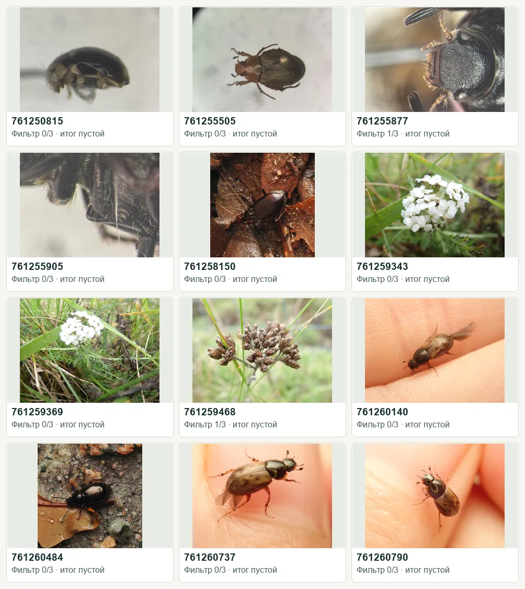
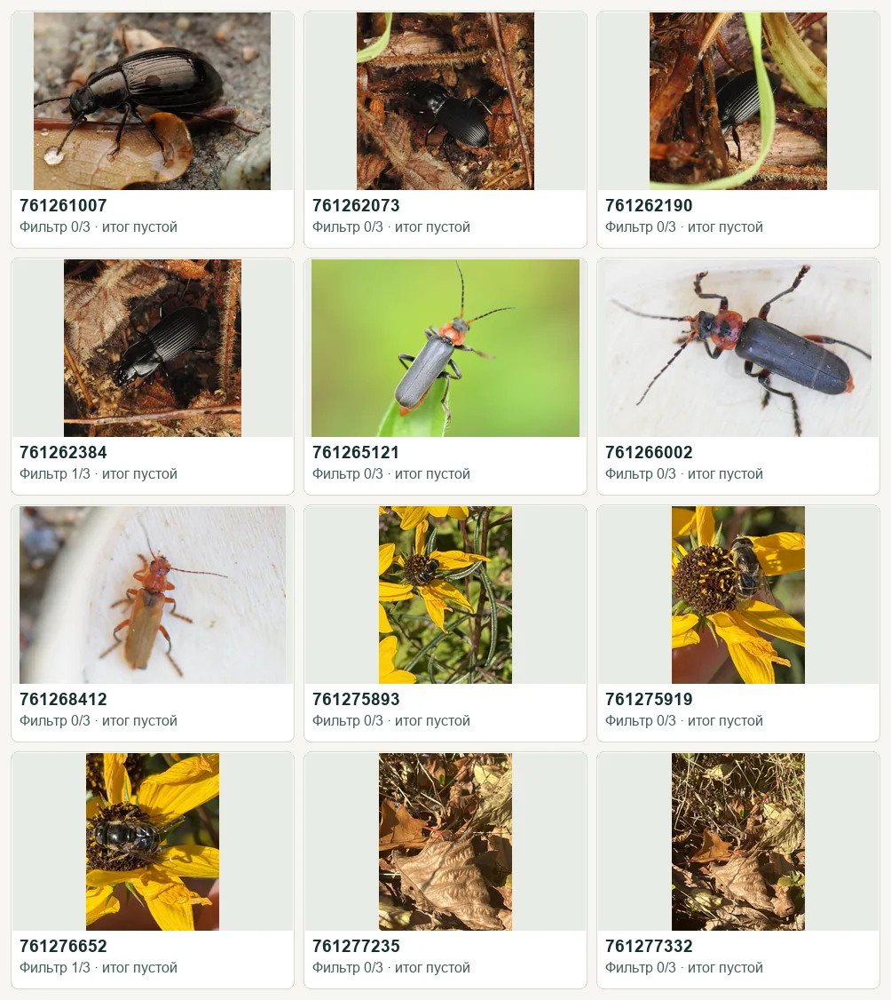

# Отсев на входе · проверка рамок не проводилась

[Вся галерея](README.md) · Страницы [1](screened-1.md) · [2](screened-2.md) · [3](screened-3.md) · [4](screened-4.md) · **5** · [6](screened-6.md) · [7](screened-7.md) · [8](screened-8.md) · [9](screened-9.md)

На каждом фото у модели 0 рамок и меньше двух голосов за бабочку. По правилу отбора фото сразу получило пустой список рамок.

### Лист 9

| Фото | Голоса фильтра «есть» | Рамок модели → итог | Проверка рамок |
|---|---:|---:|---|
| [761250815](https://inaturalist-open-data.s3.amazonaws.com/photos/761250815/original.jpg) | 0/3 | 0 → 0 | Отсев на входе |
| [761255505](https://inaturalist-open-data.s3.amazonaws.com/photos/761255505/original.jpg) | 0/3 | 0 → 0 | Отсев на входе |
| [761255877](https://inaturalist-open-data.s3.amazonaws.com/photos/761255877/original.jpg) | 1/3 | 0 → 0 | Отсев на входе |
| [761255905](https://inaturalist-open-data.s3.amazonaws.com/photos/761255905/original.jpg) | 0/3 | 0 → 0 | Отсев на входе |
| [761258150](https://inaturalist-open-data.s3.amazonaws.com/photos/761258150/original.jpg) | 0/3 | 0 → 0 | Отсев на входе |
| [761259343](https://inaturalist-open-data.s3.amazonaws.com/photos/761259343/original.jpg) | 0/3 | 0 → 0 | Отсев на входе |
| [761259369](https://inaturalist-open-data.s3.amazonaws.com/photos/761259369/original.jpg) | 0/3 | 0 → 0 | Отсев на входе |
| [761259468](https://inaturalist-open-data.s3.amazonaws.com/photos/761259468/original.jpg) | 1/3 | 0 → 0 | Отсев на входе |
| [761260140](https://inaturalist-open-data.s3.amazonaws.com/photos/761260140/original.jpg) | 0/3 | 0 → 0 | Отсев на входе |
| [761260484](https://inaturalist-open-data.s3.amazonaws.com/photos/761260484/original.jpg) | 0/3 | 0 → 0 | Отсев на входе |
| [761260737](https://inaturalist-open-data.s3.amazonaws.com/photos/761260737/original.jpg) | 0/3 | 0 → 0 | Отсев на входе |
| [761260790](https://inaturalist-open-data.s3.amazonaws.com/photos/761260790/original.jpg) | 0/3 | 0 → 0 | Отсев на входе |

### Лист 10

| Фото | Голоса фильтра «есть» | Рамок модели → итог | Проверка рамок |
|---|---:|---:|---|
| [761261007](https://inaturalist-open-data.s3.amazonaws.com/photos/761261007/original.jpg) | 0/3 | 0 → 0 | Отсев на входе |
| [761262073](https://inaturalist-open-data.s3.amazonaws.com/photos/761262073/original.jpg) | 0/3 | 0 → 0 | Отсев на входе |
| [761262190](https://inaturalist-open-data.s3.amazonaws.com/photos/761262190/original.jpg) | 0/3 | 0 → 0 | Отсев на входе |
| [761262384](https://inaturalist-open-data.s3.amazonaws.com/photos/761262384/original.jpg) | 1/3 | 0 → 0 | Отсев на входе |
| [761265121](https://inaturalist-open-data.s3.amazonaws.com/photos/761265121/original.jpg) | 0/3 | 0 → 0 | Отсев на входе |
| [761266002](https://inaturalist-open-data.s3.amazonaws.com/photos/761266002/original.jpg) | 0/3 | 0 → 0 | Отсев на входе |
| [761268412](https://inaturalist-open-data.s3.amazonaws.com/photos/761268412/original.jpg) | 0/3 | 0 → 0 | Отсев на входе |
| [761275893](https://inaturalist-open-data.s3.amazonaws.com/photos/761275893/original.jpg) | 0/3 | 0 → 0 | Отсев на входе |
| [761275919](https://inaturalist-open-data.s3.amazonaws.com/photos/761275919/original.jpg) | 0/3 | 0 → 0 | Отсев на входе |
| [761276652](https://inaturalist-open-data.s3.amazonaws.com/photos/761276652/original.jpg) | 1/3 | 0 → 0 | Отсев на входе |
| [761277235](https://inaturalist-open-data.s3.amazonaws.com/photos/761277235/original.jpg) | 0/3 | 0 → 0 | Отсев на входе |
| [761277332](https://inaturalist-open-data.s3.amazonaws.com/photos/761277332/original.jpg) | 0/3 | 0 → 0 | Отсев на входе |

[К группам и поиску по ID](README.md) · [Следующая страница](screened-6.md)
