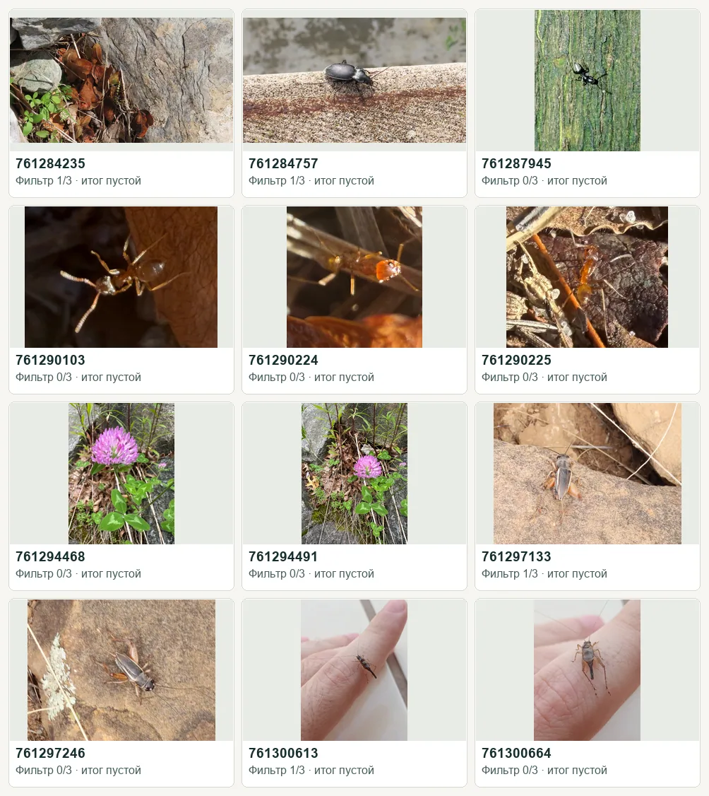
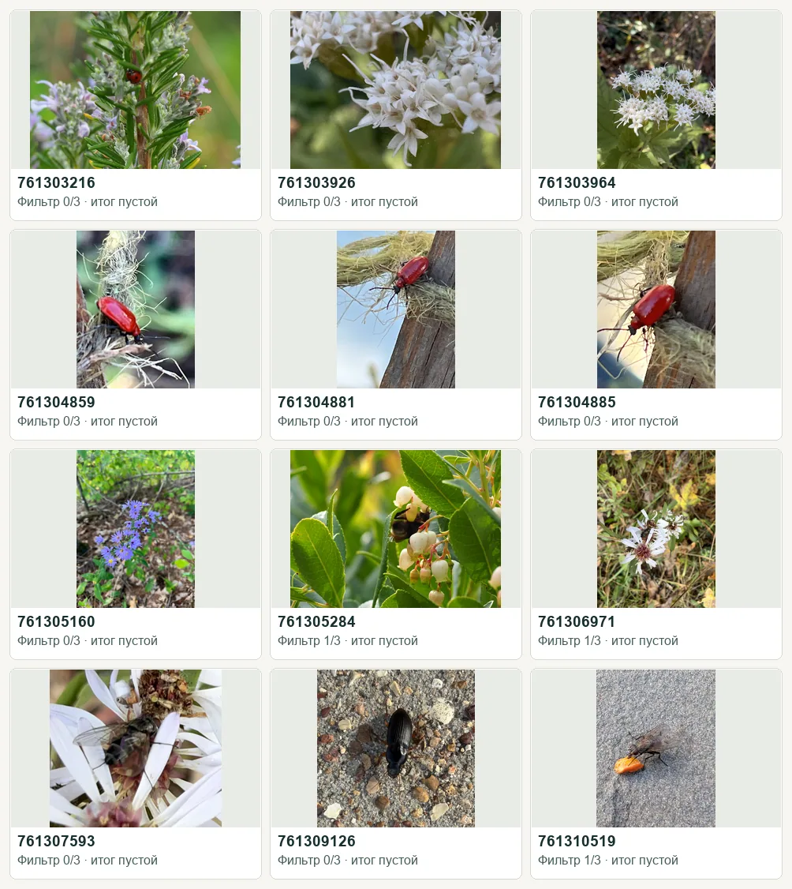

# Отсев на входе · проверка рамок не проводилась

[Вся галерея](README.md) · Страницы [1](screened-1.md) · [2](screened-2.md) · [3](screened-3.md) · [4](screened-4.md) · [5](screened-5.md) · **6** · [7](screened-7.md) · [8](screened-8.md) · [9](screened-9.md)

На каждом фото у модели 0 рамок и меньше двух голосов за бабочку. По правилу отбора фото сразу получило пустой список рамок.

### Лист 11

| Фото | Голоса фильтра «есть» | Рамок модели → итог | Проверка рамок |
|---|---:|---:|---|
| [761284235](https://inaturalist-open-data.s3.amazonaws.com/photos/761284235/original.jpg) | 1/3 | 0 → 0 | Отсев на входе |
| [761284757](https://inaturalist-open-data.s3.amazonaws.com/photos/761284757/original.jpg) | 1/3 | 0 → 0 | Отсев на входе |
| [761287945](https://inaturalist-open-data.s3.amazonaws.com/photos/761287945/original.jpg) | 0/3 | 0 → 0 | Отсев на входе |
| [761290103](https://inaturalist-open-data.s3.amazonaws.com/photos/761290103/original.jpg) | 0/3 | 0 → 0 | Отсев на входе |
| [761290224](https://inaturalist-open-data.s3.amazonaws.com/photos/761290224/original.jpg) | 0/3 | 0 → 0 | Отсев на входе |
| [761290225](https://inaturalist-open-data.s3.amazonaws.com/photos/761290225/original.jpg) | 0/3 | 0 → 0 | Отсев на входе |
| [761294468](https://inaturalist-open-data.s3.amazonaws.com/photos/761294468/original.jpg) | 0/3 | 0 → 0 | Отсев на входе |
| [761294491](https://inaturalist-open-data.s3.amazonaws.com/photos/761294491/original.jpg) | 0/3 | 0 → 0 | Отсев на входе |
| [761297133](https://inaturalist-open-data.s3.amazonaws.com/photos/761297133/original.jpg) | 1/3 | 0 → 0 | Отсев на входе |
| [761297246](https://inaturalist-open-data.s3.amazonaws.com/photos/761297246/original.jpg) | 0/3 | 0 → 0 | Отсев на входе |
| [761300613](https://inaturalist-open-data.s3.amazonaws.com/photos/761300613/original.jpg) | 1/3 | 0 → 0 | Отсев на входе |
| [761300664](https://inaturalist-open-data.s3.amazonaws.com/photos/761300664/original.jpg) | 0/3 | 0 → 0 | Отсев на входе |

### Лист 12

| Фото | Голоса фильтра «есть» | Рамок модели → итог | Проверка рамок |
|---|---:|---:|---|
| [761303216](https://inaturalist-open-data.s3.amazonaws.com/photos/761303216/original.jpg) | 0/3 | 0 → 0 | Отсев на входе |
| [761303926](https://inaturalist-open-data.s3.amazonaws.com/photos/761303926/original.jpg) | 0/3 | 0 → 0 | Отсев на входе |
| [761303964](https://inaturalist-open-data.s3.amazonaws.com/photos/761303964/original.jpg) | 0/3 | 0 → 0 | Отсев на входе |
| [761304859](https://inaturalist-open-data.s3.amazonaws.com/photos/761304859/original.jpg) | 0/3 | 0 → 0 | Отсев на входе |
| [761304881](https://inaturalist-open-data.s3.amazonaws.com/photos/761304881/original.jpg) | 0/3 | 0 → 0 | Отсев на входе |
| [761304885](https://inaturalist-open-data.s3.amazonaws.com/photos/761304885/original.jpg) | 0/3 | 0 → 0 | Отсев на входе |
| [761305160](https://inaturalist-open-data.s3.amazonaws.com/photos/761305160/original.jpg) | 0/3 | 0 → 0 | Отсев на входе |
| [761305284](https://inaturalist-open-data.s3.amazonaws.com/photos/761305284/original.jpg) | 1/3 | 0 → 0 | Отсев на входе |
| [761306971](https://inaturalist-open-data.s3.amazonaws.com/photos/761306971/original.jpg) | 1/3 | 0 → 0 | Отсев на входе |
| [761307593](https://inaturalist-open-data.s3.amazonaws.com/photos/761307593/original.jpg) | 0/3 | 0 → 0 | Отсев на входе |
| [761309126](https://inaturalist-open-data.s3.amazonaws.com/photos/761309126/original.jpg) | 0/3 | 0 → 0 | Отсев на входе |
| [761310519](https://inaturalist-open-data.s3.amazonaws.com/photos/761310519/original.jpg) | 1/3 | 0 → 0 | Отсев на входе |

[К группам и поиску по ID](README.md) · [Следующая страница](screened-7.md)
