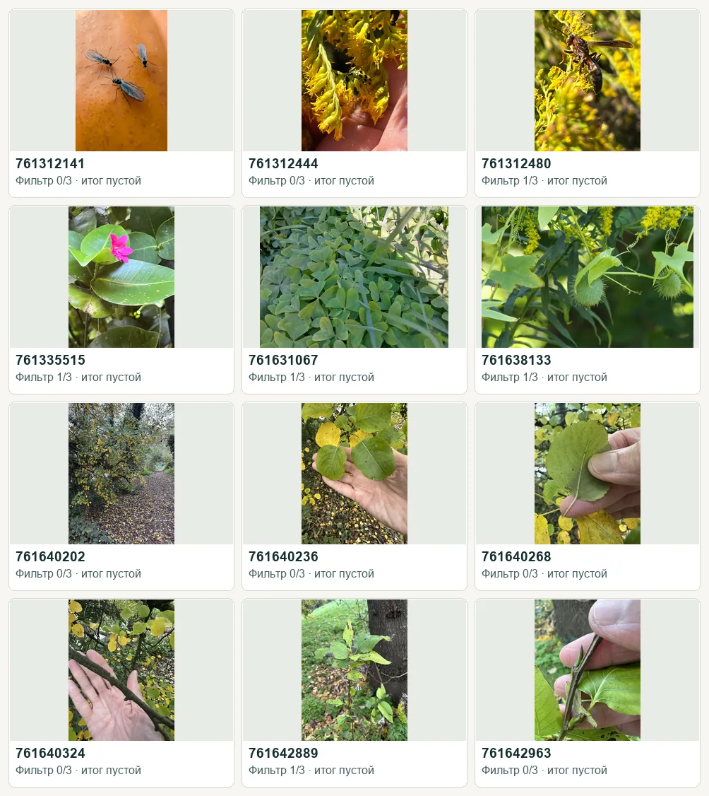
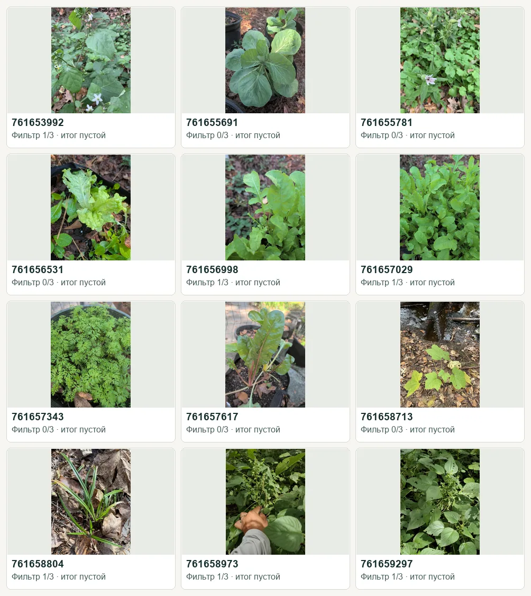

# Отсев на входе · проверка рамок не проводилась

[Вся галерея](README.md) · Страницы [1](screened-1.md) · [2](screened-2.md) · [3](screened-3.md) · [4](screened-4.md) · [5](screened-5.md) · [6](screened-6.md) · **7** · [8](screened-8.md) · [9](screened-9.md)

На каждом фото у модели 0 рамок и меньше двух голосов за бабочку. По правилу отбора фото сразу получило пустой список рамок.

### Лист 13

| Фото | Голоса фильтра «есть» | Рамок модели → итог | Проверка рамок |
|---|---:|---:|---|
| [761312141](https://inaturalist-open-data.s3.amazonaws.com/photos/761312141/original.jpg) | 0/3 | 0 → 0 | Отсев на входе |
| [761312444](https://inaturalist-open-data.s3.amazonaws.com/photos/761312444/original.jpg) | 0/3 | 0 → 0 | Отсев на входе |
| [761312480](https://inaturalist-open-data.s3.amazonaws.com/photos/761312480/original.jpg) | 1/3 | 0 → 0 | Отсев на входе |
| [761335515](https://inaturalist-open-data.s3.amazonaws.com/photos/761335515/original.jpg) | 1/3 | 0 → 0 | Отсев на входе |
| [761631067](https://inaturalist-open-data.s3.amazonaws.com/photos/761631067/original.jpg) | 1/3 | 0 → 0 | Отсев на входе |
| [761638133](https://inaturalist-open-data.s3.amazonaws.com/photos/761638133/original.jpg) | 1/3 | 0 → 0 | Отсев на входе |
| [761640202](https://inaturalist-open-data.s3.amazonaws.com/photos/761640202/original.jpg) | 0/3 | 0 → 0 | Отсев на входе |
| [761640236](https://inaturalist-open-data.s3.amazonaws.com/photos/761640236/original.jpg) | 0/3 | 0 → 0 | Отсев на входе |
| [761640268](https://inaturalist-open-data.s3.amazonaws.com/photos/761640268/original.jpg) | 0/3 | 0 → 0 | Отсев на входе |
| [761640324](https://inaturalist-open-data.s3.amazonaws.com/photos/761640324/original.jpg) | 0/3 | 0 → 0 | Отсев на входе |
| [761642889](https://inaturalist-open-data.s3.amazonaws.com/photos/761642889/original.jpg) | 1/3 | 0 → 0 | Отсев на входе |
| [761642963](https://inaturalist-open-data.s3.amazonaws.com/photos/761642963/original.jpg) | 0/3 | 0 → 0 | Отсев на входе |

### Лист 14

| Фото | Голоса фильтра «есть» | Рамок модели → итог | Проверка рамок |
|---|---:|---:|---|
| [761653992](https://inaturalist-open-data.s3.amazonaws.com/photos/761653992/original.jpg) | 1/3 | 0 → 0 | Отсев на входе |
| [761655691](https://inaturalist-open-data.s3.amazonaws.com/photos/761655691/original.jpg) | 0/3 | 0 → 0 | Отсев на входе |
| [761655781](https://inaturalist-open-data.s3.amazonaws.com/photos/761655781/original.jpg) | 0/3 | 0 → 0 | Отсев на входе |
| [761656531](https://inaturalist-open-data.s3.amazonaws.com/photos/761656531/original.jpg) | 0/3 | 0 → 0 | Отсев на входе |
| [761656998](https://inaturalist-open-data.s3.amazonaws.com/photos/761656998/original.jpg) | 1/3 | 0 → 0 | Отсев на входе |
| [761657029](https://inaturalist-open-data.s3.amazonaws.com/photos/761657029/original.jpg) | 1/3 | 0 → 0 | Отсев на входе |
| [761657343](https://inaturalist-open-data.s3.amazonaws.com/photos/761657343/original.jpg) | 0/3 | 0 → 0 | Отсев на входе |
| [761657617](https://inaturalist-open-data.s3.amazonaws.com/photos/761657617/original.jpg) | 0/3 | 0 → 0 | Отсев на входе |
| [761658713](https://inaturalist-open-data.s3.amazonaws.com/photos/761658713/original.jpg) | 0/3 | 0 → 0 | Отсев на входе |
| [761658804](https://inaturalist-open-data.s3.amazonaws.com/photos/761658804/original.jpg) | 1/3 | 0 → 0 | Отсев на входе |
| [761658973](https://inaturalist-open-data.s3.amazonaws.com/photos/761658973/original.jpg) | 1/3 | 0 → 0 | Отсев на входе |
| [761659297](https://inaturalist-open-data.s3.amazonaws.com/photos/761659297/original.jpg) | 1/3 | 0 → 0 | Отсев на входе |

[К группам и поиску по ID](README.md) · [Следующая страница](screened-8.md)
