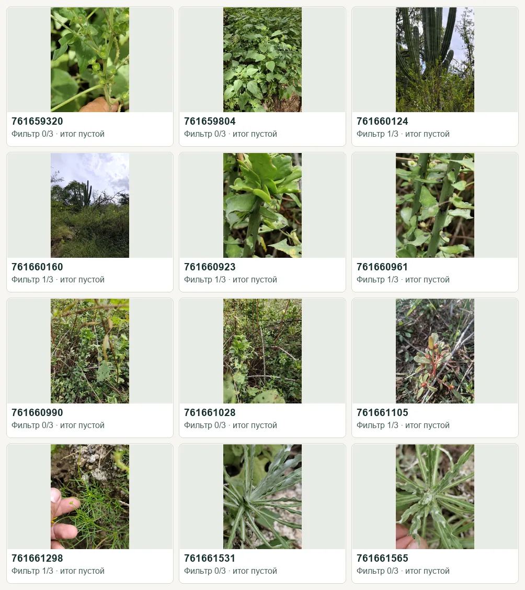
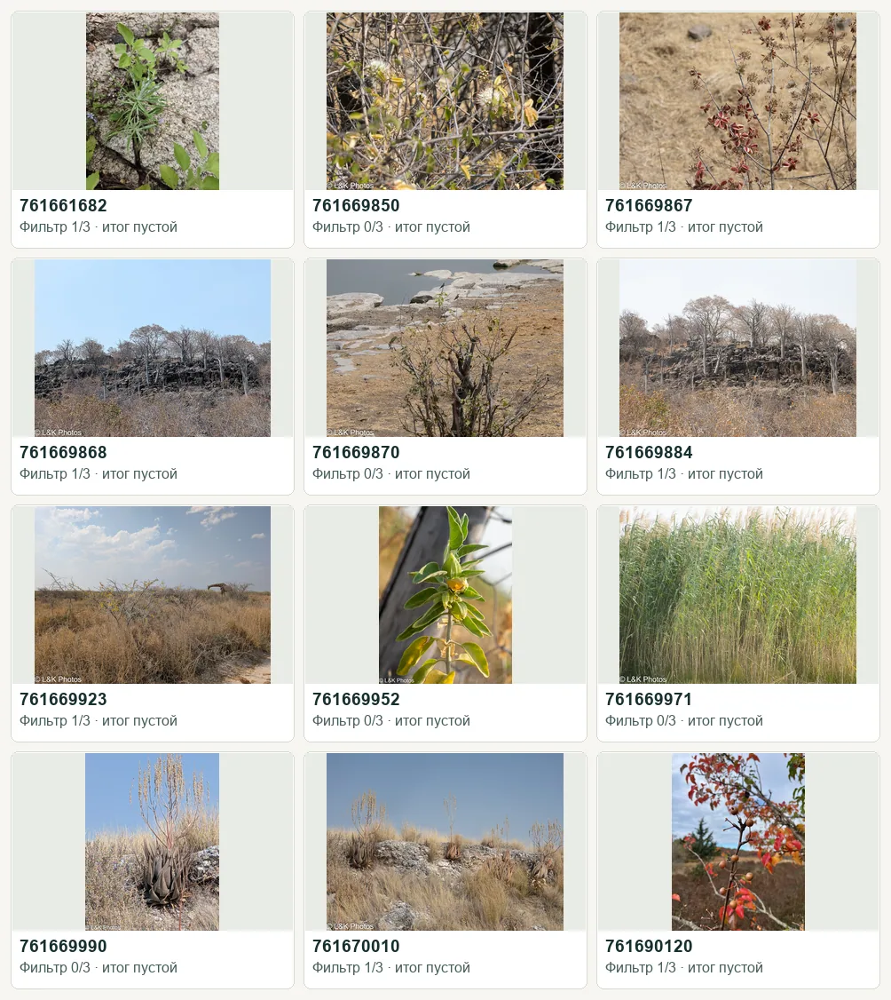

# Отсев на входе · проверка рамок не проводилась

[Вся галерея](README.md) · Страницы [1](screened-1.md) · [2](screened-2.md) · [3](screened-3.md) · [4](screened-4.md) · [5](screened-5.md) · [6](screened-6.md) · [7](screened-7.md) · **8** · [9](screened-9.md)

На каждом фото у модели 0 рамок и меньше двух голосов за бабочку. По правилу отбора фото сразу получило пустой список рамок.

### Лист 15

| Фото | Голоса фильтра «есть» | Рамок модели → итог | Проверка рамок |
|---|---:|---:|---|
| [761659320](https://inaturalist-open-data.s3.amazonaws.com/photos/761659320/original.jpg) | 0/3 | 0 → 0 | Отсев на входе |
| [761659804](https://inaturalist-open-data.s3.amazonaws.com/photos/761659804/original.jpg) | 0/3 | 0 → 0 | Отсев на входе |
| [761660124](https://inaturalist-open-data.s3.amazonaws.com/photos/761660124/original.jpg) | 1/3 | 0 → 0 | Отсев на входе |
| [761660160](https://inaturalist-open-data.s3.amazonaws.com/photos/761660160/original.jpg) | 1/3 | 0 → 0 | Отсев на входе |
| [761660923](https://inaturalist-open-data.s3.amazonaws.com/photos/761660923/original.jpg) | 1/3 | 0 → 0 | Отсев на входе |
| [761660961](https://inaturalist-open-data.s3.amazonaws.com/photos/761660961/original.jpg) | 1/3 | 0 → 0 | Отсев на входе |
| [761660990](https://inaturalist-open-data.s3.amazonaws.com/photos/761660990/original.jpg) | 0/3 | 0 → 0 | Отсев на входе |
| [761661028](https://inaturalist-open-data.s3.amazonaws.com/photos/761661028/original.jpg) | 0/3 | 0 → 0 | Отсев на входе |
| [761661105](https://inaturalist-open-data.s3.amazonaws.com/photos/761661105/original.jpg) | 1/3 | 0 → 0 | Отсев на входе |
| [761661298](https://inaturalist-open-data.s3.amazonaws.com/photos/761661298/original.jpg) | 1/3 | 0 → 0 | Отсев на входе |
| [761661531](https://inaturalist-open-data.s3.amazonaws.com/photos/761661531/original.jpg) | 0/3 | 0 → 0 | Отсев на входе |
| [761661565](https://inaturalist-open-data.s3.amazonaws.com/photos/761661565/original.jpg) | 0/3 | 0 → 0 | Отсев на входе |

### Лист 16

| Фото | Голоса фильтра «есть» | Рамок модели → итог | Проверка рамок |
|---|---:|---:|---|
| [761661682](https://inaturalist-open-data.s3.amazonaws.com/photos/761661682/original.jpg) | 1/3 | 0 → 0 | Отсев на входе |
| [761669850](https://inaturalist-open-data.s3.amazonaws.com/photos/761669850/original.jpg) | 0/3 | 0 → 0 | Отсев на входе |
| [761669867](https://inaturalist-open-data.s3.amazonaws.com/photos/761669867/original.jpg) | 1/3 | 0 → 0 | Отсев на входе |
| [761669868](https://inaturalist-open-data.s3.amazonaws.com/photos/761669868/original.jpg) | 1/3 | 0 → 0 | Отсев на входе |
| [761669870](https://inaturalist-open-data.s3.amazonaws.com/photos/761669870/original.jpg) | 0/3 | 0 → 0 | Отсев на входе |
| [761669884](https://inaturalist-open-data.s3.amazonaws.com/photos/761669884/original.jpg) | 1/3 | 0 → 0 | Отсев на входе |
| [761669923](https://inaturalist-open-data.s3.amazonaws.com/photos/761669923/original.jpg) | 1/3 | 0 → 0 | Отсев на входе |
| [761669952](https://inaturalist-open-data.s3.amazonaws.com/photos/761669952/original.jpg) | 0/3 | 0 → 0 | Отсев на входе |
| [761669971](https://inaturalist-open-data.s3.amazonaws.com/photos/761669971/original.jpg) | 0/3 | 0 → 0 | Отсев на входе |
| [761669990](https://inaturalist-open-data.s3.amazonaws.com/photos/761669990/original.jpg) | 0/3 | 0 → 0 | Отсев на входе |
| [761670010](https://inaturalist-open-data.s3.amazonaws.com/photos/761670010/original.jpg) | 1/3 | 0 → 0 | Отсев на входе |
| [761690120](https://inaturalist-open-data.s3.amazonaws.com/photos/761690120/original.jpg) | 1/3 | 0 → 0 | Отсев на входе |

[К группам и поиску по ID](README.md) · [Следующая страница](screened-9.md)
