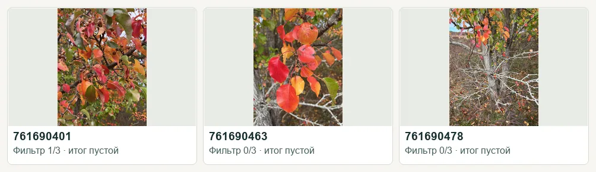

# Отсев на входе · проверка рамок не проводилась

[Вся галерея](README.md) · Страницы [1](screened-1.md) · [2](screened-2.md) · [3](screened-3.md) · [4](screened-4.md) · [5](screened-5.md) · [6](screened-6.md) · [7](screened-7.md) · [8](screened-8.md) · **9**

На каждом фото у модели 0 рамок и меньше двух голосов за бабочку. По правилу отбора фото сразу получило пустой список рамок.

### Лист 17

| Фото | Голоса фильтра «есть» | Рамок модели → итог | Проверка рамок |
|---|---:|---:|---|
| [761690401](https://inaturalist-open-data.s3.amazonaws.com/photos/761690401/original.jpg) | 1/3 | 0 → 0 | Отсев на входе |
| [761690463](https://inaturalist-open-data.s3.amazonaws.com/photos/761690463/original.jpg) | 0/3 | 0 → 0 | Отсев на входе |
| [761690478](https://inaturalist-open-data.s3.amazonaws.com/photos/761690478/original.jpg) | 0/3 | 0 → 0 | Отсев на входе |

[К группам и поиску по ID](README.md)
