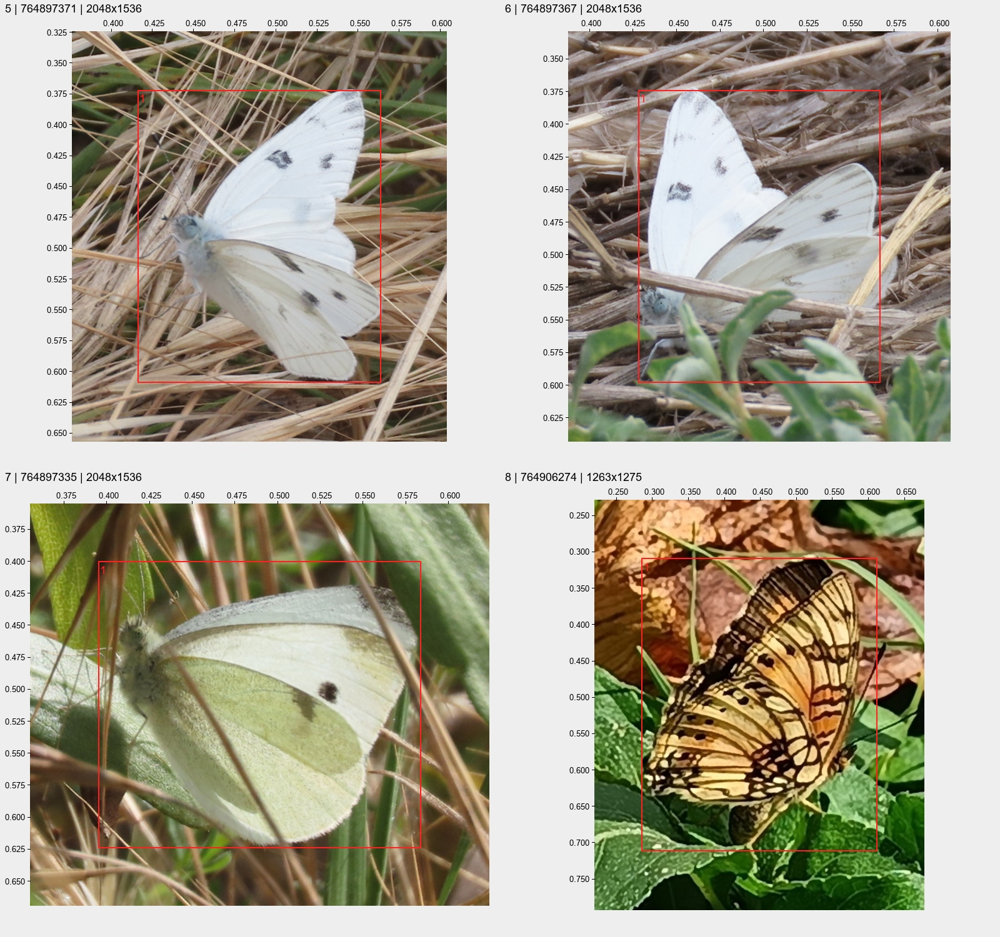

# Предразметка и фильтрация моделью

Используются две нейросетки: YOLO-World и Codex. Идея простая: YOLO предлагает рамки, а Codex смотрит на фото и исправляет разметку. На вход подаём `dataset.json` со ссылками на фотографии, на выходе получаем `dataset_boxed.json`.

## Как это работает

`dataset.json → YOLO-World → Codex → проверка координат → dataset_boxed.json`

1. YOLO-World ищет бабочек и предлагает рамки. Порог стоит `0.1`, чтобы собрать больше кандидатов.
2. Codex получает исходное фото и копию с рамками. Он убирает лишние рамки, уточняет границы и добавляет пропущенных бабочек. Если YOLO ничего не нашла, фото всё равно идёт на проверку.
3. Скрипт проверяет координаты и сохраняет результат. Спорные кадры остаются на ручную проверку.

Таким образом YOLO даёт начальную разметку, а Codex помогает исправить ошибки и пропуски. Размечаем взрослых бабочек, включая толстоголовок. Мотыльков, гусениц и куколок не учитываем.

## Пример разметки

Ниже уже готовые рамки из дополнительного датасета `Extra_filtration_prediction/dataset_boxed.json`.



Фото из iNaturalist: [764897371](https://www.inaturalist.org/photos/764897371), [764897367](https://www.inaturalist.org/photos/764897367), [764897335](https://www.inaturalist.org/photos/764897335), [764906274](https://www.inaturalist.org/photos/764906274).

## Запуск

Команды выполняются из папки `pred_boxing`. Нужен установленный Codex CLI. Зависимости Python:

```bash
python -m pip install "ultralytics==8.3.253" Pillow requests
python -m pip install "clip @ https://github.com/ultralytics/CLIP/archive/7ffa84b3bfa40c42ecc1c77147a855e69cb2dd40.zip"
```

Веса `yolov8s-worldv2.pt` нужно заранее положить в `.yolo_cache/`. Для первого запуска авторизуемся в Codex и пробуем на пяти фото:

```bash
codex login
python filter_dataset.py --limit 5
```

Для всего датасета:

```bash
python filter_dataset.py
```

Можно указать другой входной файл через `--dataset`, а путь результата через `--output`.

## Что получаем

Результат сохраняется в `Yolo_codex_prediction/dataset_boxed.json`. Для каждого фото есть `photo_id`, `photo_url`, `Has_butterflies`, `boxes` и `error`. Рамки записаны как `left`, `top`, `width`, `height` в долях размера изображения от 0 до 1.

Если бабочек нет, получаем `Has_butterflies: false` и `boxes: []`. При ошибках или спорных кадрах результат сохраняется в `.partial.json`, неизвестные метки остаются `null`. Пробный запуск создаёт отдельный файл с `.sample-5` в имени.

Фото, предложения YOLO и ответы Codex кешируются. После остановки можно повторить команду. Спорные ответы тоже берутся из кеша: для повторной оценки нужно удалить соответствующий файл ответа. Изменение самого скрипта создаёт новый кеш разметки.
